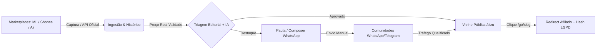

# Product Vision & Business Logic — BizuMiner

> **Documento Mestre do Produto (Single Source of Truth de Negócio)**  
> Toda funcionalidade, regra de validação, cópia de interface e política de dados deve estar alinhada com as diretrizes descritas neste documento.

---

## 1. Visão do Produto

O **BizuMiner** é uma plataforma inteligente de curadoria de ofertas, validação de preços reais e monetização via afiliação. Diferente de agregadores caóticos ou comparadores superficiais, o propósito do BizuMiner é:

1. **Detectar promoções genuínas**: monitorar marketplaces líderes e validar se um desconto declarado é real ou mera maquiagem ("metade do dobro").
2. **Proteger a confiança do consumidor**: sustentar afirmações de menor preço com base em histórico real, verificável e append-only (até 90 dias de observação contínua).
3. **Monetização transparente de afiliados**: redirecionamento seguro com tags de rastreamento (`matt_*`, subId) gerando receita para a operação, respeitando rigorosamente a LGPD e a privacidade de quem compra.

---

## 2. Personas do Sistema

### 1. O Comprador Inteligente (Visitante / B2C)
- **Perfil:** Usuário que deseja economizar em compras cotidianas e eletrônicos, mas desconfia de "falsas promoções".
- **Necessidades:**
  - Encontrar ofertas quentes organizadas por categorias, departamentos ou destaques editoriais.
  - Ver o histórico real de preço do produto antes de comprar para saber se hoje é de fato uma boa hora.
  - Ter opção de salvar ofertas ("Favoritos") e acompanhar produtos de interesse ("De olho no preço") com alertas honestos.
  - Acessar os produtos diretamente na loja de destino com um clique rápido, sem fricções ou armadilhas.

### 2. O Administrador / Dono do Bizu (Curador Editorial & Operador)
- **Perfil:** Operador de negócios e estrategista de conteúdo do BizuMiner.
- **Necessidades:**
  - Painel de comando centralizado (`/admin`) para telemetria de tráfego, cliques, conversões e saúde das coletas.
  - Disparo e acompanhamento de lotes de captura por departamento (Shopee, AliExpress, Mercado Livre).
  - Triagem assistida por IA (Gemini) para separar o "ouro do cascalho" com base em atratividade, preço e evidências.
  - Gerador de copy e pauta diária (`/pauta` e Composer) para montar mensagens irresistíveis, humanas e prontas para disparo manual em canais do WhatsApp e Telegram.

### 3. O Parceiro Afiliado (Visão Multi-Conta / Multi-Tenant em Expansão)
- **Perfil:** Afiliado profissional que utiliza a inteligência e o catálogo curado do BizuMiner operando com sua própria tag e conta isolada.
- **Necessidades:**
  - Isolamento estrito de catálogo e credenciais por conta (`account_id` / `tenant_id`).
  - Redirecionamentos de saída parametrizados com a sua respectiva tag de afiliado.

---

## 3. Os Cinco Fluxos Centrais

### 1. Ingestão e Formação de Histórico de Preço
- Cada varredura ou captura assistida insere uma `price_observation` com timestamp, preço atual, preço original e disponibilidade.
- O histórico é estritamente aditivo (*append-only*). O produto nunca perde seu passado ao retornar à vitrine após um período fora do feed.
- O cálculo de "Menor Preço Histórico" requer validação multi-dia (pelo menos 3 dias distintos de histórico para certificar piso real e evitar ruídos de catalogação).

### 2. Triagem e Curadoria Inteligente
- Ofertas capturadas passam por filtros de piso, completude e conformidade de catálogo.
- Motor de triagem com LLM (Gemini) analisa título, categoria real de uso (ex: brinquedo vs jardinagem), desconto plausível e apelo de compra, atribuindo pontuações objetivas.
- Ofertas com selo editorial aprovado são disponibilizadas para a vitrine e para a pauta.

### 3. Vitrine Pública (`/` e `/bizu/[slug]`)
- Renderização dinâmica e veloz com paginação honesta, filtros por categorias e busca textual.
- A página de produto `/bizu/[slug]` apresenta cards explicativos: histórico de preço, variação percentual, selos de oportunidade e botão de saída.
- Parâmetro `?direto=1` converte a página de produto em tela de passagem com contador de 3s para o marketplace, com opção de cancelamento e proteção anti-loop no histórico do navegador.

### 4. Redirecionamento Afiliado Seguro (`/go/[slug]`)
- Resolve a URL canônica com parâmetros de atribuição (`matt_tool`, `matt_word`, `subId`).
- Registra `click_event` em banco: o IP do visitante é imediatamente anonimizado via hash com sal criptográfico (conformidade integral com LGPD).
- Não há cookies invasivos nem rastreamento de dados pessoais sem consentimento.

### 5. Pauta Diária e Composer Editorial
- Ferramenta dedicada no painel (`/pauta` e Composer) para organizar as melhores ofertas do dia.
- Gera templates de copy com formatação pensada para mobile e WhatsApp (emojis funcionais, preço anterior riscado, preço novo destacado, link seguro e aviso claro de promoção relâmpago).

---

## 4. Regras Invioláveis de Negócio (Linhas Vermelhas)

1. **WhatsApp é Estritamente Manual:**
   - Proibido implementar automações de disparo em massa, bots não oficiais, emuladores de sessão (Puppeteer/Playwright para WhatsApp Web), bibliotecas não autorizadas ou instâncias de WAHA/Docker.
   - O BizuMiner gera a copy pronta com o link verificado; o envio para os grupos/canais é feito manualmente pelo operador humano. Isso blinda o negócio contra riscos jurídicos e bloqueios de número.
2. **Uso de APIs Oficiais e Captura Ética:**
   - Shopee opera exclusivamente via Open API oficial GraphQL.
   - AliExpress opera exclusivamente via Open API oficial (TOP API).
   - Mercado Livre opera via captura pública assistida/extensão de navegador e endpoints de ofertas públicas. Nunca executar scraping agressivo de páginas individuais de produto (que acionam barreiras anti-bot 302).
3. **Honestidade Absoluta em Preços e Gatilhos:**
   - Jamais inflar descontos artificialmente. Descontos de 1% nunca são promovidos como grandes barganhas.
   - O termo "Menor Preço Histórico" só é emitido se o histórico contiver observações verificadas em múltiplos dias.
   - As copies editoriais devem soar humanas, orientadas a dados e sem urgências fabricadas.
4. **Proteção de Dados e LGPD:**
   - IPs de cliques são armazenados apenas como hash unidirecional salgado.
   - A área do usuário nunca compartilha dados de navegação ou preferências com terceiros.
