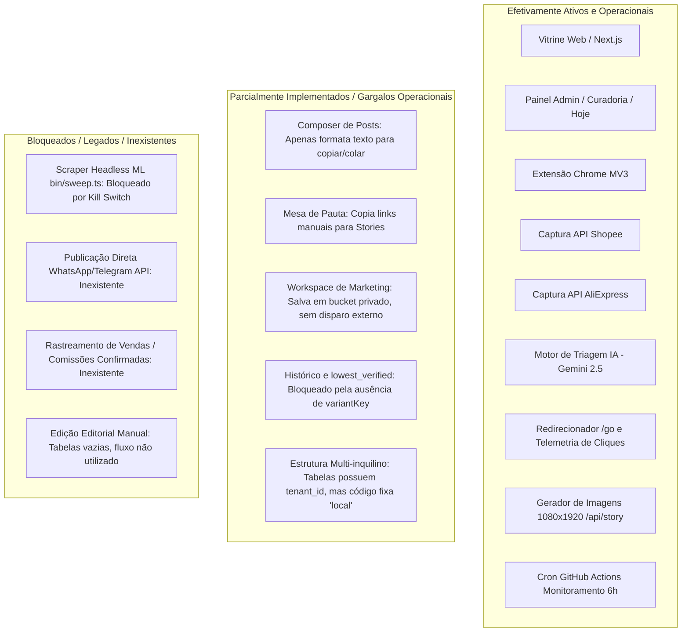
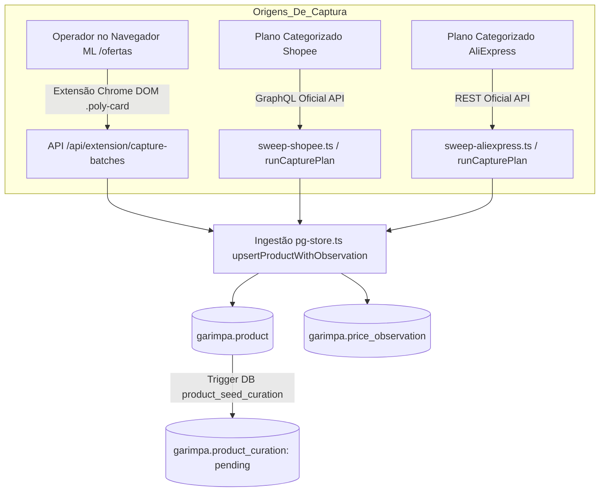
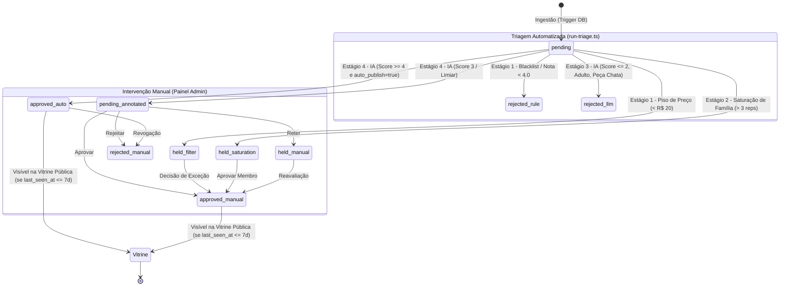

# Auditoria Técnica e Operacional do BizuMiner — Parte 1 e 2: Arquitetura e Pipeline

**Data da auditoria:** 13 de outubro de 2026  
**Ambiente auditado:** Monorepo BizuMiner (Branch `main` / Workspace Linux)  
**Conexão de dados:** Banco Supabase PostgreSQL (schema `garimpa`, role `garimpa_app`)  
**Status do relatório:** Factual, verificado contra código-fonte, migrations e registros de produção.

---

## 1. Inventário da Arquitetura Existente

### 1.1 Stack Tecnológico

| Camada | Tecnologia / Biblioteca | Versão / Detalhe | Localização Principal | Condição Operacional |
| :--- | :--- | :--- | :--- | :--- |
| **Frontend Web** | Next.js (App Router), React | 15.0.0-rc / React 19 rc | `packages/web` | **Ativo e Operacional** |
| **Linguagem / Runtime** | Node.js (TypeScript nativo com `--experimental-strip-types`) | Node >= 22.6 (testado v22.23.2) | Raiz e todos os packages | **Ativo e Operacional** |
| **Driver de Banco** | `postgres` (postgres.js) | ^3.4.9 | `packages/persistence`, `packages/web` | **Ativo e Operacional** (max: 1/pooler) |
| **Auth & SSR Client** | `@supabase/ssr`, `@supabase/supabase-js` | ^0.5.2 / ^2.45.4 | `packages/web/lib/supabase.ts` | **Ativo** (Auth Google OAuth) |
| **Inteligência Artificial** | `@google/generative-ai` | ^0.24.1 (Gemini API) | `packages/web/lib/ai-curation-service.ts` | **Ativo** (`gemini-2.5-flash`) |
| **Extensão de Navegador** | Chrome Extension Manifest V3 (TypeScript puro) | v0.2.0 | `packages/extension` | **Ativo** (Captura Mercado Livre) |
| **Geração de Imagens** | `@vercel/og` (`next/og`) | Integrado ao Next.js | `packages/web/app/api/story/[slug]` | **Ativo** (Stories 1080×1920) |
| **Orquestração / Cron** | GitHub Actions Workflows | Checkout v4, Setup-Node v4 | `.github/workflows` | **Ativo** (2 workflows configurados) |

---

### 1.2 Estrutura Principal de Diretórios

```
Garimpa/
├── .github/workflows/           # Automação CI/CD e cron de monitoramento
│   ├── capture-offers.yml       # Disparo de lote de captura e triagem (workflow_dispatch)
│   └── monitor-prices.yml       # Cron agendado (03, 09, 15, 21h UTC) para Shopee/AliExpress
├── packages/
│   ├── capture/                 # Clientes e adaptadores brutos de marketplaces
│   │   ├── src/adapters/        # mercadolivre, shopee, aliexpress
│   │   ├── src/types.ts         # Contratos canônicos de ofertas brutas (RawOffer)
│   │   └── src/money.ts         # Conversores para centavos (inteiros) e taxas
│   ├── extension/               # Extensão Chrome (Manifest V3)
│   │   ├── manifest.json        # Configuração MV3 (permissões activeTab, scripting, storage)
│   │   ├── src/background/      # Service worker e fila outbox
│   │   ├── src/content/         # Extratores de DOM (.poly-card) e injetores
│   │   └── src/popup/           # Interface de pareamento e importação de lote
│   ├── persistence/             # Camada de banco de dados e scripts CLI
│   │   ├── bin/                 # sweep, sweep-shopee, sweep-aliexpress, monitor-prices, etc.
│   │   ├── src/pg-store.ts      # Implementação Postgres do OfferStore
│   │   ├── src/ingest.ts        # Orquestrador de varredura, planos e saturação
│   │   └── supabase/migrations/ # 95 migrations SQL versionadas
│   ├── social/                  # Saídas e testes visuais de templates de redes sociais
│   └── web/                     # Aplicação Next.js (Vitrine, Área Administrativa e APIs)
│       ├── app/                 # App Router (/, /bizu/[slug], /go/[slug], /admin/*, /pauta)
│       ├── bin/                 # run-triage.ts, run-capture-batch.ts
│       └── lib/                 # Regras de negócio, db.ts, curation-pipeline.ts, etc.
├── docs/                        # Documentação técnica e estratégica viva
└── tools/                       # Scripts auxiliares de renderização e testes editoriais
```

---

### 1.3 Funções Serverless, Workers, Cron Jobs e Serviços Externos

1. **GitHub Actions Cron Worker (`.github/workflows/monitor-prices.yml`):**
   - **Gatilho:** Agendamento cron `'7 3,9,15,21 * * *'` (a cada 6 horas) e `workflow_dispatch`.
   - **Responsabilidade:** Executar `packages/persistence/bin/monitor-prices.ts` em matriz paralela para `[shopee, aliexpress]` com teto de orçamento (`MONITOR_PLAN_BUDGET`).
   - **Condição:** Ativo quando `vars.MONITORING_ENABLED == 'true'`. **Mercado Livre não participa deste cron** devido à ausência de API oficial de preços.

2. **GitHub Actions Batch Worker (`.github/workflows/capture-offers.yml`):**
   - **Gatilho:** `workflow_dispatch` acionado com o parâmetro `batch_id`.
   - **Responsabilidade:** Executa `packages/web/bin/run-capture-batch.ts`, que coordena os sweeps das lojas selecionadas e dispara a triagem editorial da IA.

3. **Next.js Middleware (`packages/web/middleware.ts`):**
   - **Responsabilidade:** Rotação de cookies de sessão `@supabase/ssr`, verificação de roles (`afiliado`) para rotas `/admin/*` e `/api/admin/*`, redirecionando usuários sem permissão.

4. **Next.js Route Handlers (`packages/web/app/api/*`):**
   - `/api/extension/capture-batches`: Recebe lotes de ofertas extraídos pelo navegador.
   - `/api/go/[slug]`: Resolução de redirecionamento de afiliação e registro de `click_event`.
   - `/api/p/[code]`: Redirecionamento de links curtos para a landing page `/bizu/[slug]`.
   - `/api/story/[slug]`: Geração server-side de arte gráfica de Stories/Status em 1080×1920 via `ImageResponse`.
   - `/api/pauta`: Alimentação da mesa de links rápidos do dia para o operador.
   - `/api/admin/*`: Operações administrativas (captura, rodagens, dispositivos, políticas de monitoramento).

---

### 1.4 Integrações com Marketplaces

| Marketplace | Método de Integração | Autenticação / Chaves | Estratégia de Link | Condição Operacional |
| :--- | :--- | :--- | :--- | :--- |
| **Mercado Livre** | **Assistida via Extensão Chrome** (DOM scraping consentido do navegador) | Sessão do operador no navegador + pareamento de dispositivo | **Dinâmica (V2):** Parâmetros `matt_word` + `matt_tool` aplicados no redirecionamento do `/go` | **Ativo e em produção**. O scraping automatizado headless via servidor (`bin/sweep.ts`) está **bloqueado por kill switch** (`ML_AUTOMATED_CAPTURE_ENABLED`). |
| **Shopee** | **API Oficial GraphQL** (`productOfferV2`) | `SHOPEE_APP_ID` + `SHOPEE_APP_SECRET` | **Pré-gerada:** Gerada via endpoint `generateShortLink` e persistida em `publication.affiliate_url` | **Ativo e em produção**. Utiliza plano de busca baseado em categorias (`CATEGORY_FIRST_PLAN`). |
| **AliExpress** | **API Oficial REST** (`aliexpress.affiliate.product.query`) | `ALIEXPRESS_APP_KEY` + `APP_SECRET` + `TRACKING_ID` (HMAC-MD5) | **Pré-gerada:** Vem diretamente no campo `promotion_link` da resposta da busca oficial | **Ativo e em produção**. Exige estritamente a moeda `BRL` em `target_sale_price`. |
| **Amazon** | Inexistente | N/A | N/A | **Não implementada** (nenhum adaptador ou menção de código ativa). |

---

### 1.5 Supabase: Schemas, Tabelas, Views, Triggers e Políticas

O banco de dados PostgreSQL opera sob o schema dedicado `garimpa`. Toda a aplicação se conecta através do pooler Supavisor utilizando a role de aplicação `garimpa_app`.

#### Tabelas Base (27 tabelas) e Views (1 view):

1. **Núcleo de Catálogo e Preços:**
   - `product` (1.657 registros): Identidade do produto (`id`, `tenant_id`, `marketplace`, `external_id`, `title`, `product_url`, `image_url`, `last_price_cents`, `family_key`, etc.). Chave única: `(tenant_id, marketplace, external_id)`.
   - `price_observation` (9.017 registros): Observações pontuais de preço (`price_cents`, `original_price_cents`, `claimed_discount_rate`, `rating_star`, `sales_count`, `capture_source`, `offer_evidence`). Chave única: `(capture_run_id, product_id)`.
   - `capture_run` (385 registros): Histórico de execuções de captura por loja (`items_captured`, `items_new`, `price_changes`, `status`, `parameters`).
   - `capture_batch` (11 registros): Agrupador de operações multiloja disparadas pelo painel ou automação.

2. **Núcleo de Curadoria e Auditoria:**
   - `product_curation` (1.657 registros): Estado editorial atual do produto (`status`, `reason_code`, `reason_detail`, `deferred_until`, `reviewed_by_app_user_id`, `reviewed_at`).
   - `curation_event` (1.330 registros): Log imutável de transições de curadoria, contendo snapshot completo dos dados observados no momento da decisão (`actor_type`: `'human' | 'llm' | 'rule'`).
   - `triage_run` (17 registros): Histórico das rodadas de triagem semântica automatizada pela IA (`total_input`, `approved_count`, `held_count`, `rejected_count`, `annotated_count`, `model_name`).
   - `editorial_guideline` (1 registro): Configuração da bússola editorial (`guideline`, `auto_publish`, `min_score_auto_publish`).
   - `curation_queue_facts` (VIEW): Visão unificada que consolida dados do produto, última observação, contagem histórica de observações (`observation_count`), dias de histórico (`history_days`), menor preço anterior e cálculo de `lowest_verified`.

3. **Seleção e Destaques (Edição Editorial):**
   - `editorial_selection` (0 registros): Cabeçalho de edições manuais de vitrine.
   - `editorial_selection_item` (0 registros): Itens posicionados na edição editorial.
   - `editorial_assessment` (0 registros): Avaliações detalhadas de evidência de produto para destaques.

4. **Operação Comercial, Links e Afiliação:**
   - `affiliate_account` (1 registro): Conta de afiliado (`id = 'aff_local'`, `public_slug = 'bizuminer'`).
   - `affiliate_marketplace_config` (1 registro): Credenciais e tracking tags do afiliado por loja.
   - `affiliate_membership` (1 registro): Vínculo entre usuário (`app_user`) e conta de afiliado.
   - `extension_device` (3 registros): Tokens e pareamentos de extensões Chrome autorizadas.
   - `publication` (1.494 registros): Publicações geradas por produto e canal (`channel = 'web'`, `affiliate_url`).
   - `click_event` (670 registros): Registro de cliques e redirecionamentos no `/go/[slug]`, com hash SHA-256 do IP (em conformidade com a LGPD).
   - `short_link` (172 registros): Mapeamento de códigos curtos (`/p/[code]`) para slugs.

5. **Área do Comprador (Engajamento):**
   - `app_user` (3 registros) e `app_user_role` (1 registro).
   - `buyer_profile` (1 registro): Preferências de categorias e faixa de preço.
   - `favorite` (7 registros): Produtos favoritados por compradores logados.
   - `price_watch` (4 registros): Alertas de preço ativos com preço-alvo.
   - `subscriber` (0 registros): Inscrições de newsletter.

#### Triggers de Banco de Dados:
- **`product_seed_curation` na tabela `product`:**  
  Executa `garimpa.seed_product_curation()`. A cada novo `INSERT` em `garimpa.product`, insere automaticamente um registro correspondente em `garimpa.product_curation` com `status = 'pending'`, garantindo que nenhum produto capturado escape da fila de curadoria.

#### Políticas de Segurança (Row Level Security - RLS):
- O RLS está habilitado em **todas as 27 tabelas**.
- No entanto, todas as políticas existentes (`*_app_access`) concedem permissão irrestrita (`FOR ALL`) para a role `garimpa_app`. Como o backend web e os workers utilizam `DATABASE_URL` conectando-se sob a role `garimpa_app`, **o isolamento de dados ocorre exclusivamente por filtros lógicos (`WHERE tenant_id = ...`) no código da aplicação**, e não por restrição de linha em nível de banco.

---

### 1.6 Classificação dos Componentes da Arquitetura



---

## 2. Pipeline Real de Captura e Processamento

### 2.1 Origem e Descoberta de Ofertas

O BizuMiner descobre ofertas através de três fluxos distintos:



#### Detalhes por Marketplace:
1. **Mercado Livre:**
   - **Mecanismo:** Captura manual assistida pelo operador através da Extensão Chrome.
   - **Página de Origem:** `https://www.mercadolivre.com.br/ofertas`.
   - **Extração DOM:** Inspeciona nós com a classe `.poly-card`.
   - **Metadados Coletados:** `externalId` (extraído do parâmetro `wid` ou `MLB\d+`), `title` (texto do título do card), `productUrl` (URL limpa sem parâmetros de rastreamento), `imageUrl`, `priceCents` (lido do atributo `aria-label` do preço atual em reais/centavos), `originalPriceCents` (lido do `aria-label` de "Antes: ..."), `ratingStar` (extraído de texto "Classificação X de 5 estrelas") e `salesCount` (extraído de "+X mil vendidos").
   - **Metadados NÃO Coletados:** Cupons de desconto da loja, valor de frete, opções de parcelamento e dados do vendedor.

2. **Shopee:**
   - **Mecanismo:** Chamadas à API GraphQL oficial de afiliados (`productOfferV2`).
   - **Plano de Execução:** `CATEGORY_FIRST_PLAN` (`packages/persistence/src/capture-plan.ts`), executando buscas categorizadas com palavras-chave direcionadas (ex: "garrafa termica", "organizador", "cozinha").
   - **Metadados Coletados:** `itemId`, `productName`, `productLink`, `imageUrl`, `price` / `priceMin`, `priceDiscountRate`, `commissionRate`, `sales`, `ratingStar`.
   - **Preço Original:** A Shopee não retorna o "preço de". O BizuMiner calcula um preço de referência proporcional a partir do `priceDiscountRate` declarado pelo vendedor.

3. **AliExpress:**
   - **Mecanismo:** Chamadas à API REST oficial (`aliexpress.affiliate.product.query`) com assinatura HMAC-MD5.
   - **Armadilha de Moeda:** A API retorna valores em CNY (`sale_price`) e em BRL (`target_sale_price`). O adaptador descarta qualquer registro cuja moeda declarada em `target_sale_price_currency` não seja estritamente `'BRL'`.
   - **Avaliação:** O campo de avaliação (`evaluate_rate`) é percentual (ex: "98.5%"). O BizuMiner **não converte** esse valor para nota de 1 a 5 estrelas; o campo `ratingStar` fica deliberadamente `null`.

#### Atualização de Preços e Deduplicação Diária:
- Ao receber uma oferta já conhecida (`tenant_id`, `marketplace`, `external_id`), o método `upsertProductWithObservation` em `pg-store.ts` atualiza `product.last_seen_at` e `product.last_price_cents`.
- **Regra de Inserção de Observação:** Uma nova linha só é inserida em `garimpa.price_observation` se:
  1. O produto for recém-criado (`is_new = true`); OU
  2. O preço mudou em relação à observação anterior (`last_price_cents != priceCents`); OU
  3. Não houver nenhuma observação registrada nas **últimas 20 horas**.
- Essa regra evita que varreduras frequentes saturem a tabela `price_observation` com preços idênticos no mesmo dia.

---

### 2.2 Identidade do Produto, Deduplicação e Agrupamento

1. **Identidade Singular do Anúncio:**
   - A unicidade técnica no banco é garantida pela constraint `UNIQUE(tenant_id, marketplace, external_id)`.
   - O `external_id` é o identificador único do anúncio na plataforma de origem (ex: `MLB7476671028` para Mercado Livre, `itemId` para Shopee, `product_id` para AliExpress).

2. **Detecção de Anúncios Semelhantes (Famílias):**
   - O sistema **não possui catálogo mestre de produtos unificado** (ex: o mesmo modelo de fone de ouvido anunciado por três vendedores diferentes ou em marketplaces distintos cria 3 linhas distintas na tabela `product`).
   - O agrupamento de ofertas semelhantes é realizado via **heurística determinística baseada em regex no título** (`packages/persistence/src/product-family.ts`).
   - Exemplo: Títulos que contenham palavras como "fone", "headset", "airdots" recebem `family_key = 'audio'`; termos como "organizador", "cabide", "caixa organizadora" recebem `family_key = 'organizacao'`.
   - Essa chave de família (`family_key`) é utilizada para duas finalidades:
     1. **Anti-saturação na captura e na triagem** (evitar que 50 produtos da mesma família passem simultaneamente).
     2. **Aba de Grupos Repetitivos** no painel administrativo (`curationGroupCards`).

3. **Variações de Cor, Capacidade e Vendedor:**
   - Anúncios com seletores de cor ou tamanho: a extensão ou a API capturam apenas o valor padrão da página/card no instante da consulta.
   - Vendedores diferentes do mesmo produto físico são tratados como produtos e anúncios independentes.

---

### 2.3 Máquina de Estados e Processamento Editorial

O ciclo de vida editorial de um produto é governado pela tabela `garimpa.product_curation` e auditado pela tabela `garimpa.curation_event`.



#### Tabela de Estados Possíveis:

| Status (`garimpa.product_curation`) | Significado | Visível na Vitrine? | Motivos Comuns (`reason_code`) |
| :--- | :--- | :--- | :--- |
| `pending` | Aguardando triagem ou aguardando decisão humana pós-avaliação IA (score 3) | **Não** | `null` |
| `approved` | Oferta aprovada para publicação e vitrine | **Sim** (se visto nos últimos 7 dias) | `null` |
| `rejected` | Oferta descartada editorialmente | **Não** | `adult_sexual`, `low_utility`, `low_quality_listing`, `misleading_claim`, `unsafe_restricted` |
| `held` | Oferta retida em fila de espera (pode ser recuperada) | **Não** | `weak_offer` (piso de preço), `insufficient_evidence`, `family_saturation` |
| `deferred` | Oferta com avaliação adiada para data futura (`deferred_until > now`) | **Não** | `deferred` |
| `legacy_visible` | Estado legado para produtos aprovados antes da criação do motor de curadoria | **Sim** (se visto nos últimos 7 dias) | Migração inicial |

#### Onde Ocorre Perda, Retenção ou Adiamento:
1. **Retenção por Piso de Valor (Estágio 1):** Todo produto com preço abaixo de R$ 20,00 que não comprove histórico de preço anterior mais alto é automaticamente retido como `held / weak_offer`.
2. **Retenção por Saturação de Família (Estágio 2):** Quando um lote possui muitos produtos da mesma família (ex: 15 fones de ouvido), apenas os 3 melhores representantes continuam para a IA; os outros 12 são retidos como `held / family_saturation`.
3. **Rejeição Silenciosa por Falha de API:** Se o Gemini falhar por estouro de cota e os retries se esgotarem, os itens permanecem em `pending` na fila humana, sem anotação semântica.
4. **Expiração por Idade do Catálogo:** Produtos aprovados (`approved`) cujas lojas não recebem atualizações há mais de 7 dias deixam de ser exibidos na vitrine pública devido ao filtro `last_seen_at >= now() - interval '7 days'`.
