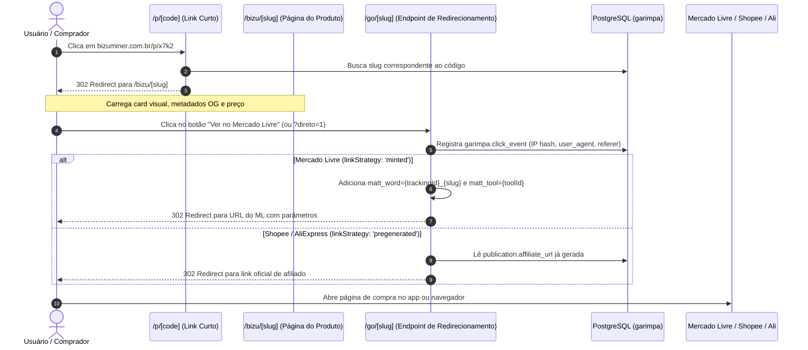
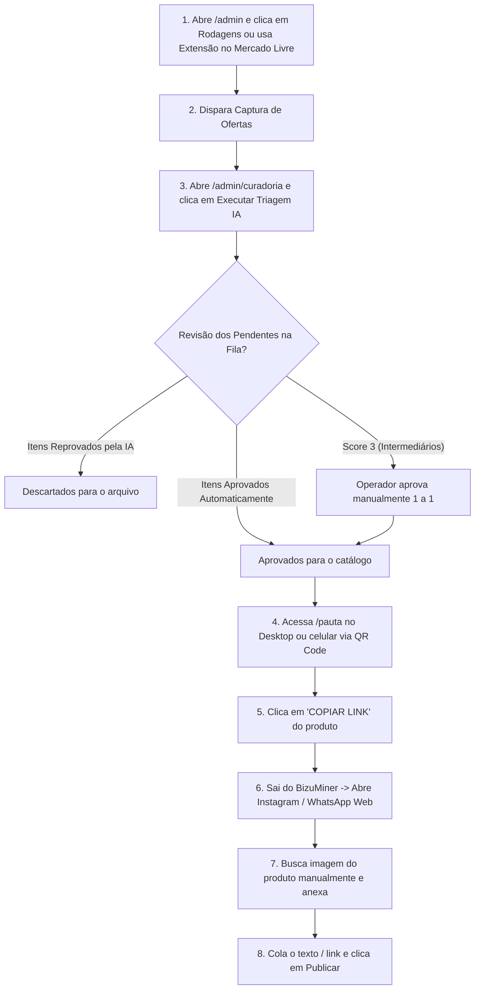

# Auditoria Técnica e Operacional do BizuMiner
## Documento 03: Operação Comercial, Distribuição, Métricas e UX do Administrador

**Data da Auditoria:** 14 de Outubro de 2026  
**Status do Módulo Auditado:** Operação 100% Manual / Métricas Parciais / Sem Ciclo de Feedback  
**Escopo:** Geração de Copy (`composer.ts`), Mecanismo de Redirecionamento e Links de Afiliados (`go/[slug]`, `p/[code]`, `marketplaces.ts`, `db.ts`), Telemetria (`click_event`, `publication`), Telas Administrativas (`/admin`, `/admin/curadoria`, `/admin/marketing`, `/pauta`) e Fluxo de Trabalho do Operador.

---

## Sumário Executivo do Módulo

O BizuMiner foi concebido com uma visão de alta automação editorial e inteligência comercial. No entanto, a auditoria detalhada da operação, distribuição e telemetria revelou que a "última milha" do produto é **estritamente artesanal e desconectada de métricas de conversão reais**:

1. **Geração de Conteúdo Rudimentar:** O gerador de mensagens (`composer.ts`) produz apenas texto puro formatado para WhatsApp/Telegram via templates estáticos de interpolação. Não há uso de IA para copywriting, não há variação temática inteligente e não há geração automatizada de criativos visuais para redes sociais (Instagram, Reels, Carrosséis).
2. **Distribuição 100% Manual:** A despeito de menções a bots de Telegram e APIs oficiais de mensageria em documentações e planos, **não existe uma única linha de código integrando WhatsApp Cloud API ou Telegram Bot API**. Toda a distribuição depende de um ser humano copiando textos e links no navegador e colando manualmente em aplicativos de terceiros.
3. **Links de Afiliados Rígidos e Sem Atribuição de Canal:** O sistema suporta dois modelos de monetização (links gerados sob demanda com `matt_word` para Mercado Livre e links pré-gravados para Shopee/AliExpress). Contudo, o identificador de rastreamento (`subId`) é invariavelmente fixado no `slug` do produto. O sistema é incapaz de distinguir se uma venda veio do WhatsApp, do Telegram ou do Instagram.
4. **Cegueira Comercial e Ausência de Feedback:** A única métrica de saída registrada no banco é o clique no botão de redirecionamento (`click_event`). O sistema desconhece pedidos gerados, receita bruta, taxas de cancelamento e comissões efetivas. Consequentemente, o motor de triagem **não aprende com o que vende**, operando em circuito aberto.
5. **UX Administrativa Fragmentada:** O painel oferece diversas telas ricas (visão geral, robôs, curadoria de candidatos, grupos, pauta mobile e kanban de marketing), mas a jornada do operador exige dezenas de cliques, saltos entre abas e troca constante de janelas entre o BizuMiner e as redes sociais.

---

## 1. Operação Comercial e Geração de Conteúdo

### 1.1 Geração de Copy e Materiais Promocionais

A produção de textos para divulgação é centralizada no módulo `packages/web/lib/composer.ts`.

#### Formatos Suportados
O sistema gera apenas **mensagens de texto plano** com duas variações estruturais:
1. **Produto Único (Mensagem Individual):**
   ```text
   esse tá no menor preço desde que comecei a acompanhar 👀
   Câmera de Segurança Wi-Fi Externa TP-Link Tapo C320WS 2K 4MP IP66 Branco
   R$ 209,92 · Mercado Livre
   https://bizuminer.com.br/bizu/ml-MLB3651421579?direto=1
   link de afiliado · BizuMiner
   ```
2. **Lote de Ofertas (Digest Diário - até 5 produtos):**
   ```text
   bizus de hoje:
   1. Câmera de Segurança Wi-Fi... — R$ 209,92 · Mercado Livre — https://bizuminer.com.br/bizu/ml-MLB3651421579?direto=1
   2. Varal Dobrável De Chão... — R$ 78,91 · Mercado Livre — https://bizuminer.com.br/bizu/ml-MLB4243087779?direto=1
   link de afiliado · BizuMiner
   ```

#### Mecânica de Copywriting: Templates Determinísticos sem IA
O copywriting não utiliza chamadas ao Gemini. Trata-se de uma rotação determinística de frases de abertura baseada no hash do slug do produto (`hashSlug(slug) % list.length`):

```typescript
const OPENERS: Record<"verified" | "drop" | "unproven", string[]> = {
  verified: [
    "esse tá no menor preço desde que comecei a acompanhar 👀",
    "dá um bizu: menor preço que já vi nesse aqui",
  ],
  drop: [
    "caiu {pct}% do menor que eu tinha anotado",
    "esse baixou de novo, olha aí",
  ],
  unproven: [
    "achei esse hoje, tá em conta",
    "dá um bizu nessa",
  ],
};
```

- **Defesa de Credibilidade:** A função `priceLine()` deliberadamente omite a porcentagem de desconto declarada pelo vendedor (ex.: "80% off") para evitar repassar alegações promocionais não verificadas.
- **Limitação de Canal:** Embora exista o tipo `ComposerDestination = "whatsapp" | "telegram"`, o código gera o mesmo texto independentemente do canal selecionado.
- **Inexistência de Formatos Sociais:** Não há gerador de legendas para Instagram, roteiros de Reels, enquetes de Stories ou estruturas de carrossel. O planejamento dessas peças existe apenas como formulário manual dentro do Kanban de Marketing (`packages/web/app/admin/marketing/workspace.tsx`).

#### Geração de Imagens e Criativos Visuais
- **Cards OpenGraph Automáticos:** O sistema gera dinamicamente imagens para compartilhamento em redes sociais via `@vercel/og` na rota `packages/web/app/bizu/[slug]/opengraph-image.tsx`. A imagem gerada (1200x630px) renderiza o título, o preço formatado, o selo da loja e a identidade visual do BizuMiner para visualização automática em cards de WhatsApp e Telegram.
- **Criativos para Redes:** Inexistente. Não há integração com serviços de renderização gráfica (Puppeteer, Canvas ou APIs como Bannerbear) para produzir imagens verticais de Stories ou posts quadrados de feed com layouts prontos para publicação.

---

### 1.2 Geração e Gestão de Links de Afiliado

O fluxo de monetização e rastreamento de links é um dos componentes mais críticos do sistema, envolvendo regras rígidas de segurança e roteamento multi-loja.



#### Estratégias de Monetização por Marketplace
Conforme documentado em `packages/web/lib/marketplaces.ts`, o sistema opera duas estratégias:
1. **Link Minted (Sob Demanda - Mercado Livre):**
   - O link não é gravado na captura. No momento exato em que o usuário bate em `/go/[slug]`, o servidor monta a URL final injetando:
     - `matt_word = <trackingId>_<subId>`
     - `matt_tool = <toolId>`
     - `forceInApp = true`
   - O `trackingId` e `toolId` são extraídos da tabela `garimpa.affiliate_marketplace_config` vinculada ao afiliado dono da publicação.
2. **Link Pregenerated (Pré-Gravado - Shopee e AliExpress):**
   - As redes de afiliados da Shopee e AliExpress exigem geração prévia via API oficial de conversão de links.
   - O link final encurtado da loja (ex.: `https://s.shopee.com.br/...`) já fica salvo na coluna `garimpa.publication.affiliate_url`. No momento do clique em `/go`, o servidor apenas redireciona para a URL salva, evitando latência de chamadas externas de API no caminho crítico do comprador.

#### Rastreamento e subIDs Dinâmicos: Lacuna de Canal
- **O subID utilizado é sempre estático:** No código de `handleV2()` em `packages/web/app/go/[slug]/route.ts`:
  ```typescript
  const target = affiliateLink(resolution.productUrl, slug, {
    trackingId: resolution.trackingId,
    toolId: resolution.toolId,
  });
  ```
- O parâmetro `subId` passado é invariavelmente o `slug` do produto (ex.: `ml-MLB7476671028`).
- **Impacto Comercial:** A plataforma de afiliados do Mercado Livre ou da Shopee recebe apenas o ID do produto. Se o afiliado quiser mensurar qual canal converte mais (ex.: "vendi mais no WhatsApp ou no Stories?"), **o sistema não oferece essa informação**, pois não há concatenação de subIDs de canal (ex.: `slug_wpp` vs `slug_ig`).

#### O Encurtador Próprio de Links (`/p/[code]`)
- **Motivação de Engenharia:** Em mensagens de WhatsApp e Stories, links longos (`bizuminer.com.br/bizu/ml-MLB123456789`) quebravam em duas linhas, prejudicando o preview visual.
- **Implementação:** Alfabeto de 29 caracteres sem ambiguidade visual (`abcdefghjkmnpqrtuvwxyz2346789`), com tamanho fixo de 4 dígitos ($29^4 = 707.281$ combinações).
- **Roteamento Seguro:** A rota `/p/[code]` redireciona com status 302 para `/bizu/[slug]`. Ela nunca redireciona diretamente para o marketplace nem para `/go`, garantindo que os crawlers das redes sociais leiam as meta tags da página do BizuMiner sem inflar artificialmente a contagem de cliques.

#### Validação e Monitoramento de Links Quebrados (404)
- **Status:** **Inexistente de forma automatizada.**
- O sistema não possui um cron ou rotina que verifique periodicamente se os anúncios cadastrados continuam ativos ou se caíram em página de produto esgotado/pausado nos marketplaces.
- **Proteção de Falha Fechada:** Se um link monetizado não puder ser resolvido no servidor (ex.: credencial de afiliado suspensa ou URL de Shopee ausente), o endpoint `/go` retorna `404 Not Found` em vez de redirecionar para a URL crua do produto, evitando a perda de comissões em silêncio.

---

### 1.3 A Realidade da Distribuição

A distribuição comercial no BizuMiner hoje é **estritamente manual**:

| Canal | Método de Envio Atual | Nível de Automação | Integração de API Existente |
| :--- | :--- | :--- | :--- |
| **WhatsApp (Grupos / Canais)** | Operador clica em "Copiar mensagem" no Composer e cola manualmente no aplicativo | **Zero (Manual)** | **Nenhuma.** Sem suporte a WhatsApp Cloud API, Evolution API ou Z-API. |
| **Telegram (Canais)** | Operador copia o texto e o link e cola no Telegram Desktop / Web | **Zero (Manual)** | **Nenhuma.** O campo existe na UI, mas não há bot ou token configurado para postagem direta. |
| **Instagram (Stories)** | Operador abre a mesa `/pauta`, copia o link `/p/xxxx`, tira print/baixa foto e publica no app móvel | **Zero (Manual)** | **Nenhuma.** Não há integração com Meta Graph API. |
| **Vitrine Pública (Web)** | Atualização automática do catálogo mediante status `approved` na curadoria | **Totalmente Automatizada** | Operação nativa do banco de dados e Next.js. |

#### Gargalo Operacional Estimado
Para cada produto publicado em um canal externo (como Instagram Stories ou Grupo de WhatsApp), o operador precisa cumprir a seguinte rotina:
1. Localizar e aprovar o produto na curadoria (20 a 40 segundos).
2. Abrir a pauta ou o composer (10 segundos).
3. Copiar o link reduzido ou texto pronto (5 segundos).
4. Abrir a página de origem da loja e salvar a imagem em boa resolução (30 a 60 segundos).
5. Abrir o WhatsApp Web ou o app do Instagram (15 segundos).
6. Colar o texto, adicionar a imagem, inserir a figurinha de link e disparar (45 a 90 segundos).
- **Tempo médio por publicação:** **3 a 5 minutos por produto.**
- **Teto de escala humana:** Um operador dedicado trabalhando 4 horas diárias consegue publicar no máximo 40 a 50 produtos, com alto risco de fadiga e erros de digitação.

---

## 2. Métricas Comerciais e Aprendizado

### 2.1 Inventário de Métricas Comerciais

A auditoria das tabelas do banco `garimpa` revela uma assimetria severa entre o volume de dados de engenharia (capturas, observações e logs) e o volume de métricas de negócio.

| Categoria | Métrica | Situação no BizuMiner | Tabela / Coluna no Banco | Confiabilidade do Dado |
| :--- | :--- | :--- | :--- | :--- |
| **Tráfego** | **Cliques no Link de Saída** | **Registrada** | `garimpa.click_event` (`id`, `clicked_at`, `ip_hash`) | **Alta.** Filtra acessos e armazena hash anônimo de IP. |
| **Tráfego** | **Visualizações de Página (PV)** | **NÃO Registrada** | Nenhuma tabela de pageview no banco | N/A (dependeria de GA4 ou Vercel Analytics externo). |
| **Tráfego** | **Cliques por Canal de Origem** | **NÃO Registrada** | Inexistente (canal é fixo como `'web'` em `publication`) | N/A. Não sabe se veio de WhatsApp, Stories ou Telegram. |
| **Conversão** | **Vendas / Pedidos Concluídos** | **NÃO Registrada** | Inexistente no banco de dados | **Zero.** O sistema não tem acesso aos relatórios dos lojistas. |
| **Conversão** | **Taxa de Conversão (CR %)** | **NÃO Registrada** | Inexistente | **Zero.** |
| **Financeiro** | **Comissões Geradas (R$)** | **NÃO Registrada** | Inexistente | **Zero.** O BizuMiner não sabe quanto dinheiro ganhou. |
| **Financeiro** | **Receita Bruta Faturada (GMV)** | **NÃO Registrada** | Inexistente | **Zero.** |
| **Qualidade** | **Cancelamentos e Devoluções** | **NÃO Registrada** | Inexistente | **Zero.** |

---

### 2.2 O Ciclo de Feedback (A Ausência de Aprendizado com o Negócio)

Um dos pilares da visão de longo prazo do BizuMiner é "aprender com os resultados comerciais". A auditoria técnica do código comprovou que **esse ciclo de feedback é 100% inexistente no estado atual**:

1. **A IA Não Sabe o que Vende:**
   - O serviço de curadoria semântica (`ai-curation-service.ts`) recebe apenas dados cadastrais brutos: `productId`, `title`, `category` e `priceFormatted`.
   - O prompt do Gemini **nunca é informado** se produtos daquela categoria tiveram cliques ontem, se tiveram vendas ou se foram ignorados pelo público.
2. **Priorização Cega na Vitrine:**
   - O ranking padrão da vitrine pública (`deal-query.ts` e `hero-ranking.ts`) ordena os produtos com base em frescor (`observed_at`), tamanho do desconto e nota de avaliação do lojista.
   - O volume de cliques registrado na tabela `click_event` é utilizado apenas para re-priorizar produtos nas rodadas de monitoramento de preços do robô (`monitoring-candidates.ts`), **mas não interfere na ordem de exibição da vitrine pública**.
3. **Comportamento Diante do Fracasso Comercial:**
   - Se um produto aprovado com nota 5 pelo Gemini tiver zero cliques após 7 dias de exposição, o sistema não toma nenhuma atitude automática (não oculta, não rebaixa e não analisa os motivos do desinteresse).

---

## 3. UX do Administrador e Jornada do Operador

### 3.1 Mapeamento Completo das Telas Administrativas

O BizuMiner concentra sua interface operacional sob a rota `/admin` e páginas adjacentes, divididas em módulos bem delimitados:

| Rota / Aba URL | Finalidade Principal | Funcionalidades Disponíveis | Volume Médio de Dados | Nível de Acabamento |
| :--- | :--- | :--- | :--- | :--- |
| **`/admin`** (Aba *Visão geral*) | Dashboard de comando diário e métricas macro | Mostra contadores gerais (produtos, observações, rodagens, cliques 7d), status por loja, botão de captura em lote e resumo de curadoria. | Métricas consolidadas de 1.657 produtos e 9.017 observações. | **Polida** (Layout coeso, componentes bem estruturados). |
| **`/admin?aba=rodagens`** | Gestão de robôs e automações de captura | Disparo manual de rodagens por loja (ML, Shopee, AliExpress), histórico de execuções com tempo e status, painel de workflows do GitHub Actions e políticas de monitoramento da casa. | Lista últimas 10 a 20 rodagens por marketplace. | **Funcional e Robusta** (Exibe erros e feedbacks em tempo real). |
| **`/admin?aba=captura-manual`** | Ingestão manual assistida por navegador | Disponibiliza o link compilado do Bookmarklet (`BM1`), instruções de instalação e diagnóstico de dispositivos conectados. | Formulário e links utilitários. | **Funcional** (Interface direta para operadores). |
| **`/admin?aba=publicacao`** | Montagem de posts rápidos (Composer) | Busca de ofertas no catálogo ativo, seleção de até 5 itens, pré-visualização de mensagem formatada com botão de copiar para WhatsApp/Telegram e ranking dos mais clicados em 7 dias. | Busca em tempo real sobre catálogo público. | **Polida** (Muito rápida, cópia com 1 clique). |
| **`/admin?aba=afiliados`** | Gestão de credenciais de afiliados | Cadastro de contas de afiliados, vinculação de membros proprietários e configuração de credenciais por loja (Tracking ID e Tool ID do ML). | Poucos registros (conta `aff_local`). | **Funcional** (Focada em governança multi-conta). |
| **`/admin/curadoria?aba=selecao`** | Seleção editorial de destaques | Exibe a seleção vigente para a Home e Pauta, controle de triagem de IA em lote e edição manual de posições na vitrine. | 10 a 24 produtos em destaque. | **Polida** (Excelente hierarquia visual). |
| **`/admin/curadoria?aba=fila`** | Fila de revisão humana de produtos | Cartões individuais de produtos pendentes, exibição de nota e justificativa da IA, botões de Aprovar, Reter e Rejeitar com motivos cadastrados. | Dezenas a centenas de itens pendentes. | **Polida** (Atalhos de teclado e filtros dinâmicos). |
| **`/admin/curadoria?aba=grupos`** | Curadoria por famílias de produtos | Agrupa produtos semelhantes na mesma família editorial para aprovação ou rejeição em lote dos representantes. | Varia conforme famílias detectadas. | **Funcional** (Boa para evitar saturação manual). |
| **`/admin/curadoria?aba=auditoria`** | Spot Check diário de qualidade | Mesa de auditoria diária (meta de 12 itens) para curador humano confirmar ou corrigir decisões automáticas da IA. | Amostra diária de 12 produtos. | **Polida** (Contadores de progresso diário). |
| **`/admin/curadoria?aba=bussola`** | Configuração da IA e Diretrizes | Ajuste da diretriz editorial em texto, ativação/desativação do `auto_publish`, ajuste de nota mínima e visualização dos Golden Examples injetados. | Formulário único com visualização de regras. | **Polida e Crítica** (Controla o comportamento do Gemini). |
| **`/admin/marketing`** | Planejamento de campanhas e redes sociais | Kanban completo com 4 visualizações (Visão geral, Conteúdos, Calendário editorial e Brainstorm de ideias). Permite arrastar cards de status. | Armazenado em JSON privado no Supabase Storage. | **Altamente Polida** (Visual moderno, drag-and-drop nativo). |
| **`/pauta`** | Mesa de trabalho de links para postagem | Cartões de ofertas com fotos e preços, botão "COPIAR LINK" reduzido (`/p/xxxx`), QR code para abrir no celular e contador de progresso diário no navegador. | 10 a 20 produtos da pauta do dia. | **Polida e Otimizada para Mobile** (Foco em agilidade). |

---

### 3.2 A Jornada Típica do Operador

Para colocar uma nova safra de ofertas na rua diariamente, o operador humano percorre a seguinte jornada:



- **Número de Telas Envolvidas:** 4 a 5 telas internas (`/admin`, `/admin/curadoria`, `/pauta`, `/admin/marketing`) mais 2 a 3 aplicativos externos (Mercado Livre, WhatsApp Web, Instagram Web ou App no smartphone).
- **Número de Ações por Lote de 10 Produtos:** Em média **80 a 100 cliques/toques** e trocas de contexto.
- **Ponto de Fricção Máxima:** A passagem da pauta para o canal de destino. O BizuMiner entrega o link na área de transferência, mas não entrega a imagem diretamente no aplicativo nem formata o sticker do Instagram.

---

### 3.3 Fricções e Riscos Operacionais Identificados

1. **Risco de Oferta Expirada ou Preço Alterado:**
   - Entre a captura do robô (ex.: 08:00h) e a postagem manual pelo operador (ex.: 15:00h), o lojista pode ter aumentado o preço ou esgotado o estoque.
   - O BizuMiner **não checa o preço em tempo real** ao clicar em "COPIAR LINK" na tela `/pauta`. O operador publica a oferta anunciando R$ 50, mas o comprador clica e encontra o item por R$ 85, gerando quebra de confiança no canal.
2. **Perda de Rastreamento por Falha de Armazenamento Local:**
   - Na tela `/pauta`, o controle de quais links já foram copiados vive no `localStorage` do navegador (`bm_pauta_copied`). Se o operador limpar o cache, trocar de computador ou abrir a pauta no celular em vez do desktop, a contagem é zerada e ele não sabe quais links já foram postados.
3. **Dependência de Credenciais em Variáveis de Ambiente:**
   - Embora exista o módulo de afiliados no banco, chaves globais da casa (`ML_TRACKING_ID`, `ML_TOOL_ID`, `GEMINI_API_KEY`) residem em variáveis de ambiente do processo. A expiração ou erro em um desses valores paralisa o redirecionamento ou a triagem sem aviso prévio na interface.

---

## 4. Síntese do Diagnóstico Operacional

| Frente Operacional | Situação Atual | Impacto no Crescimento do Negócio |
| :--- | :--- | :--- |
| **Geração de Mensagens** | **Parcialmente Implementada** | Texto simples com rotação de frases fixas; supre grupos básicos, mas não sustenta operação de mídia rica (Reels/Stories). |
| **Distribuição nos Canais** | **100% Manual / Inexistente em API** | Gargalo físico absoluto: o crescimento em volume de postagens exige contratação proporcional de horas humanas. |
| **Rastreamento de Atribuição** | **Incompleto (Sem SubIDs de Canal)** | Impossibilidade técnica de saber qual canal (WhatsApp vs Instagram) traz receita real. |
| **Telemetria Comercial** | **Inexistente para Vendas e Comissões** | Opera no escuro financeiro. Sabe quantos cliques gerou, mas desconhece a conversão final. |
| **Ciclo de Aprendizado (Feedback)** | **Inexistente** | A IA repete os mesmos erros e priorizações independentemente do sucesso comercial das ofertas. |
| **Usabilidade do Operador** | **Polida, mas Desconectada da Ponta** | Telas internas são bonitas e rápidas, mas sofrem pelo "abismo" entre copiar o link e postar na rede social. |
