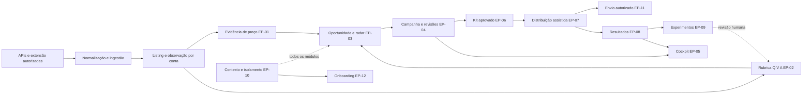

# Arquitetura global consolidada

Contrato de planejamento v1.1, 14/10/2026, após [revisão de viabilidade](09-REVISAO-DE-VIABILIDADE.md). Normativo em conjunto com [contratos](03-CONTRATOS-COMPARTILHADOS.md) e [migrations](04-EVOLUCAO-E-MIGRATIONS.md). **Existente** descreve código/banco observado; **proposto** é decisão técnica fundamentada para execução futura. Políticas comerciais ainda não aprovadas constam em [gates](07-PRONTIDAO-E-DECISOES.md).

## Motor único e fronteiras

Preservar o monorepo, Next/React, postgres.js, Supabase Auth/Storage, adapters de captura e workers atuais. Não criar microsserviços nem um segundo motor para SaaS. Módulos puros de avaliação/evidência recebem contexto explícito; web e workers usam os mesmos contratos. UI pública, cockpit da casa e cockpit dos clientes são consumidores diferentes do mesmo núcleo.

O pipeline legado product→publication web→/bizu→/go continua. Campanha, aprovação de kit e confirmação de postagem são objetos adicionais. Falhas no estúdio, importação e canais não podem impedir compra em link legado válido.

## Decisões arquiteturais (ADRs)

| ID | Decisão proposta e motivação | Consequência / alternativa descartada |
|---|---|---|
| ADR-01 | Casa e SaaS usam AccountContext explícito; house é apenas conta inicial | Elimina local implícito em novos serviços; URLs antigas continuam vinculadas à casa por resolver específico |
| ADR-02 | Preservar product como listing tenantizado e observations privadas por padrão | FKs e ingestão existentes não precisam ser reescritas; não abrir leitura global de dados coletados com credenciais privadas |
| ADR-03 | Inteligência compartilhável é capacidade de serviço com proveniência e permissão de reutilização | Motor comum não exige catálogo físico global imediato; compartilhar cópias factuais autorizadas, sem trackers/campanhas; matching apenas vínculo reversível, nunca merge por título |
| ADR-04 | Comparabilidade é por configuração + condições; histórico desconhecido não é comparável | Corrige view, membro e populares também; ausência de histórico não reprova qualidade |
| ADR-05 | Preservar editorial_assessment humano; adicionar análise automática separada, ambas com payload de rubrica v2 | Coluna actor_app_user_id obrigatória não pode receber “usuário IA” fictício; AI assessment não vira aprovação |
| ADR-06 | Oportunidade pertence a público/política; aprovação de catálogo permanece distinta | Piso, blacklist de utilidade e saturação passam a contexto; não impor teto de preço universal |
| ADR-07 | Publicação social e kit versionado em relações novas; publication web fica compatível | Não inferir postagem de exportação, kanban ou published_at legado |
| ADR-08 | Link interno por publicação/canal; rastreador do programa depende de capability verificada | C-06 define ida /p→/bizu→/go; nenhuma promessa de subID universal |
| ADR-09 | Financeiro é ledger de fatos e ajustes, com atribuição explícita e desconhecido representável | Nenhum clique cria pedido; valor previsto não vira caixa |
| ADR-10 | RLS transacional no acesso direto, autorização antes do contexto e projeção pública mínima | Não usar auth.uid() isoladamente em sessão postgres.js que não recebe JWT; nunca testar isolamento somente como postgres |
| ADR-11 | Segurança em duas entregas EP-10A/10B, contratos congelados desde agora | 10A antes de novos objetos comerciais; 10B inventário final de todos eles e gate obrigatório do piloto, sem ciclo com EP-04 |
| ADR-12 | Inicialmente conteúdo assistido em WhatsApp/Telegram/Instagram; automação candidata Telegram oficial | Preserva restrição atual de WhatsApp manual. Ativação de canal exige autorização/capability, não inferida da skill |
| ADR-13 | Nenhum novo provider de billing obrigatório para piloto; termos e entitlement explícitos | Preço/plano não inventados. Cobrança automática fica fora deste ciclo; assinaturas continuam negócio permanente, com registro de contrato/faturamento manual quando aprovado |
| ADR-14 | Novos módulos usam flags por conta e gates de schema; adaptadores de leitura preservam antigos DTOs | Rollback por desativação; não restaurar claims inseguros nem permissões amplas para clientes externos |
| ADR-15 | 01-0 contém claims na aplicação após 00, antes da migração estrutural 10A | Sem DDL, escrita nova ou acesso externo; 01-A/B continua dependente de 10A; banco só será corrigido em M-01 |
| ADR-16 | Piloto assistido não depende de experimentos 09 nem automação 11 | 10B cobre tudo instalado na versão piloto; custos/resultados manuais antecipados após 04; receita SaaS separada de despesas |

## Entidades e invariantes

Referência de produto (opcional) ≠ listing `product` ≠ variante ≠ família editorial. Observação factual conserva fonte/instante; comparabilidade e avaliação são derivadas versionadas. `product.last_price_cents` é cache operacional, não prova histórica. Snapshot do kit copia fatos/referências e digest, porque ingestão atual pode atualizar observação no mesmo run e scripts de lifecycle podem remover dados. Antes de kits ativos, EP-04 deve proteger referências contra purge e preservar fatos imutáveis.

Invariantes em todas as entregas: valor em centavos inteiros e moeda explícita; timestamp UTC e exibição local; desconhecido não vira zero; evidência não vem da nota IA; nenhuma FK privada cruza tenant; nenhuma credencial ou resultado privado vira aprendizado compartilhado automático; versão aprovada é imutável; status de envio não é status de recebimento financeiro. INV-01–10 são critérios de regressão, não apenas orientações de texto.

## Sequência executável

1. EP-00: baseline e reconciliação do ambiente; nenhuma mudança. Depois, 01-0 contém alegações históricas sem suporte na aplicação, preservando compra e dados, sem migration. Esta entrega parcial não declara a view remota corrigida.
2. EP-10A: contexto autenticado, transação real e proteção dos dados atuais; primeiro adotar o contexto em callsites, depois ativar policies/roles com ensaio completo. Continua sendo pré-condição de novas escritas comerciais, não da contenção 01-0.
3. EP-01 A/B/C: fonte canônica de preço/claim, substituindo a projeção conservadora de 01-0. EP-02: rubrica em sombra e amostra humana; ambos podem ser desenvolvidos independentemente após 00/10A, mas EP-02 usa C-02 para preço. G-EVIDENCE distingue contrato disponível de dados comparáveis realmente obtidos.
4. EP-03: políticas e oportunidade/radar; consome resultados de 01/02.
5. EP-04: campanha e lifecycle comercial com fluxo funcional manual mínimo.
6. EP-05: cockpit inicial usando ações existentes e lifecycle 04; EP-06 estende estúdio, render e aprovação. 05 não depende de 06 pronto para sua primeira versão; ações não disponíveis são identificadas sem promessas de funcionar.
7. EP-07: exportação/confirmação e atribuição integrada. EP-08 A e parte manual de C: antecipar após 04, sem esperar 07 ou um parser de marketplace. Importador 08-B depende de relatório autorizado; filtros de canal dependem de 07. Não duplicar formulário ou ledger provisório.
8. EP-10B: validação de isolamento de todos os módulos presentes na versão candidata ao piloto; não recria 10A nem exige instalar 09. Aplicável novamente à superfície de 08/09/11/12 quando adicionada; código inacessível por UI também entra no inventário se estiver instalado.
9. EP-12: piloto assistido após 10B/04/05/06/07, respectivas dependências e decisões comerciais; 08-A/C recomendado e obrigatório para capacidades financeiras prometidas e para cobrar assinatura. Escopo sem financeiro só se aprovado em G-PILOT e exibido como não monitorado. 09/11 não são pré-requisitos.
10. EP-09: resultados e experimentos após 02/07/08, conforme amostra; não bloquear piloto pela espera de prova causal. EP-11: automação após 06/07 e gate do canal; contas externas exigem 10B atualizada. Ambos permanecem no planejamento integral, com ativação conforme seus gates.

Ordem acima é de contratos/entregas, não autorização de execução simultânea. Toda migration adota escopo e políticas de 10A ao nascer. Uma futura spec não pode adiar isolamento para 10B.

## Compatibilidade e produção

Flags propostas por conta: evidence_v2, rubric_v2 (off/shadow/assisted), commerce_v1, studio_v1, campaign_links_v1, results_v1, distribution_enabled. Não substituir flags existentes AFFILIATE_LINKS_V2_ENABLED e EXTENSION_CAPTURE_ENABLED; exigir estado real registrado no preflight. Desabilitar uma nova UI não apaga eventos. Nenhuma flag pode tornar leitura cruzada permitida.

Ativação: fixture isolada → staging confirmado → casa em sombra → comparação de saída → casa assistida → observação operacional → external somente após 10B. A primeira ativação financeira/social requer dados e destinos autorizados. Thresholds comerciais não são preenchidos por default secreto. Sem política E3 aprovada, publicar E0/E1, mantendo E2 apenas comparação delimitada permitida por C-02.

Falhas controladas: indisponibilidade de IA permite revisão humana; erro de Storage impede aprovação da arte afetada, não catálogo; erro de coleta mantém timestamp antigo e desabilita claim fresco; link inválido fecha envio/redirect afetado sem fallback de conta; timeout de envio vira resultado desconhecido, sem retry cego. Aplicação parcial de migration deixa feature off e aciona recuperação por versão.

## Propriedade de componentes e prevenção de conflito

| Componente | Dono da mudança semântica | Consumidores / integração |
|---|---|---|
| offer-history, view, DTO de evidência | EP-01 | 02/03/05/06; ninguém recria cálculo local |
| editorial-assessment / AI payload | EP-02 | 03 contextualiza; 05 exibe; 09 mede |
| triage-value/pipeline e monitoramento | EP-03 integra, EP-02 define rubrica | 01 provê evidência; mudança do piso ocorre só aqui |
| tenant-db/auth/affiliate-db | EP-10A | Todos passam contexto; 10B verifica inventário final |
| schema de campaign/kit/publicação | EP-04 | 06 preenche/valida; 07 distribui; 11 agenda |
| /p /bizu /go e campaign_link | EP-07, com interface básica de 04 | 06 usa resolver de 04; 07 acrescenta atribuição de clique |
| shell/admin/pauta/vitrine | EP-05 | 06/08/09 fornecem módulos, sem substituir shell novamente |
| conversion/commission/import | EP-08 | 09 lê coortes; 12 lê métricas de ativação |
| marketing JSON | Preservado como planejamento | 04 permite referência explícita, sem sincronização automática de status |

## Limites de reutilização SaaS

Nesta versão, cada conta mantém catálogo isolado e invoca o mesmo motor. Isso não exclui inteligência de mercado comum: C-01 define porta de leitura autorizada e lineage para importação de fatos reutilizáveis. Habilitar fonte compartilhada requer licença/termos e minimização; sem isso, coleções independentes são válidas. Comissões, políticas privadas, kits e tokens nunca atravessam essa porta. Criar uma tabela global agora copiando dados da casa sem consentimento seria uma decisão comercial indevida.

Custos são medidos por conta/operação: tokens/tempo do provedor, captura, Storage e tempo humano, quando observáveis. Ausência de tarifário ou invoice gera custo desconhecido. Relatórios financeiros separam afiliação e SaaS e identificam custos compartilhados não rateados.
