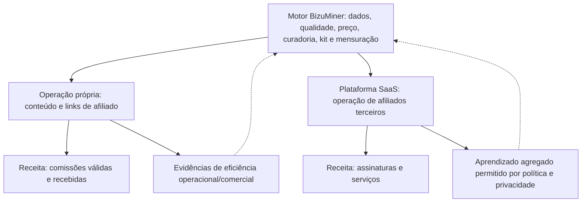
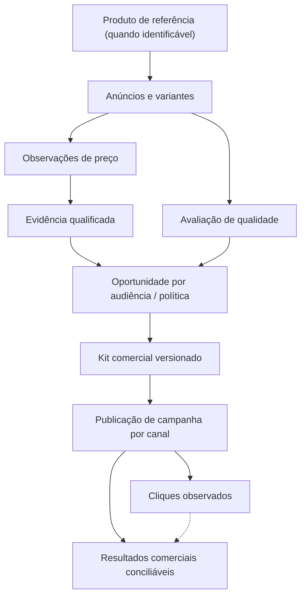
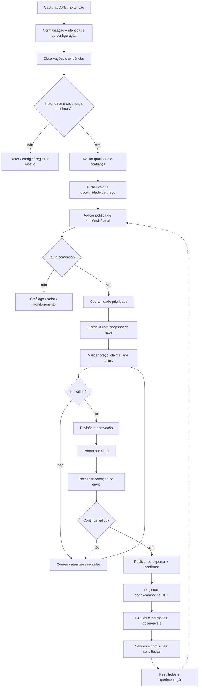
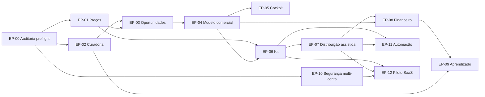

# BIZUMINER — BLUEPRINT-MESTRE DE PRODUTO, NEGÓCIO E INTELIGÊNCIA COMERCIAL

**Versão:** 2.0 — Documento-mestre de direção estratégica, funcional e arquitetural  
**Data de referência:** 14 de outubro de 2026  
**Status:** Proposta consolidada para orientar decisões, specs e implementação incremental; **não é uma autorização para alterar produção**.  
**Modo de utilização:** Fonte de requisitos e invariantes para a skill `codex-arquiteto`, aplicada a **uma entrega delimitada por vez**.  
**Contexto:** BizuMiner em produção, com **ao menos uma venda confirmada pelo proprietário**, ainda sem rastreamento interno de vendas/comissões demonstrado pela auditoria.

> **Tese central:** O BizuMiner é um motor de inteligência comercial que identifica boas compras, reconhece oportunidades de preço, prepara e acompanha a divulgação e melhora continuamente suas decisões. Ele sustenta **simultaneamente** (1) a operação própria de afiliação e (2) a plataforma SaaS utilizada por outros afiliados. Não há escolha entre os dois negócios; as capacidades centrais devem servir a ambos.

> **Princípio editorial do proprietário:** Buscar **produtos da melhor qualidade possível pelo menor preço compatível com essa qualidade**. A qualidade é relativa e deve ser estimada a partir de sinais verificáveis como marca, robustez percebida, aparência, características, avaliações e reputação — especialmente as avaliações no marketplace. O acompanhamento histórico de preços acrescenta contexto e pode elevar uma boa compra a uma oportunidade especial ou irresistível. Não confundir “barato” com “bom”, nem “desconto anunciado” com economia comprovada.

---

## Índice executivo

1. Como interpretar este documento e o grau de evidência
2. Identidade, missão, públicos e os dois negócios complementares
3. O que sabemos sobre o sistema atual
4. Filosofia editorial e classificação de oportunidades
5. Modelo de domínio: produto, anúncio, evidência, oportunidade, kit e publicação
6. Camada de preços: comparabilidade, séries históricas e afirmações comerciais
7. Avaliação de qualidade, custo-benefício, oportunidade e adequação ao público
8. Curadoria, políticas, responsabilidades da IA e governança
9. Monitoramento e inteligência de descoberta
10. Pipeline comercial de ponta a ponta
11. Cockpit do afiliado e experiência do consumidor
12. Kit comercial: geração, edição, validação e aprovação
13. Distribuição, links, identidade de campanhas e rastreabilidade
14. Resultados, aprendizado comercial e métricas
15. Modelo SaaS e arquitetura compartilhada
16. Estratégia comercial e prova de valor
17. Roadmap modular com dependências e critérios de conclusão
18. Testes de referência, não regressão e rollout de produção
19. Governança de decisões e perguntas ainda abertas
20. Protocolo de uso da skill `codex-arquiteto`
21. Apêndices: matriz de requisitos, glossário, prompts e fontes

---

# 1. Como interpretar o blueprint

## 1.1. Natureza da especificação

Este documento responde **o que construir, por que e quais propriedades precisam continuar verdadeiras**. A skill `codex-arquiteto` inspecionará o repositório para definir **como** implementar uma fatia funcional, com arquivos concretos, migrations necessárias, comandos de verificação efetivos e compatibilidade com a produção.

O documento **não** obriga a criar microsserviços, novas tabelas com os nomes aqui sugeridos, endpoints específicos ou uma reescrita do monorepo. Os nomes de contratos e entidades servem para estabelecer fronteiras semânticas; o desenho físico deve ser fundamentado no código atual.

### Níveis de afirmação

- **[D] Decisão do proprietário:** direção explicitamente estabelecida pelo responsável do BizuMiner.
- **[A] Reportado pela auditoria:** achado presente nos quatro relatórios fornecidos; exige nova verificação pelo Codex antes de modificar código ou banco.
- **[P] Proposta deste blueprint:** comportamento-alvo sujeito a refinamento e aceite.
- **[V] Validação pendente:** informação não demonstrada, contraditória ou cuja decisão ainda não foi tomada.

Esta distinção evita converter opiniões, estimativas e observações incompletas em fatos definitivos.

## 1.2. Decisões inegociáveis

**[D-01]** Os dois negócios — comissões de afiliação e assinaturas SaaS — são **complementares e permanentes**. A plataforma deve evoluir para suportá-los juntos.  
**[D-02]** A operação própria é o primeiro uso real do motor, demonstra sua utilidade e tende a ganhar automação progressiva; não é apenas um projeto transitório.  
**[D-03]** A curadoria busca qualidade e valor pelo dinheiro; não se reduz a preço baixo, impulso ou apelo visual.  
**[D-04]** O histórico monitorado de preços deve diferenciar uma oferta verdadeiramente interessante de um desconto alegado sem evidência.  
**[D-05]** O site atual está em produção e deve continuar funcional ao longo da evolução.  
**[D-06]** O proprietário já realizou ao menos uma venda; sua origem/canal/comissão só serão tratados como fatos rastreados quando registrados com fonte adequada.

## 1.3. Invariantes transversais

- [INV-01] Não fabricar preço, qualidade, avaliação, atributo, cupom, comissão, disponibilidade ou prova histórica.
- [INV-02] Não anunciar “menor preço da internet” a partir apenas das coletas internas.
- [INV-03] Não permitir que uma nota semântica de IA seja a única justificativa de uma alegação comercial verificável.
- [INV-04] Não confundir aprovação para catálogo, seleção para campanha, aprovação de kit e publicação efetiva.
- [INV-05] Não presumir que copiar, baixar ou exportar material equivale a tê-lo publicado.
- [INV-06] Não presumir que clique signifique venda, que comissão prevista seja recebida, ou que ausência de rastreamento signifique receita zero.
- [INV-07] Não misturar dados, credenciais, campanhas nem resultados de afiliados diferentes.
- [INV-08] Não criar requisitos de um único nicho como restrições globais permanentes da plataforma.
- [INV-09] Não colocar automação irreversível em produção antes de testes e mecanismo de desligamento ou recuperação.
- [INV-10] Não exigir grande substituição de módulos existentes quando integração/adaptação incremental for segura.

---

# 2. Identidade, públicos e dois negócios

## 2.1. Identidade de produto

**Definição:** Plataforma de inteligência de compras e oportunidades comerciais para afiliação, com capacidade de observar o mercado, recomendar produtos e condições vantajosas, produzir conteúdo de divulgação, registrar campanhas e melhorar as decisões com resultados observados.

**Frase de produto:** *O BizuMiner encontra boas compras, identifica quando elas ficam ainda melhores e transforma essa inteligência em divulgação comercial rastreável.*

O motor atende três experiências, sem promessas idênticas:

1. **Comprador final (site público):** ver boas compras e ofertas com preço atual, contexto histórico quando confiável, características e informações claras para decidir.
2. **Operador do BizuMiner (afiliado da casa):** achar oportunidades, compreender razões, montar kits, distribuir com menos esforço e conhecer resultados comerciais.
3. **Afiliado contratante (SaaS):** utilizar a mesma inteligência do motor com seu público, suas políticas editoriais, credenciais, canais, kits, campanhas e resultados privados.

## 2.2. Modelo econômico dual: operação + software

**[P-BIZ-01]** Toda capacidade central relevante deve poder ser usada pela operação própria e por afiliados terceiros, sem exigir duas versões independentes do motor.  
**[P-BIZ-02]** A conta da casa deve ser tratada conceitualmente como um cliente interno da plataforma, não como um caminho técnico privilegiado impossível de reproduzir para terceiros.  
**[P-BIZ-03]** O desenvolvimento pode ser incremental, mas SaaS não é considerado alternativa ou destino que substitua a operação própria.  
**[P-BIZ-04]** O sucesso da operação própria será uma prova comercial útil se publicado com metodologia clara, sem atribuições ou ganhos exagerados.  
**[P-BIZ-05]** O primeiro assinante externo só poderá receber acesso quando o isolamento de dados, a segurança das credenciais e o funcionamento de sua conta tiverem sido testados.

## 2.3. Proposta de valor por público

| Público | Problema | Promessa prudente | Prova necessária |
|---|---|---|---|
| Consumidor | Não sabe se desconto é real nem se o produto vale a pena | Curadoria e contexto transparente para comprar melhor | Histórico com fonte/cobertura, critérios claros, links válidos |
| Operador próprio | Perde tempo garimpando, escolhendo e preparando material | Pauta qualificada e preparação de campanhas mais eficiente | Tempo gasto, kits produzidos, erros, cliques e receita disponível |
| Afiliado SaaS | Precisa repetir manualmente uma operação de baixo controle | Motor configurável que ajuda a selecionar, divulgar e medir | Testes de isolamento, ganho de eficiência, uso recorrente, resultados demonstráveis |

**Não prometer neste momento:** quantidade fixa de “10 produtos irresistíveis” todos os dias; conversão garantida; menor preço absoluto do mercado; receita certa; disparos automáticos em todos os canais; algoritmo treinado em grandes volumes de conversões já existentes.

---

# 3. O estado atual: evidência, oportunidades e riscos

## 3.1. Base documentada na auditoria

**[A]** O agente relatou a seguinte stack e componentes, conforme os quatro arquivos anexos (inspeção de código/banco não repetida na elaboração deste blueprint):

- Monorepo com `packages/web` em Next.js/React, `packages/persistence` em Node/TypeScript/PostgreSQL, `packages/capture`, extensão Chrome MV3 e recursos sociais.
- PostgreSQL/Supabase com schema `garimpa`, tabelas para produtos, observações, curadoria, eventos, publicações e cliques.
- Captura Mercado Livre assistida por extensão; Shopee e AliExpress por integrações API; cron/workflows no GitHub Actions.
- Triagem determinística + IA (`gemini-2.5-flash` à época da auditoria), estados de curadoria e automação de aprovação configurável.
- Composer de mensagens, `/p/[code]`, `/bizu/[slug]`, `/go/[slug]`, `click_event`, possível gerador de Story vertical e visualização de pauta.
- Sem rastreamento interno demonstrado de pedidos, comissões confirmadas e atribuição de divulgação social por canal.
- `tenant_id` amplamente presente, mas caminhos de código orientados a `local` e RLS permissivo para `garimpa_app`.

### Números reportados em outubro de 2026

| Indicador | Quantidade reportada | Interpretação correta |
|---|---:|---|
| Produtos cadastrados | 1.657 | Registros de anúncios, não necessariamente produtos físicos únicos |
| Observações de preço | 9.017 | Capturas pontuais, com comparabilidade limitada |
| Registros `publication` | 1.494 | Publicação/catálogo web; não comprova envio a canais sociais |
| Cliques acumulados `click_event` | 670 | Redirecionamentos observados; não comprovam vendas |
| Cliques nos últimos 30 dias | 505 | Total no período segundo auditoria; atribuição por canal insuficiente |
| Produtos novos nos últimos 30 dias | 780 | Volume técnico de ingestão, não volume de oportunidades |
| Aprovados em rodadas de triagem no período | 209 | Não necessariamente mesma coorte das publicações ou cliques |
| Vendas no sistema | Não mensuradas | Há ao menos uma venda informada pelo proprietário; não interpretar 0 registros como 0 vendas |

### Achados críticos da auditoria

- [A-01] `lowest_verified` é descrito como inoperante: nenhuma das 9.017 observações possui `offer_evidence.variantKey`, exigida por `sameOfferConfigurationSql()`.
- [A-02] A amostragem do histórico é fraca para muitos anúncios: relatório informa 78% dos produtos com menos de três observações.
- [A-03] A IA pode aprovar automaticamente anúncios para vitrine com nota ≥ limiar; o caso da impressora 3D de R$ 5.299 mostra desvio comercial de contexto.
- [A-04] A regra de piso de R$ 20 impede ou retém produtos baratos potencialmente interessantes; o conjunto de regras não considera valor global ou contexto comercial suficiente.
- [A-05] Apenas 37,9% do catálogo recebe `family_key`; as dez famílias heurísticas são categorias editoriais amplas, não identidade robusta de produto.
- [A-06] Divulgação social depende de trabalho manual e não cria um registro confiável de campanhas/publicações externas.
- [A-07] SubIDs/links não capturam origem de canal de maneira adequada; não há confirmação interna de vendas e comissões.
- [A-08] A modelagem multi-tenant não foi validada como isolamento de segurança para terceiros.

## 3.2. Contradições a reproduzir antes de qualquer migração

**[V-01]** O documento de arquitetura descreve `/api/story/[slug]` como ativo; o de operação diz que não existe geração automatizada de criativos verticais. Inspecionar implementação, uso real e qualidade do output.  
**[V-02]** A regra de preço < R$ 20 parece não explicar todos os registros (há amostra de R$ 19,99 aprovado); verificar trilha de eventos, intervenção humana e versão do pipeline.  
**[V-03]** Preços nulos/zerados aparecem com resultados diferentes em partes da documentação; reconstruir casos por fonte/versão.  
**[V-04]** `publication` em quantidade superior às aprovações recentes exige compreensão da semântica temporal e de criação do registro.  
**[V-05]** A auditoria qualifica o custo de IA como baixo, mas não apresenta custo consolidado nem consumo de tokens; medir antes de usar como argumento financeiro.  
**[V-06]** A métrica “2,41 cliques por aprovado” não deve ser apresentada como desempenho de coorte sem vincular o conjunto de publicações aos cliques do mesmo grupo.  
**[V-07]** Confirmar a disponibilidade atual e os termos de cada programa de afiliados antes de desenhar automação, links, APIs ou claims específicos.

## 3.3. Proibição de reescrita baseada apenas em diagnóstico

A auditoria é suficiente para priorizar perguntas e hipóteses de melhoria, **não é prova de que cada trecho continua idêntico no momento da implementação**. Cada spec deve revalidar `AGENTS.md`, rotas, símbolos, migrations, consultas, testes e produção/staging reais.

---

# 4. Filosofia editorial: qualidade com vantagem de preço

## 4.1. O princípio comercial

> Um bom achadinho é uma **boa decisão de compra**; um desconto é um possível sinal dessa decisão, não sua definição.

A busca parte da qualidade percebida e de evidências confiáveis. O preço só é interessante quando relacionado ao **que o produto entrega**, às alternativas e, quando disponível, ao próprio histórico.

**[REQ-ED-01]** A curadoria deve avaliar qualidade/confiabilidade independentemente de desconto.  
**[REQ-ED-02]** Deve avaliar custo-benefício com base no preço atual e, quando possível, alternativas realmente equivalentes.  
**[REQ-ED-03]** Deve avaliar condição temporal de oportunidade com histórico **comparável e qualificado**, sem exigir histórico perfeito para reconhecer um candidato promissor.  
**[REQ-ED-04]** Deve identificar limites de evidência e apresentar justificativas ao operador.  
**[REQ-ED-05]** Deve permitir políticas por nicho/audiência, sem teto de preço global; produtos caros podem ser relevantes para segmentos próprios.  
**[REQ-ED-06]** O fator visual/demonstrável é atributo de potencial criativo e canal, não substituto de qualidade.

## 4.2. Quatro patamares de recomendação

| Classe | Descrição | Exigência principal | Uso sugerido |
|---|---|---|---|
| **Produto recomendável** | Indícios consistentes de qualidade e integridade | Evidências de qualidade mínimas para o contexto | Catálogo/radar de monitoramento |
| **Boa compra** | Qualidade adequada com preço competitivo para o que entrega | Comparação de valor ou julgamento justificado, com incerteza explícita | Recomendação geral; pauta conforme público |
| **Oportunidade especial** | Boa compra com vantagem de preço particularmente favorável agora | Evidência temporal ou comparação comercial realmente sustentável | Destaque e campanhas com justificativa |
| **Ouro BizuMiner** | Oportunidade com excelente conjunto qualidade + vantagem de preço + confiança + adequação ao público | Critérios explícitos e auditáveis; não apenas IA nota 5 | Prioridade alta na pauta/canais compatíveis |

Essas classes **não precisam ser a representação física dos estados da máquina** e não exigem nota numérica única. A elegibilidade e a classificação podem ser implementadas separadamente de status operacionais (`pending`, `approved`, `held` etc.).

## 4.3. Exemplos de interpretação

1. **Produto marca forte, boa avaliação, preço normal alto:** pode ser recomendável, mas não oportunidade especial.
2. **Marca pouco conhecida, milhares de boas avaliações, boa construção e preço vantajoso:** pode ser boa compra; ausência de marca famosa não elimina qualidade.
3. **Produto muito barato e mal avaliado:** não ganha destaque só por desconto.
4. **Produto excelente de R$ 5.299:** pode ser relevante em nicho técnico com desconto real; não entra automaticamente numa pauta generalista de compra rápida.
5. **Organizador de R$ 13,99 com bom histórico de satisfação:** não deve ser eliminado universalmente pelo piso antigo de R$ 20.
6. **Desconto anunciado de 70% sem histórico:** a declaração do vendedor não se converte em queda comprovada.

## 4.4. Qualidade não é verdade absoluta

Para um produto, a qualidade precisa ser registrada como **inferência suportada por sinais**. A fonte pode não oferecer garantia sobre durabilidade, autenticidade, pós-venda ou avaliações manipuladas. A solução deve dizer “boa reputação observada” quando apropriado, não “qualidade comprovada” automaticamente.

---

# 5. Modelo de domínio comercial

## 5.1. Conceitos que não devem ser confundidos

**Produto de referência:** item/modelo com atributos que permitam identificar equivalências (marca, modelo, configuração); pode ser desconhecido.  
**Anúncio/listing:** oferta do vendedor num marketplace, hoje representada pelo identificador externo da plataforma.  
**Variante:** configuração capaz de alterar valor/comparabilidade (voltagem, tamanho, capacidade, quantidade, cor quando alterar preço, kit).  
**Observação:** snapshot factual coletado, contendo tempo, fonte e condições conhecidas.  
**Evidência de preço:** conjunto de observações comparáveis + qualidade/cobertura e referências calculadas.  
**Avaliação de produto:** julgamento de qualidade e adequação, com fontes e confiança.  
**Oportunidade comercial:** decisão contextual que relaciona anúncio/variante, preço, perfil de audiência, canal, momento e política comercial.  
**Kit comercial:** materiais versionados para uma oportunidade, preparados para um ou mais canais e ligados a um snapshot factual.  
**Campanha:** intenção editorial com objetivo, público e janela; pode possuir diversos kits/publicações.  
**Publicação de campanha:** evento de distribuição por canal, manual ou automatizado, distinto da tabela `publication` web legada.  
**Clique:** evento de saída/canal quando observável.  
**Conversão e comissão:** resultados reconhecidos conforme evidência e regras do programa de afiliação.

**[REQ-DOM-01]** O modelo físico deve distinguir ao menos a semântica dos itens acima, mesmo que parte seja representada por tabelas ou objetos existentes.  
**[REQ-DOM-02]** Não criar dois motores de curadoria independentes para operação própria e SaaS.  
**[REQ-DOM-03]** A mesma referência de produto poderá resultar em oportunidades diferentes para diferentes públicos, contas, canais e momentos.  
**[REQ-DOM-04]** Todas as decisões comerciais e materiais devem registrar a versão dos critérios e da evidência usada.

## 5.2. Relações conceituais

**Observação:** a seta de clique para resultado é uma **possibilidade de atribuição**, não prova automática de venda.

## 5.3. Separação entre identidade e agrupamento editorial

`family_key = audio` ou `organizacao` identifica um tema amplo, não prova que dois anúncios são do mesmo produto. O motor deve separar:

- **Categoria:** organização editorial, busca e segmentos.
- **Equivalência de produto:** identificação de mesmo modelo/configuração com confiança explícita.
- **Diversidade da pauta:** impedir excesso de itens parecidos num canal em janela de tempo.
- **Deduplicação de postagem:** evitar republicar mesmo anúncio/campanha por acidente.

**[REQ-DOM-05]** Matching entre marketplaces é funcionalidade evolutiva, com tratamento de ambiguidade; não fazer merge destrutivo por semelhança de título apenas.

---

# 6. Inteligência de preços e evidências

## 6.1. O que o BizuMiner precisa saber

Antes de qualificar desconto, o sistema precisa responder:

1. Qual anúncio e qual variante exatamente estamos observando?
2. Qual foi o preço visto, em qual fonte e quando?
3. Esse preço é válido para qual condição: frete, cupom, pagamento, região, quantidade?
4. Existem observações anteriores **da mesma configuração comercial comparável**?
5. Quantas observações, em quantos dias e com quais lacunas?
6. Que frases publicitárias essa evidência autoriza?
7. Quando a evidência deverá ser considerada desatualizada?

## 6.2. Contrato de observação [REQ-PRICE-01]

Campos conceituais: `marketplace`, `external_listing_id`, `product_reference_id?`, `variant_identity?`, `raw_title`, `captured_at`, `price_amount`, `currency`, `listing_url`, `capture_source`, `price_type`, `original_price_claimed?`, `shipping?`, `coupon?`, `payment_condition?`, `seller?`, `rating?`, `rating_count?`, `stock_state?`, `source_evidence`, `confidence/unknown_fields`.

Isso **não exige** todos esses campos para aceitar a observação; o importante é distingui-los como **disponível / ausente / não aplicável / declarado pela fonte**. Não preencher ausência por suposição. O Codex deverá mapear campos atuais antes de sugerir schema.

## 6.3. Identidade e comparabilidade de variante [REQ-PRICE-02]

- Comparar preços diretamente apenas quando configuração comercial e moeda forem compatíveis.
- Não tratar `variantKey = null` como variação única.
- Quando a fonte não identifica variante, usar estado **comparabilidade indeterminada**; permitir análise de preço atual sem selo de mínima histórica.
- Planejar enriquecimento progressivo: atributos estruturados quando APIs oferecem, extração assistida por IA apenas como **hipótese** sujeita a confirmação, fingerprints versionados e revisão de ambiguidades.
- Não exigir retroativamente um `variantKey` inventado para “consertar” a estatística.
- Em migração de compatibilidade, preservar observações originais e registrar como a identidade foi inferida, com possibilidade de revogação.

## 6.4. Níveis de evidência [REQ-PRICE-03]

| Evidência | Sustenta | Não sustenta |
|---|---|---|
| **E0 — Preço pontual** | “Preço observado às HH:mm em DD/MM” | Afirmar queda ou recorde |
| **E1 — Histórico parcial** | Informar N observações numa janela, mostrar gráfico e lacunas | “Menor preço em 90 dias” se não há 90 dias comparáveis |
| **E2 — Série comparável** | Comparar com mediana/mínimo anterior **observado** da mesma configuração, citando janela | “Melhor preço da internet” |
| **E3 — Mínima observada qualificada** | “Menor preço observado pelo BizuMiner na janela analisada”, se cobertura/configuração/política bastam | “Nunca esteve tão barato” em sentido absoluto |

Limiar de E2/E3 é hipótese a testar: quantidade mínima de amostras, dias abrangidos, espaçamento, lacunas, frescor e estabilidade de variante. **Não** reutilizar 3 observações/7 dias do código como verdade estatística universal.

## 6.5. Referências e gráficos [REQ-PRICE-04]

Exibir separadamente, quando calculáveis:

- Preço atual observado (timestamp e fonte).
- Mínimo observado anterior comparável (não inclui indevidamente o instante atual quando a regra exigir “anterior”).
- Mediana ou referência histórica, acompanhada do tamanho da amostra e janela.
- Número de observações, dias abrangidos e cobertura temporal.
- Variação percentual com denominador explicitado.
- Eventos de preço riscado alegado pelo seller identificados como **declaração do anúncio**.
- Ausência de histórico representada por mensagem clara, não gráfico artificial.

O gráfico é prova visual do histórico **observado**, não representação de todos os preços praticados no mercado. A marca temporal e o contexto da variante devem permanecer disponíveis ao usuário.

## 6.6. Guardião de afirmações comerciais [REQ-PRICE-05]

A redação de um kit deve ser construída a partir de um inventário de afirmações permitidas: `observed_current_price`, `observed_drop`, `historical_observed_minimum`, `seller_claimed_discount`, `limited_stock_if_verified`, `coupon_condition_if_verified` etc. Cada claim traz evidência, janela, validade e condição.

- “50% OFF” fornecido pela loja pode ser apresentado somente com qualificação apropriada à fonte e às regras de exibição, nunca como economia histórica comprovada.
- Urgência (“acaba hoje”), escassez (“últimas unidades”) e garantias não são inventadas por IA.
- Promessas sobre qualidade e durabilidade precisam ser apoiadas em sinais, garantias ou fontes adequadas.
- Frete/cupom/desconto no Pix não podem ser afirmados quando desconhecidos.
- Ao expirar o snapshot de preço, o kit é marcado para rechecagem; não fica automaticamente confiável só porque já foi aprovado.

## 6.7. Prioridades de correção [REQ-PRICE-06]

1. Reproduzir `sameOfferConfigurationSql()` e o problema de `variantKey` reportado.
2. Impedir geração e exibição de selos/claims inválidos.
3. Especificar comparabilidade segura com dados presentes e coleta futura.
4. Adicionar testes cobrindo variantes, moeda, histórico ausente e alegação falsa.
5. Corrigir/instrumentar somente os pontos de código afetados, com migrações aditivas se necessárias.
6. Recalcular ou reclassificar dados antigos apenas com trilha de proveniência e compatibilidade.

---

# 7. Modelo de avaliação: qualidade, valor, momento e público

## 7.1. Quatro avaliações independentes

**Q — Qualidade/confiança do produto:** é provável que entregue o prometido?  
**V — Valor pelo dinheiro:** vale o preço atual frente ao que entrega e alternativas equivalentes?  
**O — Oportunidade temporal:** o preço/condição de hoje está particularmente vantajoso, dentro do histórico confiável?  
**A — Adequação à audiência/canal:** esta boa compra tem chance razoável de interessar àquele público naquele contexto?

A decisão comercial combina esses sinais e fatores impeditivos, mas **não** deve esconder evidência insuficiente dentro de uma nota única.

## 7.2. Sinais de qualidade [REQ-CUR-01]

| Sinal | Utilidade | Limite ou viés |
|---|---|---|
| Marca/modelo identificáveis | Reputação, especificações, compatibilidade | Marcas famosas podem cobrar mais; marca desconhecida não é defeito |
| Avaliação média | Satisfação percebida | Média instável em amostra pequena, ratings manipuláveis |
| Quantidade de avaliações | Tamanho da evidência social | Volume não assegura legitimidade nem qualidade |
| Selo de compra verificada, quando a fonte fornece | Ajuda na proveniência | Pode não estar disponível em API/listagem |
| Vendas declaradas | Demanda/aceitação | Não equivale a satisfação nem garante integridade |
| Aparência, acabamento e robustez aparentes | Hipóteses úteis para curadoria humana | Foto promocional não prova material ou durabilidade |
| Especificações, garantia e suporte verificáveis | Adequação e riscos | Podem não estar disponíveis em todas as fontes |
| Reputação do vendedor | Reduz risco operacional | Deve ser específica e atual; vendedor ≠ fabricante |

**Requisito:** a IA deve separar **o que foi observado** de **o que inferiu** e indicar quando os sinais são fracos ou contraditórios. Quando o anúncio não oferece contagem de avaliações, não inventar quantidade, intervalo de confiança ou “milhares de compradores”.

## 7.3. Estimativa de qualidade e confiança [REQ-CUR-02]

Não fixar pesos arbitrários em produção. Primeiro criar uma rubrica humana com casos reais, usando classes como `forte`, `razoável`, `fraca`, `insuficiente` e motivadores visíveis. Se posteriormente houver escore calibrado, sua interpretação deve ser validada e versionada; separar `quality_assessment` de `evidence_confidence`.

A IA pode revisar fotos/descritivos quando autorizada e disponíveis, mas não deve concluir “produto robusto” como fato de uma imagem promocional. Uma dimensão sem dados precisa continuar como desconhecida.

## 7.4. Valor pelo dinheiro [REQ-CUR-03]

Comparar com alternativas equivalentes apenas quando identidade e características são suficientemente semelhantes. Quando essa comparação não existe, a nota de valor pode ficar `não determinada`. Não confundir: um produto de R$ 79 permanentemente mais barato que equivalentes de R$ 120 pode ser **boa compra** sem ter desconto histórico.

## 7.5. Oportunidade de preço [REQ-CUR-04]

A oportunidade temporal usa séries comparáveis e regras de evidenciação; **não** depende do desconto riscado pela loja. A avaliação pode distinguir `queda_observada`, `minima_observada_qualificada`, `sem_base_suficiente`, `sem_queda`, `reversao_de_preco` e casos semelhantes. A ausência de histórico impede afirmação histórica, não impede avaliação do produto.

## 7.6. Adequação à audiência [REQ-CUR-05]

O perfil editorial padrão da operação própria poderá priorizar utilidades, organização, cozinha e tecnologia prática, conforme o foco de curadoria auditado. Isso é **política configurável**, não definição universal do SaaS.

Contextos exemplares: achadinhos generalistas, casa e cozinha, makers, gamers, ferramentas, beleza, bebês, tecnologia premium. Ticket, categoria, perfil do público, formato do canal, saturação recente e disponibilidade de material devem influenciar o **ranking da pauta**, não necessariamente um bloqueio global do catálogo.

## 7.7. Atratividade de afiliação [REQ-CUR-06]

Separar preço baixo de economia real da afiliação. Informações disponíveis podem incluir comissão percentual, valor monetário potencial, programa ativo, limitações do link, risco de estorno, custo/tempo de criação e dados de desempenho. Sem estimativa confiável de conversão, não mostrar “conversão altíssima” nem usar probabilidade inventada.

Preferir uma política que maximize valor para audiência **sujeita a qualidade, confiança e conformidade**, em vez de maximizar apenas comissão esperada.

## 7.8. Exemplo de decisão explicável

> **Produto:** luminária sem fio com sensor. **Qualidade:** razoavelmente suportada por avaliações e anúncio; reputação do vendedor a confirmar. **Valor:** interessante para a categoria, mas comparação cruzada ainda ausente. **Preço:** R$ X observado em data Y; série histórica insuficiente para selo de mínima. **Público:** casa/organização. **Decisão:** boa candidata ao radar, sem alegação de recorde; elegível para pauta após checagem comercial.

Valores ilustrativos jamais devem aparecer como preço real no sistema.

---

# 8. Curadoria, IA e governança

## 8.1. Camadas de decisão [REQ-CUR-07]

1. **Validade/integridade:** preço numérico e moeda corretos, anúncio resolvível, requisitos mínimos, segurança e restrições de plataforma.
2. **Evidência:** atributos, variantes, avaliação de preço, atualização e grau de confiança.
3. **Análise semântica:** categoria, benefício provável, uso, clareza, potenciais riscos e compatibilidade editorial.
4. **Política comercial configurável:** audiência, faixas de prioridade, histórico de postagens, custo, monetização.
5. **Decisão:** catalogar, monitorar, priorizar, exigir revisão, reter ou descartar.
6. **Auditoria:** quem/quando/qual política/qual evidência orientou a decisão.

## 8.2. Papel da IA [REQ-CUR-08]

A IA é um **analista semântico e assistente editorial**, não autoridade absoluta de preço ou venda.

Pode: sugerir categorias; sumarizar características; identificar sinais de uso/benefício; sinalizar promessas problemáticas; explicar riscos; sugerir públicos; redigir conteúdos dentro de dados autorizados.

Não pode: inventar evidência de desconto; atestar autenticidade/durabilidade sem prova; criar urgência; extrapolar receita; promover automaticamente um kit inválido; contornar política de publicidade, restrições e governança.

Separar no contrato de saída: `facts_used`, `inferences`, `unknowns`, `editorial_reasons`, `safety_flags`, `policy_version`, `model_version`. Esse é **exemplo conceitual**, não schema final até inspeção do reposítório.

## 8.3. Aprovação automática de vitrine vs. campanhas [REQ-CUR-09]

O sistema atual associa `auto_publish` a uma aprovação editorial para catálogo. O futuro deve distinguir:

- **Elegibilidade para vitrine:** pode aparecer no site com alegações compatíveis com evidência disponível.
- **Prioridade para pauta comercial:** merece ser divulgado agora para determinada audiência.
- **Aprovação do kit:** conteúdo, artes, link, preço, disclosures e claims validados.
- **Publicação externa:** ato separado com canal e confirmação.

Automação de cada transição pode ser graduada por risco, nível de evidência e histórico de confiabilidade; aprovação humana inicial é uma política prudente para publicações externas.

## 8.4. Política de risco [REQ-CUR-10]

- Inconsistência de preço/configuração, suspeita de produto restrito, anúncio enganoso, link inválido e forte desatualização são motivos de bloqueio/retensão específicos.
- Preço muito alto em pauta popular gera revisão/baixa aderência, não rejeição universal do anúncio.
- Preço inferior a R$ 20 pode ser relevante; analisar qualidade, valor e contexto, em vez de piso comercial imutável.
- Regra de saturação aplica-se por público/canal/janela temporal e identidade do tema/produto — não somente “3 itens da mesma família no mesmo lote”.
- Decisão humana pode rever classificação com motivação, sem perder trilha original.

---

# 9. Monitoramento orientado à oportunidade

## 9.1. Duas frentes de descoberta [REQ-MON-01]

**Garimpo aberto:** capturar novidades, ofertas de destaque e itens que ainda não conhecemos.  
**Radar de recomendáveis:** manter acompanhamento recorrente dos produtos que já demonstraram qualidade e têm potencial para tornar-se oportunidade especial quando o preço cai.

A segunda frente transforma a tese editorial em vantagem acumulativa: histórico próprio mais denso nos itens que importam.

## 9.2. Prioridade de observação [REQ-MON-02]

Candidate à atenção conforme interesse real, qualidade provável, confiança atual da série, volatilidade observada, frescor da última captura, cobertura, custo de coleta e disponibilidade de fonte. Não priorizar apenas número de cliques brutos, pois itens com mais exposição tendem a receber mais cliques.

## 9.3. Escolha técnica de fonte [REQ-MON-03]

Respeitar limites, termos e formas oficiais de acesso de cada plataforma. A existência de scraper legado bloqueado não autoriza contornar mecanismos antibot. Quando não houver fonte atual confiável, manter o dado como não atualizado e impedir claims de preço recente.

## 9.4. Histórico de produto sem comparação de variantes

Forte acompanhamento de um anúncio com variante não identificada não deve gerar uma falsa série comparável. A evolução de coleta precisa ser integrada à evolução da identidade comercial.

---

# 10. Pipeline de ponta a ponta

## 10.1. Donos conceituais das decisões

| Passo | Decisão | Automação inicial | Registro necessário |
|---|---|---|---|
| Capturar | Qual fonte/dado aceitar? | Determinística | Origem, run, timestamp, erros |
| Qualificar | O que sabemos sobre a oferta? | Determinística + IA auxiliar | Dados, hipótese, nível de confiança |
| Priorizar | Vale a pauta para esse público? | Recomendação assistida | Política, contexto, razões |
| Montar kit | Quais mensagens/formatos? | Semiautomática | Snapshot, versões, fontes |
| Aprovar | O conteúdo está publicável? | Humana inicialmente | Autor, data, revisão |
| Distribuir | Foi realmente publicado? | Manual/assistida inicialmente | Canal, status, link e prova quando disponível |
| Medir | O que observamos comercialmente? | Eventual + importação | Origem dos dados, coorte, estado financeiro |
| Aprender | O que deve mudar na política? | Análise com revisão | Experimento, baseline, amostra, decisão |

---

# 11. Experiência: cockpit e vitrine

## 11.1. Princípio de UX [REQ-UX-01]

A interface deve refletir perguntas operacionais, não tabelas e serviços internos. As telas técnicas existentes não precisam desaparecer; devem ficar em configurações e auditoria avançada, sem obstruir a rotina diária.

**Três áreas de trabalho principais:**

1. **Pauta:** “O que vale publicar hoje?”
2. **Radar:** “O que merece atenção ou monitoramento?”
3. **Resultados:** “O que publicamos, o que aconteceu e o que aprendemos?”

**Área secundária:** configurações, integrações, credenciais, políticas de audiência, logs, auditoria e operações de captura.

## 11.2. Pauta [REQ-UX-02]

Cards/linhas devem dar resposta imediata para:

- O que é o produto, onde está, preço observado e quando?
- Por que foi recomendado e quão forte é a evidência?
- Sua qualidade/valor/condição atual foi avaliada? Com quais ressalvas?
- Para que público/canal e por que agora?
- Kit existe? Está válido/aprovado? O link funciona?
- Qual é a **próxima ação** inequívoca?

A Pauta não deve impor quota de dez produtos: a quantidade deriva da qualidade real das oportunidades e da capacidade de distribuição.

## 11.3. Radar [REQ-UX-03]

Inclui candidatos, qualidade promissora sem oferta especial, itens com histórico incompleto, produtos em observação, decisões pendentes, similares, retidos e condições expiradas. Permite decisões manuais justificadas, cadastro na watchlist e investigação de eventos sem navegar por múltiplas abas de banco.

## 11.4. Resultados [REQ-UX-04]

Mostra campanhas e publicações confirmadas, cliques atribuíveis, conciliação de pedidos/comissões, revisões, erros, tempo operacional e análise segmentada. Quando uma informação não estiver disponível, mostrar **não monitorado**, não zero fictício.

## 11.5. Experiência do comprador [REQ-UX-05]

A vitrine pública deve oferecer conteúdo claro, preço com timestamp, avaliações quando disponíveis, sinal de evidência, link válido, contexto histórico honesto e aviso de condições variáveis. O gráfico deve ter legenda para lacunas e dados limitados. Não exigir login desnecessário para visualizar boas compras.

## 11.6. Critério de simplificação

Uma decisão diária completa deve poder ser tomada no cockpit sem alternar entre telas técnicas para descobrir sua justificativa, gerar texto e exportar arte. Registrar tempo e passos reais antes/depois para determinar ganho operacional; não prometer redução percentual sem baseline.

---

# 12. Kit comercial

## 12.1. O que é [REQ-KIT-01]

Unidade versionada que transforma oportunidade selecionada em materiais publicáveis com rastreabilidade. Contém:

- Referência à oportunidade, ao perfil editorial, ao canal e ao snapshot da oferta.
- Ficha factual com preço/marketplace/variante/condições e data.
- Racional comercial interno (“por que vale divulgar”).
- Ganchos, copies curta e longa, CTA e disclosures de afiliação adequados.
- Criativo ou template renderizável (quando a origem da imagem permitir), com versão e direitos de uso aplicáveis.
- Link próprio da campanha, URL de destino monetizada e status de validação.
- Claims autorizados pela evidência, ressalvas e período de validade.
- Dados editoriais: autor/IA, prompts/templates versionados, edição, aprovador, data e histórico.

O kit pode incluir variantes por WhatsApp, Telegram, Instagram Stories, carrossel e outras superfícies, conforme capacidade efetivamente implementada. Um kit não precisa nascer com vídeo IA; formatos devem ser priorizados por operação real.

## 12.2. Separação de estados [REQ-KIT-02]

**Oportunidade:** `candidate` → `monitored` / `prioritized` / `held` / `archived` (conceitual).  
**Kit:** `not_created` → `draft` → `validating` → `needs_revision` / `approved` → `invalidated` ou `archived`.  
**Publicação por canal:** `planned` → `ready` → `exported` → `published_confirmed` / `failed` / `cancelled` / `expired`.

Esses nomes são candidatos, não schemas obrigatórios. `exported` **não** equivale a `published_confirmed`.

## 12.3. Geração [REQ-KIT-03]

1. Operador seleciona oportunidade.
2. Sistema congela fatos e referências disponíveis.
3. Escolhe audiência, objetivo e destinos.
4. Monta copy a partir de claims permitidos; IA pode sugerir redação dentro das evidências fornecidas.
5. Reaproveita templates e geradores existentes quando comprovadamente funcionais.
6. Cria link rastreável com identidade de campanha/canal.
7. Verifica consistência entre título, preço, imagem, texto, desconto, link e disclosure.
8. Exibe preview e justificativa para revisão.

## 12.4. Aprovação e revalidação [REQ-KIT-04]

- Aprovação inicial é humana; automações futuras demandam políticas de risco e registro de resultados.
- O aprovador pode editar a copy, mas a nova versão deve ser revalidada para não introduzir claim falso.
- A aprovação congela a versão, **não** torna preço imutável.
- Preço alterado materialmente, link quebrado, evidência revogada, variante divergente ou dados expirados devem invalidar ou exigir rechecagem do kit.
- No momento do envio, fazer checagem de frescor compatível com a integração; onde não houver verificação em tempo real, identificar explicitamente limitação e não declarar certeza.
- Não permitir que erro de uma integração comprometa o site público.

## 12.5. Forma inicial de entrega [REQ-KIT-05]

Caminho mínimo útil: **selecionar → gerar copy e arte reutilizando recursos → validar claims/link → aprovar → copiar/exportar → confirmar publicação**. Não exigir postagem automática como condição para que a entrega gere valor.

---

# 13. Distribuição e rastreabilidade

## 13.1. Publicação social é evento próprio [REQ-DIST-01]

A tabela atual `publication` corresponde a objetos web conforme a auditoria. O plano técnico deve preservar essa semântica ou migrar com compatibilidade; uma divulgação no Instagram ou WhatsApp exige identidade própria e confirmação de publicação.

Campos conceituais: `account`, `audience_policy`, `campaign`, `opportunity`, `kit_version`, `destination`, `channel`, `scheduled_at?`, `exported_at?`, `published_at?`, `status`, `operator`, `publication_url?`, `tracking_link`, `evidence_of_posting?`, `failure_reason?`.

## 13.2. Links de campanha [REQ-DIST-02]

- Reaproveitar `/p`, `/bizu`, `/go` e regras de monetização existentes.
- Produzir identificadores próprios de publicação/canal ao gerar o kit.
- Preservar trackers autorizados e geração de links específica de cada marketplace.
- Não presumir que um mesmo parâmetro `subId` é suportado em todas as lojas.
- Testar com cada programa e não transformar redirecionamento inválido em link desmonetizado silenciosamente.
- Separar clique humano/observável de crawler/preview quando houver base técnica; sem alegar detecção perfeita.

## 13.3. Estratégia de canais [REQ-DIST-03]

**Etapa assistida:** o operador copia, salva, publica e confirma.  
**Etapa integrada:** implementar canal por canal, mediante API oficial/autorizada, consentimentos adequados, limites e confirmação de status.  
**Etapa automatizada:** políticas por conta, janela, quotas editoriais, cooldown, agendamento, aprovação condicional, kill switch, fila de falhas e auditoria.

Automatizar o envio sem selecionar bons produtos nem medir resultados pode amplificar erros. Por isso a automação deve nascer sobre os mesmos contratos da operação assistida.

## 13.4. Integridade de comunicação

Disclosures de conteúdo afiliado quando aplicáveis, restrições dos marketplaces, políticas dos serviços de mensageria e consentimentos necessários devem ser considerados no design. Não gerar urgência artificial, enganar sobre preço ou publicar sem autorização em contas de terceiros.

---

# 14. Resultado comercial e ciclo de aprendizado

## 14.1. Funil de negócio [REQ-MET-01]

`captura -> candidato elegível -> oportunidade priorizada -> kit válido -> kit aprovado -> publicação confirmada -> clique atribuível -> venda conhecida -> comissão confirmada`.

Cada etapa usa entidades, janelas e denominadores adequados. Não calcular taxa de conversão somando cliques de toda a vitrine com aprovações de uma coorte recente.

## 14.2. Métricas com origem e cobertura [REQ-MET-02]

| Camada | Indicadores | Cuidados |
|---|---|---|
| Qualidade/evidência | Cobertura de variantes, histórico comparável, claims válidos, erros de preço | Distinguir capturado de comparável |
| Curadoria | Aceite humano, falso positivo/negativo, tempo para decisão, razão da revisão | Amostragem representativa, não apenas aprovados |
| Operação | Kits gerados/aprovados, tempo por publicação, falhas, invalidações | Registrar linha de base antes de alegar ganho |
| Tráfego | Cliques atribuíveis por link/publicação/canal | Tráfego orgânico, bots e origem desconhecida |
| Conversão | Pedidos vinculados ou declarados, estado, valor e data | Reconciliação, atraso e regras de atribuição |
| Financeiro | Comissão prevista, pendente, confirmada, revertida, recebida | Nunca confundir estimativa com caixa |
| SaaS | Ativação, tempo até primeiro kit, uso recorrente, suporte, retenção | Aferição por cliente, isolamento |

## 14.3. Primeira venda [REQ-MET-03]

A primeira venda relatada deve poder ser registrada como evento manual com fonte documental/relatório quando disponível, data, loja, produto se confirmado, valor e comissão se comprovados. Se não houver evidência de canal/campanha, marcar **origem desconhecida**. Essa venda prova atividade comercial inicial, **não** valida por si só taxa de conversão, qualidade da IA ou rentabilidade do motor.

## 14.4. Evolução de conciliação [REQ-MET-04]

1. Registro manual com proveniência explícita.
2. Importação idempotente de CSVs/relatórios aceitos pelos programas de afiliação.
3. Integrações automáticas somente quando APIs/parcerias fornecerem dados e autorização adequados.
4. Correspondência entre conversão e campanha com grau de confiança; jamais forçar atribuição.
5. Estados financeiros e reversões mantidos ao longo do tempo.

## 14.5. Aprendizado [REQ-MET-05]

A IA não deve “aprender” simplesmente de cliques brutos. Antes é necessário considerar: exposição real de cada oferta, posição da vitrine, canal, horário, audiência, volume insuficiente e seleção enviesada. Use inicialmente relatórios descritivos, revisão humana e testes em **modo sombra**; só depois altere ranking automaticamente com experimentos e baseline mensuráveis.

**Hipótese de melhoria legítima:** uma rubrica editorial nova reduz recomendações inadequadas sem perder produtos de alto valor.  
**Medição:** amostra etiquetada por humanos, métricas de precisão/recall conforme definição, decisões contestadas, qualidade de evidência, resultados posteriores quando disponíveis.

---

# 15. Arquitetura para operação própria + SaaS

## 15.1. Fronteira de dados [REQ-SAAS-01]

**Compartilhável sob regras e direitos de uso:** catálogo de anúncios, observações de preços, classificação pública de produto e conhecimento não sensível do mercado.  
**Privado por conta:** políticas editoriais, audiência, credenciais e trackers, conteúdos não públicos, campanhas, links atribuídos, publicações, clicks sensíveis, pedidos, comissões, dados de assinaturas e permissões de equipe.

Um serviço de dados comum pode servir à casa e aos assinantes; **não** significa que afiliados tenham acesso aos resultados ou credenciais uns dos outros.

## 15.2. Separação conceitual de responsabilidades [REQ-SAAS-02]

- **Market intelligence:** dados de marketplace, observações, histórico qualificado e monitoramento.
- **Commerce intelligence:** perfis de audiência, regras e oportunidades por afiliado.
- **Campaign studio:** kits, versões, criativos e aprovações.
- **Distribution:** destinos, links, publicação e confirmação.
- **Measurement:** cliques, resultados externos e reconciliação.
- **Platform control:** contas, equipes, papéis, permissões, billing e auditoria.

Essa divisão é uma fronteira de domínio. Pode permanecer no monorepo e em serviços atuais.

## 15.3. Multi-tenancy e segurança [REQ-SAAS-03]

- Rever `RLS` e os caminhos que usam role ampla e `tenant_id='local'`.
- Definir escopo de conta no início de cada operação e verificar autorização no serviço/DB, não apenas confiar em filtro ad hoc.
- Testes negativos para leituras, inserções, atualizações, listagens, relatórios, campanhas, redirecionamentos e arquivos de outras contas.
- Segregar chaves dos marketplaces por cliente, com criptografia/proteção e rotacionabilidade conforme provedor.
- Não expor credenciais via frontend, logs ou artefatos de spec.
- Definir autorização para membros da equipe e validação do contexto de conta.
- Não abrir pilotos B2B com dados privados reais antes de isolar credenciais e registros efetivamente.

## 15.4. Configurabilidade [REQ-SAAS-04]

Perfil editorial, categorias, limites de risco/ticket, canais, tonalidade de copy, templates, nível de automação, ofertas monitoradas, regras de saturação e metas de operação devem poder variar por afiliado, ainda que o primeiro MVP da configuração seja simples.

## 15.5. Prontidão comercial [REQ-SAAS-05]

Planos/preços, billing, quotas, onboarding, documentação, suporte e métricas de uso serão desenhados a partir de pilotos. As faixas hipotéticas de R$ 200/500/1.000 não são dados de disposição a pagar. Não vender “IA que garante vendas”; vender capacidade com eficiência e controles demonstráveis.

---

# 16. Estratégia comercial: fazer o próprio motor vender

## 16.1. Dois ciclos de aquisição

**B2C:** conteúdos próprios de ofertas, histórico transparente, tráfego para vitrine e links monetizados, retenção em canais de divulgação e, no futuro, automação editorial segura.  
**B2B:** demonstração do cockpit real, casos com metodologia, testes/pilotos com afiliados externos e comercialização de assinaturas quando requisitos de segurança e serviço estiverem cumpridos.

O conteúdo da operação B2C também pode gerar prova para B2B, mas métricas de tráfego ou screenshots isolados não comprovam ROI.

## 16.2. Cadência editorial [REQ-MKT-01]

- Não postar quantidade artificial só para preencher calendário.
- Priorizar qualidade, clareza do benefício, oportunidade de preço e diversidade para audiência.
- Distinguir **boa compra constante** de **queda especial de preço**, inclusive no copy e nos gráficos.
- Preservar linguagem de leitura rápida, ritmo curto e concretude, evitando exagero ou frases vagas de IA.
- Medir formatos/canais antes de automatizar volume.

## 16.3. Demonstração da solução [REQ-MKT-02]

Um futuro prospect deve conseguir ver, com dados reais e escopo claro: oportunidades identificadas; motivos; tempo para preparar/gerar publicações; quantas publicações efetivamente ocorreram; cliques por canal observáveis; e receitas confirmadas quando conciliadas. A demonstração deve incluir limites e tamanho da amostra.

## 16.4. Economia da operação [REQ-MKT-03]

Acompanhar separadamente: receita líquida efetiva de afiliação, gastos com infraestrutura/IA/mensageria/produção, horas humanas e faturamento de assinaturas. Não presumir margens; descobrir gargalos. A automação é investimento valioso se reduzir custo/erro ou aumentar oportunidade **sem prejudicar reputação**.

---

# 17. Roadmap modular para geração de specs

> **Importante:** os itens abaixo são **épicos funcionais**, não especificações técnicas prontas. O Codex deve produzir uma spec individual após conferir o estado atual. Não executar todos juntos. Os trilhos de negócio próprio e SaaS permanecem integrados desde a arquitetura; funcionalidades B2B visíveis ao mercado dependem dos gates de segurança.

## 17.1. Trilhos paralelos

- **Trilho A — Receita própria:** curadoria, histórico, kit, divulgação e resultados do próprio BizuMiner.
- **Trilho B — Produto de plataforma:** fronteiras de dados e políticas configuráveis, identidades de conta, contratos reutilizáveis e isolamento.
- **Trilho C — Confiabilidade:** evidências, regressão, segurança, observabilidade e rollback.

Cada épico declara efeitos nos três trilhos. A ordem de entrega reflete dependências, não exclusão de B2B.

## 17.2. Épicos e critérios mínimos

### EP-00 — Pré-voo de produção e reconciliação de auditoria

**Resultado:** confirmar estado real das rotas, contratos e fluxos antes de alterações.  
**Inclui:** reproduzir bug `variantKey`; conferir `/api/story/[slug]`; explicar `publication`; resolver discrepâncias de regras/piso e fluxos de preço zero; inventariar testes e flags.  
**Não inclui:** refatorar módulos ou migrar banco.  
**Aceite:** relatório com evidências de caminho/símbolo/query, reprodução dos casos contraditórios, ambiente alvo confirmado e riscos de produção; nenhuma escrita remota.  
**Dependências:** nenhuma.  
**Trilhos:** C, com impactos A/B.

### EP-01 — Integridade dos históricos e alegações de preço

**Resultado:** preço histórico seguro e noções explícitas de comparabilidade.  
**Inclui:** política de variação, níveis de evidência, claims permitidos, guarda de `lowest_verified`, testes, eventual correção de ingestão/consulta compatível com produção.  
**Não inclui:** matching universal de catálogos entre marketplaces.  
**Aceite:** não comparar variantes indeterminadas; não produzir selo sem base; preservar dados antigos; regressões da vitrine e filtros verificadas; observabilidade de casos não comparáveis.  
**Dependências:** EP-00.  
**Trilhos:** A/B/C.

### EP-02 — Rubrica editorial de qualidade e valor

**Resultado:** qualidade, valor pelo dinheiro e oportunidade representados separadamente.  
**Inclui:** amostra humana de referência, critérios de avaliação, confiança, decisões explicáveis, versão de política; comparar novo mecanismo em modo sombra.  
**Não inclui:** treinar modelo preditivo de venda nem retirar Gemini sem evidência.  
**Aceite:** casos de baixa qualidade com grande desconto não recebem destaque indevido; marca desconhecida não é automaticamente descartada; nota baseada em poucos reviews não é tratada como certeza; divergências com decisões humanas ficam registradas.  
**Dependências:** EP-00; utilizar EP-01 para claims históricos.  
**Trilhos:** A/B/C.

### EP-03 — Oportunidade contextual e radar de monitoramento

**Resultado:** distinguir produto recomendável, boa compra e oportunidade especial conforme política/audiência.  
**Inclui:** perfil inicial da casa, dimensões de decisão, registro de motivos, fila/radar, política de prioridade de observação e cooldown por canal/janela.  
**Não inclui:** lançamento de multiempresa externo.  
**Aceite:** impressora 3D com nota alta não vira automaticamente pauta generalista; organizador barato pode ser candidato; oportunidade de nicho é possível; ausência de histórico fica visível; regras são configuráveis conceitualmente por conta.  
**Dependências:** EP-01 + EP-02 (pode ser dividido em specs dependentes).  
**Trilhos:** A/B/C.

### EP-04 — Contratos de campanha, kit e publicação social

**Resultado:** identidade/versionamento dos objetos comerciais sem sobrecarregar `publication` web.  
**Inclui:** modelo de oportunidade/kit/campanha/publicação, autorização por conta, transições de estado, snapshots e compatibilidade de rotas existentes.  
**Não inclui:** integração automática de mensageria.  
**Aceite:** mesmo anúncio em duas campanhas/canais não mistura rastreio; exportado ≠ publicado; edição cria revisão rastreável; dados da vitrine existente continuam funcionando.  
**Dependências:** EP-00, EP-03; pode exigir etapas aditivas antes do UI.  
**Trilhos:** A/B/C.

### EP-05 — Cockpit Pauta/Radar/Resultados (primeira versão funcional)

**Resultado:** operador encontra oportunidades, entende razões e vê próxima ação numa área coerente.  
**Inclui:** composição de componentes existentes, ações de curadoria, estados de kit e resumo de campanhas; preservar acessibilidade à auditoria técnica.  
**Não inclui:** reescrever todo o painel, criar telas decorativas ou métricas fictícias.  
**Aceite:** fluxo diário sem saltos obrigatórios entre abas para ações centrais; nenhuma regressão na curadoria original; estados e erros perceptíveis.  
**Dependências:** EP-03 + EP-04.  
**Trilhos:** A/B/C.

### EP-06 — Gerador e aprovador de kit comercial

**Resultado:** kit por canal publicável, editável e verificado.  
**Inclui:** copy assistida, reaproveitamento de `/api/story`/composer após inspeção, preview, links, guarda de claims, aprovação e invalidação.  
**Não inclui:** vídeo IA completo ou disparo automático universal.  
**Aceite:** usuário gera e revisa kit a partir de oportunidade; não inventa %/urgência; mudança material no preço exige rechecagem; arte e link são exportáveis; aprovação vinculada à versão.  
**Dependências:** EP-01 + EP-04; UI integrada ao EP-05 conforme cronograma técnico.  
**Trilhos:** A/B/C.

### EP-07 — Distribuição assistida e atribuição de links

**Resultado:** uma publicação externa tem identidade e cliques associados quando tecnicamente possível.  
**Inclui:** operação copiar/baixar/confirmar, identificador por canal, evolução compatível `/p`/`/go`, testes de monetização por loja.  
**Não inclui:** alegar vendas por canal sem dados do marketplace ou assumir subID universal.  
**Aceite:** publicar a mesma oferta em WhatsApp e Instagram cria registros distintos; exportar não confirma publicação; redirecionamento preserva afiliação; cliques atribuíveis se separam.  
**Dependências:** EP-04 + EP-06.  
**Trilhos:** A/B/C.

### EP-08 — Registro e conciliação comercial

**Resultado:** métricas financeiras deixam de ser desconhecidas quando existem relatórios externos, sem falsificar atribuição.  
**Inclui:** venda manual comprovável, estados financeiros, importação CSV quando compatível, deduplicação/idempotência e relatórios por coorte.  
**Não inclui:** prever com precisão conversões não observadas.  
**Aceite:** primeira venda pode ser registrada sem forçar canal; comissão pendente ≠ recebida; importação repetida não duplica; informação ausente aparece como não monitorada.  
**Dependências:** EP-04 + EP-07 para atribuição fina; registro manual básico pode antecipar-se.  
**Trilhos:** A/B/C.

### EP-09 — Painel de aprendizado e experimentos

**Resultado:** comparação rigorosa de decisões/recomendações com observações comerciais.  
**Inclui:** dashboards de qualidade, tempo e receita; segmentação, versões de políticas, modo sombra e análise de vieses.  
**Não inclui:** retreinamento autônomo da IA com uma única venda ou cliques isolados.  
**Aceite:** métricas com fonte/denominador/coorte; histórico comparável; decisão de promover uma política requer evidência/revisão.  
**Dependências:** EP-02 + EP-07 + EP-08.  
**Trilhos:** A/B/C.

### EP-10 — Isolamento de dados, contas e permissões SaaS

**Resultado:** base tecnicamente preparada para clientes externos, com testes de isolamento.  
**Inclui:** autenticação/autorização por conta, RLS efetivo, escopo de dados, credenciais isoladas, contratos comuns do motor e testes negativos entre tenants.  
**Não inclui:** campanha de lançamento, cobrança ou promessa de disponibilidade geral.  
**Aceite:** nenhum afiliado acessa dados/artefatos/segredos de outro; a conta da casa usa os mesmos contratos autorizados; testes de acesso indevido executados.  
**Dependências:** EP-00 e revisão arquitetural transversal; **iniciar desenho cedo em paralelo**, aplicar mudanças de segurança com rollout cuidadoso.  
**Trilhos:** B/C, com proteção A.

### EP-11 — Automação progressiva de distribuição

**Resultado:** agendamento e envio nos canais suportados com políticas e observabilidade.  
**Inclui:** primeiras integrações autorizadas, fila, revalidação, confirmação de envio, limites, cooldown, gestão de erros, kill switch por conta.  
**Não inclui:** automação indiscriminada ou técnicas que contrariem regras da plataforma.  
**Aceite:** falhas recuperáveis, sem publicações duplicadas indevidas; envio suspenso em kit inválido; logs por canal; operação manual sempre possível.  
**Dependências:** EP-06 + EP-07 + controles de EP-10 quando houver contas externas.  
**Trilhos:** A/B/C.

### EP-12 — Onboarding e piloto comercial SaaS

**Resultado:** afiliado externo autorizado opera uma campanha em seu próprio contexto.  
**Inclui:** onboarding, conexão de programas permitidos, escolha de política, teste de link, onboarding assistido, limites/plano piloto e suporte mínimo.  
**Não inclui:** cobrar milhares de clientes antes de aferir retenção/segurança.  
**Aceite:** cliente consegue selecionar oportunidade, gerar/aprovar kit, confirmar divulgação e ver resultados permitidos; não acessa dados da casa nem de outros clientes.  
**Dependências:** EP-10 + EP-04 + EP-06 + EP-07; EP-08 desejável para prova comercial; segurança é bloqueador absoluto.  
**Trilhos:** B/C e realimentação A.

## 17.3. Dependências e paralelismo

Este gráfico mostra o caminho típico; o Codex pode recompor fatias coerentes se o repositório justificar. **Não deixar decisões de contrato entre contas para o fim**, ainda que EP-10 seja uma entrega técnica separada.

---

# 18. Aceitação global, testes e operação em produção

## 18.1. Bateria mínima de casos [REQ-TEST-01]

1. Impressora 3D de alto ticket, 1 observação e nota 5 da IA → não entra automaticamente em pauta popular, mas pode permanecer elegível para nicho apropriado.
2. Organizador útil de R$ 13,99 → não é descartado universalmente pelo piso anterior; qualidade e validade ainda são necessárias.
3. Produto de R$ 19,99 aprovado no histórico → reconstruir regra, intervenção humana e versão do fluxo antes de alterar filtro.
4. Produto com nota 4,9 e poucas avaliações → confiança inferior à de amostra grande, sem afirmar qualidade comprovada.
5. Marca desconhecida com muitas avaliações boas → possível boa compra se demais sinais sustentarem.
6. Produto com 70% OFF alegado e baixa reputação → não vira ouro pelo número do desconto.
7. Mesmo anúncio 110V/220V ou capacidades diferentes → não misturar séries se comparabilidade não é comprovada.
8. Histórico com grandes lacunas → gráfico com cobertura, sem selo indevido de 90 dias.
9. Produto com preço estável mas custo-benefício favorável → pode ser boa compra sem queda histórica.
10. Kit aprovado cujo preço mudou → deve ser invalidado/retido para revisão antes do envio.
11. Link monetizado inválido ou credencial da loja suspensa → bloquear publicação pronta; nunca trocar silenciosamente por link sem afiliação.
12. Texto IA com urgência/escassez sem dados → claim rejeitado e versão corrigida.
13. Kit copiado mas não postado → status não confirmado.
14. Mesmo kit publicado em dois canais → campanhas/cliques distinguíveis, se link de entrada usado.
15. Venda registrada manualmente sem fonte de canal → permanece com origem desconhecida.
16. CSV de comissões importado duas vezes → sem duplicidade de transações.
17. Acesso cruzado entre contas (web/API/DB/storage) → bloqueado antes do piloto SaaS.
18. Regressão da vitrine/webhooks/rotas `/p`, `/bizu`, `/go` → continuidade da venda/monetização.

## 18.2. Ciclo de implementação [REQ-OPS-01]

**Descobrir no código → criar spec delimitada → revisar contrato → implementar em ambiente controlado → rodar testes e fluxo integral → validar dados/segurança → habilitar gradualmente → observar → registrar conclusão.**

Cada spec técnica deve conter rollback ou estratégia de recuperação proporcional ao risco; mudanças que afetam produção devem prever ativação progressiva/feature flag quando justificável.

## 18.3. Banco e migrations [REQ-OPS-02]

- Criar arquivo de migration não é o mesmo que aplicá-lo.
- A skill arquiteta apenas; não modifica dados nem aplica migrations.
- A presença do MCP Supabase logado **não autoriza** operação remota.
- Antes da execução, confirmar projeto, ambiente, role, schema e autorização expressa para escrita.
- Preferir migrações aditivas, compatibilidade de versões, backfill auditável e observabilidade pós-execução.
- Não destruir/apagar dados legados para adequar o banco ao novo vocabulário.
- Se houver dúvida sobre ambiente de produção, parar e exigir confirmação.

## 18.4. Definição de pronto [REQ-OPS-03]

Um épico só está pronto quando o operador reconhece um ganho funcional **mensurável ou verificável**, o fluxo de ponta a ponta funciona, os casos de regressão pertinentes foram executados, as mudanças de banco foram verificadas (se aplicável) e há registro do que mudou e do que continua pendente.

Não declarar pronto porque “a migration existe”, “o componente renderiza” ou “o prompt ficou mais detalhado”.

---

# 19. Decisões, pendências e próximos experimentos

## 19.1. Decisões aceitas neste documento

- Ambos os negócios evoluem juntos sobre mesmo motor.
- Qualidade, valor e oportunidade temporal são avaliações separadas.
- Desconto alegado pelo lojista é diferente de queda historicamente observada.
- Ausência de histórico gera incerteza, não rejeição global automática.
- Teto/piso de ticket são políticas contextuais de audiência, não limites universais.
- Pauta e cockpit priorizam decisões e kit pronto; auditoria técnica continua acessível.
- Produção externa começa assistida e progride por risco/validação.
- Métricas comerciais distinguem observado, atribuído, estimado e desconhecido.
- Segurança multiempresa condiciona acesso externo, mas é preocupação desde o início.

## 19.2. Questões abertas que **não** devem bloquear EP-00

**[OPEN-01]** Quais categorias devem receber maior prioridade editorial da operação própria nos próximos meses?  
**[OPEN-02]** Qual regra de confiança mínima é apropriada para cada categoria de produtos com poucos reviews?  
**[OPEN-03]** Com que cobertura de histórico podemos permitir cada nível de claim, após validar distribuição real de dados?  
**[OPEN-04]** Qual canal/peça oferece melhor alavanca inicial para kits: WhatsApp, Telegram ou Instagram?  
**[OPEN-05]** Existem relatórios de comissão da primeira venda e das lojas que permitam conciliação?  
**[OPEN-06]** Que nível de automação será permitido por conta/canal em cada estágio?  
**[OPEN-07]** Quais funções estarão no piloto SaaS e qual faixa de preço será testada com clientes reais?  
**[OPEN-08]** Como o produto tratará imagens e direitos de uso por plataforma e por cliente?  
**[OPEN-09]** Como as regras de captação e divulgação serão verificadas contra limites dos programas de afiliados vigentes?

Essas decisões devem ser registradas com data, motivo, evidência e impacto em requisitos. Não substituir silêncio do proprietário por uma decisão escondida no código.

## 19.3. Experimentos de validação

- **EXP-01:** amostra equilibrada de 30–50 anúncios avaliados por humano; comparar rubrica de qualidade/valor com IA antiga e política nova.
- **EXP-02:** reconstruir 10 casos reais de preço/variante, distinguindo evidência suficiente e insuficiente.
- **EXP-03:** registrar tempo real para preparar 5 kits no fluxo atual e no novo, com mesma dificuldade aproximada.
- **EXP-04:** publicar em dois canais com links próprios, verificar atribuição de cliques e funcionamento da monetização.
- **EXP-05:** conciliar primeira venda e próximos resultados conhecidos sem inventar origem.
- **EXP-06:** com plataforma segura, acompanhar afiliado piloto do onboarding à primeira campanha e observar fricções reais.

---

# 20. Como usar com a skill `codex-arquiteto`

## 20.1. Avaliação da skill recebida

A skill orienta corretamente: **evidência antes de desenho; fatias funcionais coerentes; contratos fundamentados; verificação observável; migrations separadas de execução remota; escopo explícito**. Esses princípios são compatíveis com este blueprint.

**Limite da skill:** ela foi projetada para **planejar uma mudança identificável**, não para converter um documento estratégico inteiro em dezenas de especificações finais sem supervisão. Seu uso ótimo exige uma etapa de sequenciamento e **uma invocação por épico/fatia revisada**.

## 20.2. Hierarquia de documentos

1. **Blueprint-mestre:** fonte estável de intenção de produto, requisitos e invariantes. Não dita implementação física.
2. **Índice de épicos/dependências:** mapa de execução com status e ligações para specs, mantido pelo Codex ou operador.
3. **Spec técnica por entrega:** produto da skill `codex-arquiteto`, obrigatoriamente fundamentada no estado do repositório.
4. **Relatório de implementação/verificação:** produzido pelo executor após autorização, com testes, dados e riscos restantes.

O blueprint pode permanecer **um documento único**: os níveis 2–4 são artefatos executáveis do trabalho, não tentativas de fragmentar a visão estratégica.

## 20.3. Contrato obrigatório para cada spec [REQ-CODEX-01]

- Identificador da entrega (`EP-XX`) e IDs de requisitos abrangidos.
- Resultado funcional visível e razão comercial.
- Estado atual comprovado no repo, com caminhos/símbolos/migrations/testes, distinguindo fatos de hipóteses.
- Limites de escopo, dependências e invariantes.
- Contratos antes/depois de entidades, APIs, estados e banco **apenas onde necessários**.
- Passos de implementação agrupados por incrementos funcionais (não “um arquivo por passo”).
- Critérios de aceite, cenários adversos, comandos de teste existentes e validação ponta a ponta.
- Preflight, compatibilidade, backfill, segurança e recuperação para cada alteração de banco.
- O que não implementar ainda e o que exigiria nova decisão de produto.
- Resultado final verificável e condição de encerramento da spec.

## 20.4. Regras para geração automatizada de specs [REQ-CODEX-02]

1. Não gerar especificações detalhadas de todos os 13 épicos num único passe, porque o estado do repositório e as decisões de base mudarão entre entregas.
2. Começar por **EP-00**; depois planejar EP-01 e EP-02 com fatos atualizados, mantendo EP-10 em desenho transversal.
3. Não modificar o blueprint silenciosamente porque o código atual difere dele: registrar **gap** e alternativa, pedir decisão apenas quando realmente bloqueadora.
4. Quando a documentação conflitar com o código, o comportamento existente deve ser verificado; **a intenção de negócio continua sendo esta especificação**, salvo nova decisão do proprietário.
5. Manter mapa de rastreabilidade de requisitos do blueprint → spec → teste → implementação.
6. Não transformar a skill de arquitetura em skill executora: ela não escreve código de feature nem aplica migration.
7. Não usar autorização de leitura no MCP como autorização de escrita de produção.
8. As specs devem ser pequenas o suficiente para revisão, mas completas para entregar resultado — evitar specs apenas cosméticas/intermediárias.

## 20.5. Fluxo de solicitação ao Codex

**Primeira interação:** pedir leitura do blueprint, inspeção superficial de compatibilidade, sequenciamento dos épicos e **uma única spec: EP-00**.  
**Próximas interações:** selecionar o próximo épico autorizado e pedir a spec correspondente com a skill.  
**Execução:** encaminhar spec aprovada ao agente executor; verificar resultados e atualizar o índice; iniciar próximo épico após aceite.

## 20.6. Prompt inicial recomendado

> Leia integralmente `docs/blueprints/BLUEPRINT-MESTRE-BIZUMINER-V2.md` e a skill `codex-arquiteto` disponível neste ambiente. Aplique a skill à entrega **EP-00 (Pré-voo de produção e reconciliação de auditoria)**. Antes, confira `AGENTS.md`, README, migrations, rotas e testes do repositório. Respeite a distinção entre decisão do proprietário, relatório de auditoria, proposta e validação pendente. Entregue: (1) mapa curto de dependências dos épicos e seus bloqueios, **sem** criar specs detalhadas dos outros épicos; (2) spec EP-00 verificável, com comandos reais e critérios observáveis; (3) lista de divergências entre blueprint, auditoria e código com evidências. **Não implemente funcionalidades, não edite arquivos do produto nem aplique migrations.** A operação própria e o SaaS são duas frentes permanentes do mesmo motor; não as trate como alternativas. Se houver conflito entre documento e estado real, registre-o, não invente compatibilidade.

## 20.7. Prompt por épico

> Use a skill `codex-arquiteto` para planejar **somente EP-XX** do blueprint em `docs/blueprints/BLUEPRINT-MESTRE-BIZUMINER-V2.md`. Consulte o código atual e as specs já aprovadas, respeite dependências, produção existente, invariantes e requisitos indicados. Produza `docs/specs/EP-XX-NOME-SPEC.md` contendo resultado funcional, evidências com caminhos/símbolos reais, mudanças de contrato estritamente necessárias, passos implementáveis, testes existentes e verificação ponta a ponta. Não implemente a mudança nem aplique migrations. A spec só será considerada pronta se um executor puder realizá-la autonomamente, sem adivinhar interfaces ou mascarar lacunas.

## 20.8. Prompt de execução posterior (fora da skill de arquitetura)

> Implemente **apenas** a spec aprovada `docs/specs/EP-XX-NOME-SPEC.md`, preservando os invariantes e a compatibilidade em produção definidos no blueprint. Antes de qualquer escrita remota, confirme projeto/ambiente/schema, solicite autorização quando ausente e execute o preflight previsto. Rode comandos reais de verificação, registre evidências e entregue relatório do que foi concluído, alterado, testado e do que permanece pendente. Não alargue o escopo silenciosamente: novos problemas relevantes viram apontamentos para uma próxima decisão.

---

# 21. Apêndices

## A. Matriz de requisitos por épico

| Família de requisitos | Tema | Épicos prioritários |
|---|---|---|
| D-01–D-06, P-BIZ-01–05 | Estratégia dual e prioridades | Todos; especialmente EP-10/EP-12 |
| INV-01–INV-10 | Invariantes | Todos |
| REQ-ED-01–06 | Filosofia editorial | EP-02/EP-03 |
| REQ-DOM-01–05 | Entidades e limites | EP-03/EP-04/EP-10 |
| REQ-PRICE-01–06 | Evidências e preços | EP-00/EP-01/EP-06 |
| REQ-CUR-01–10 | Qualidade, IA e decisão | EP-02/EP-03 |
| REQ-MON-01–03 | Monitoramento | EP-03 |
| REQ-UX-01–05 | UX operacional e consumidor | EP-05 |
| REQ-KIT-01–05 | Kit comercial | EP-04/EP-06 |
| REQ-DIST-01–03 | Distribuição e atribuição | EP-07/EP-11 |
| REQ-MET-01–05 | Conversões e aprendizado | EP-08/EP-09 |
| REQ-SAAS-01–05 | SaaS e segurança | EP-10/EP-12 |
| REQ-MKT-01–03 | Estratégia comercial | EP-05/EP-07/EP-09/EP-12 |
| REQ-TEST-01 | Regressões | Todos conforme escopo |
| REQ-OPS-01–03 | Engenharia/implantação | Todos |
| REQ-CODEX-01–02 | Planejamento técnico | Todas as specs |

## B. Glossário prático

- **Bom produto:** item com sinais razoáveis de qualidade e confiabilidade, independentemente do preço.
- **Boa compra:** bom produto com preço competitivo em relação ao valor que entrega.
- **Oportunidade especial:** boa compra cuja condição comercial atual ficou excepcionalmente favorável e isso é sustentado por evidências.
- **Ouro BizuMiner:** oportunidade especial com confiança e adequação suficientes para prioridade editorial, sem promessa de venda.
- **Avaliação de qualidade:** julgamento probabilístico ou rubricado, distinto de atributos comprovados.
- **Evidência comparável:** observações da mesma configuração identificável sob condições compatíveis.
- **Claim:** afirmação comercial destinada ao público e que precisa de suporte específico.
- **Pauta:** seleção de oportunidades para atuação do operador.
- **Radar:** candidatos e produtos em monitoramento/investigação.
- **Kit comercial:** pacote editável/versionado de copy, criativo e link baseado em fatos e sujeito a aprovação.
- **Publicação:** envio/postagem efetiva, não apenas geração de registro web ou cópia de material.
- **Atribuição:** evidência de que clique/venda pode ser associado a link/campanha, com limites técnicos.
- **Comissão confirmada:** receita reconhecida como válida conforme o programa, ainda distinguível de dinheiro recebido quando aplicável.
- **SaaS:** produto de assinaturas, compartilhando motor, com contas e dados privados isolados.

## C. Fontes de trabalho

Este blueprint foi elaborado com base em:

1. `manifesto-curadoria-e-visao-afiliado.md` — visão inicial e problemas percebidos.
2. `01-ARQUITETURA-E-PIPELINE.md` — auditoria de stack, captura, fluxos e modelos.
3. `02-CURADORIA-E-PRECOS.md` — auditoria de filtros, Gemini, preço e famílias.
4. `03-OPERACAO-E-RESULTADOS.md` — auditoria de conteúdo, links, UX e lacunas comerciais.
5. `04-DIAGNOSTICO-CONSOLIDADO.md` — síntese da auditoria e prontidão B2B.
6. `BLUEPRINT-V1-BIZUMINER.md` — versão anterior; supersedida em caso de conflito estratégico, especialmente na simultaneidade dos dois negócios e prioridade explícita à qualidade/custo-benefício.
7. `SKILL.md` (`codex-arquiteto`) — contrato da ferramenta de planejamento técnico.
8. Declarações do proprietário nesta conversa: site em produção, primeira venda, negócios complementares, visão de qualidade e preço.

**Integridade da fonte:** as estatísticas técnicas foram reproduzidas dos relatórios do agente, sem nova conexão direta ao repositório ou ao Supabase. Os exemplos comerciais não são cotações reais. Os elementos `[P]` são propostas de desenho, não funcionalidades existentes.

---

## Critério final de validade deste documento

Este blueprint será útil se permitir duas coisas simultâneas:

1. **Para o negócio:** qualquer pessoa responsável pelo BizuMiner consegue explicar que tipo de produto merece recomendação, quando vira oportunidade, como será divulgado e como saberemos se a operação valeu a pena.
2. **Para o desenvolvimento:** a skill `codex-arquiteto` consegue gerar, **por entrega**, planos claros, fundamentados e testáveis, sem reinventar os critérios comerciais nem reestruturar inadvertidamente um sistema em produção.

**Resumo executivo final:** *Encontrar boas compras. Demonstrar oportunidades. Publicar com confiança. Medir o resultado. Aprender. Reutilizar o mesmo motor para a operação própria e para todos os afiliados autorizados.*
