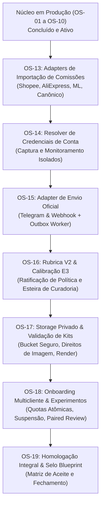

# Plano de Entregas — Finalização do Blueprint BizuMiner V2

Data: 17/10/2026  
Status: **PLANEJADO E PRONTO PARA EXECUÇÃO**  
Skill: `arquiteto-de-contratos`  
Referência do Baseline: Git commit `43700c59f4e24f68f3a2e32c20ee5147fa4816cd` + alterações locais auditadas e testadas (379 web tests, 36 persistence, 127 capture, 16 extension, 29 editorial integration, Next.js build OK).  
Núcleo em produção: Deploy Vercel `dpl_EwDxnLU8t7BLFrNFVjsnxbWQVuhp`, Supabase `spbuwcwmxlycchuwhfir` com Rollouts A/B/C instalados e monitoramento AliExpress ativo.

---

## 1. Diagnóstico e Objetivo

O agente anterior concluiu com sucesso a implantação física do núcleo (Rollouts de banco A/B/C, isolamento RLS, deploy Vercel e retomada do monitoramento). No entanto, paralisou a conclusão do Blueprint ao transformar pendências técnicas em um **ciclo artificial de impedimentos burocráticos** (exigindo de 30 a 50 avaliações humanas presenciais, relatórios comerciais assinados de redes de afiliados, contratos formais de clientes SaaS e canais pagos externos para permitir que o código fosse escrito).

Como o BizuMiner opera atualmente para a operação própria do proprietário, o objetivo deste plano é **destravar a implementação técnica** através de contratos e ordens de serviço executáveis (`OS-13` a `OS-19`). Cada ordem possui escopos de escrita e leitura fechados, aceites verificáveis (Gherkin), dados sintéticos/fixtures para teste e comandos reais de conferência, separando a capacidade técnica do software das decisões comerciais de lançamento.

---

## 2. Invariantes e Comportamentos a Preservar

1. **Catálogo e Links Existentes:** `/`, `/bizu/[slug]`, `/p/[code]`, `/go/[slug]` devem permanecer íntegros com tempo de resposta baixo e preservação de slugs e tracking.
2. **Segurança e RLS:** Manter fail-closed para acessos sem contexto de conta. Nenhuma concessão de `service_role` ou privilégios de plataforma para contas comuns.
3. **Isolamento de Credenciais:** Nenhuma herança de credenciais da conta da casa (`local`) para contas adicionais. Falha fechada se a conta não tiver credenciais próprias configuradas.
4. **Ledger Append-Only:** Imutabilidade de fatos financeiros e eventos de conversão. Invariância a reordenação em previews e commits.
5. **Autonomia sem Regressão:** Todas as suítes de testes existentes devem continuar passando com zero falhas.

---

## 3. Roteiro Sequencial de Execução

---

## 4. Matriz das Ordens de Serviço (OS-13 a OS-19)

| ID | Ordem | Foco / Entregável | Arquivos Principais | Comando de Verificação |
|---|---|---|---|---|
| **OS-13** | [Parser de Comissões](ordens/13-parser-comissao.md) | Adapters para relatórios Shopee, AliExpress, ML e Canônico; detecção automática de headers; preview e commit resilientes. | `commission-import-adapters.ts`, `commission-import-contract.ts`, UI financeiro | `node --test packages/web/test/commission-import-adapters.test.mjs` |
| **OS-14** | [Resolver de Credenciais](ordens/14-resolver-credenciais.md) | Resolver multicliente com descriptografia AES-256-GCM, isolamento estrito sem fallback e bloqueio de suspensas. | `account-credential-resolver.ts`, `capture-dispatch.ts`, `monitor-prices.ts` | `node --test packages/web/test/account-credential-resolver.test.mjs` |
| **OS-15** | [Adapter de Envio Oficial](ordens/15-dispatch-canal-oficial.md) | Adapters Telegram Bot API e Webhook HMAC-SHA256, integração com outbox worker, kill switch e backoff de rate limit. | `distribution-channel-adapters.ts`, `dispatch-worker.ts`, `dispatch-contract.ts` | `node --test packages/web/test/distribution-channel-adapters.test.mjs` |
| **OS-16** | [Rubrica V2 & Calibração E3](ordens/16-rubrica-e-calibracao.md) | Curadoria humana independente de IA, ratificação formal de versão de política editorial e E3 atrelado a calibração auditada. | `rubric-db.ts`, `price-evidence.ts`, `actions.ts` curadoria | `node --test packages/web/test/rubric-policy-ratification.test.mjs` |
| **OS-17** | [Storage Privado & Kits](ordens/17-storage-e-artefatos.md) | Driver de storage isolado com magic numbers, verificação de direitos de asset e renderizador de kits promocionais. | `marketing-storage-core.ts`, `kit-validator.ts`, rotas de upload/download | `node --test packages/web/test/storage-and-kit-rendering.test.mjs` |
| **OS-18** | [Onboarding, Quotas & Experimentos](ordens/18-onboarding-e-experimentos.md) | Transação atômica de onboarding, dedução/reserva de quotas, corte imediato pós-suspensão e testes pareados. | `saas-onboarding-db.ts`, `saas-entitlement-db.ts`, `experiment-db.ts` | `node --test packages/web/test/onboarding-quota-experiment.test.mjs` |
| **OS-19** | [Homologação Integral](ordens/19-homologacao-e-conclusao.md) | Verificação cruzada dos 13 épicos, matriz de testes completa, build e atualização dos documentos de rastreabilidade. | `STATUS-EXECUCAO.md`, `08-RASTREABILIDADE.md`, `CAPACIDADES-PENDENTES.md` | Execução integrada de todos os scripts de teste |

---

## 5. Protocolo de Transição para Execução

1. O executor (`antigravity-executor` ou `executor-blindado`) deve processar as ordens de **forma estritamente sequencial** (OS-13 -> OS-14 -> OS-15 -> OS-16 -> OS-17 -> OS-18 -> OS-19).
2. Não alterar arquivos fora do `escopo_escrita` da respectiva OS.
3. Se um teste ou comando de verificação falhar, analisar o erro técnico e corrigir o código da OS atual antes de prosseguir; não pular etapas.
4. Cada OS concluída gera seu registro correspondente em `contratos-finalizacao/resultados/` evidenciando comandos executados e saídas observadas.
