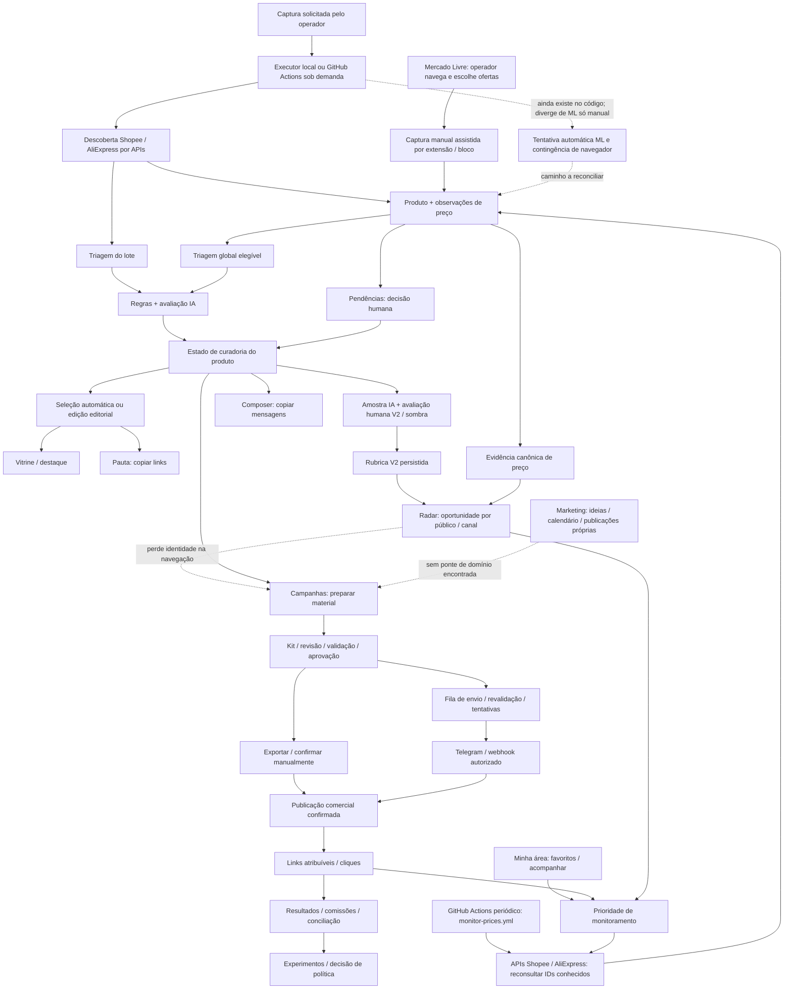
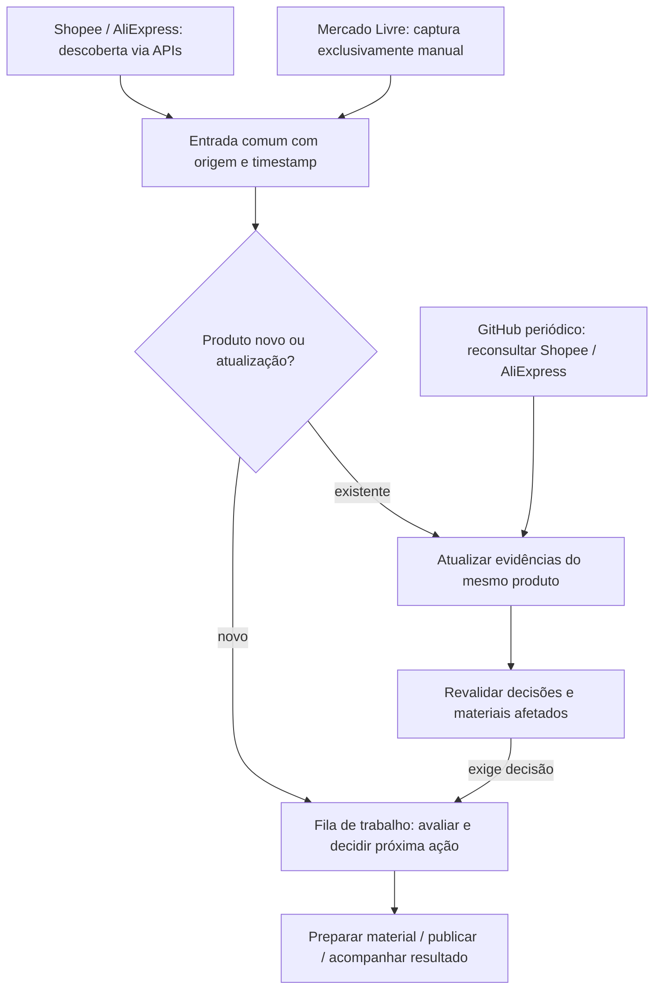

# Mapa funcional e de ligações — estado observado

Baseline e limitações: [DIAGNOSTICO.md](DIAGNOSTICO.md). Este mapa descreve o código do working tree em 2026-10-18. Linha contínua representa ligação encontrada; linha pontilhada indica passagem incompleta ou fluxo paralelo. Não representa verificação remota de disponibilidade.

O Radar do diagrama é um módulo existente, mas seu acesso por `aba=radar` está quebrado (BUG-014). A ligação Rubrica→Radar exige criação/atualização explícita da oportunidade; não é uma promoção automática após toda aprovação. Nem toda entrada avulsa dispara a triagem do lote.

## 0. Entradas e atualização — esclarecimento do usuário

O GitHub é **executor/agendador da coleta**, enquanto Shopee e AliExpress são as fontes. Deve aparecer explicitamente antes da entrada/atualização dos dados. O usuário definiu que **Mercado Livre terá captura exclusivamente manual**; isso é direção de produto, ainda não refletida integralmente no coletor existente.

| Caminho | Gatilho encontrado | Efeito no fluxo |
|---|---|---|
| Shopee/AliExpress: monitoramento periódico | `monitor-prices.yml`, cron `7 3,9,15,21 * * *`, matriz das duas lojas, condicionado a `MONITORING_ENABLED` e políticas/gates | Reconsulta produtos já conhecidos por ID e registra observações. Atualiza itens existentes; o script não dispara triagem automaticamente. |
| Shopee/AliExpress: descoberta em lote | `capture-offers.yml`, `workflow_dispatch` com ID do lote; em desenvolvimento pode executar localmente | Captura ofertas e executa triagem restrita ao lote. Esse workflow não possui cron no arquivo examinado. |
| Mercado Livre: entrada manual | Operador navega, escolhe e captura ofertas com extensão ou bloco manual | Entrada ou atualização no mesmo catálogo. Na direção definida, não deve depender de tentativa automática anterior. |

Fontes: [monitor-prices.yml](../../../../.github/workflows/monitor-prices.yml), [script de reconsulta](../../../../packages/persistence/bin/monitor-prices.ts), [capture-offers.yml](../../../../.github/workflows/capture-offers.yml), [captura manual](../../../../packages/web/lib/manual-capture.ts) e [extensão](../../../../packages/web/lib/extension-db.ts). O usuário informa que a coleta periódica está em uso; a inspeção local confirma sua definição, sem verificar o histórico remoto de execuções.

**Direção funcional atualizada, ainda não implementada como fila única:**

Captura manual não obriga avaliação inteiramente manual: após a entrada, o produto do ML pode seguir os critérios comuns e a assistência de IA autorizada. A definição trata da interação com a fonte. Atualizar evidências do ML também requer recaptura humana quando necessário; o cron examinado já exclui ML.

**Desalinhamento registrado, sem correção nesta investigação:** [capture-batch-worker.ts](../../../../packages/web/lib/capture-batch-worker.ts) ainda tenta captura automática de ML antes da contingência de navegador quando há verificação de acesso; [run-capture-batch.ts](../../../../packages/web/bin/run-capture-batch.ts) ainda mapeia ML para `bin/sweep.ts`. Isso não implementa “ML somente manual”. O bloqueio pelo site foi informado pelo usuário; não foram feitas requisições ao ML para reproduzir ou contornar o bloqueio.

## 1. Áreas expostas ao operador

| Área | O que realmente oferece | Entrada/saída principal | Continuidade observada |
|---|---|---|---|
| Hoje (`/admin`) | Resumo, atalhos, captura, contagens | Resumos de catálogo/seleção/execuções → Curadoria ou Pauta | Não é uma fila própria. “Resolver pendências” abre Curadoria/exceções. |
| Curadoria/Seleção | Produtos selecionados; iniciar triagem global; edição opcional | Catálogo aprovado → seleção compartilhada | Botão de IA opera outro conjunto, não os cards da seleção mostrada. |
| Curadoria/Pendências | Aprovar, rejeitar, reter, adiar, retomar, desfazer | `product_curation` + `curation_event` | Aguardando, retidos e adiados são filtros de estados; agrupamento é outra apresentação. |
| Curadoria/Qualidade da IA | Conferir aprovações da IA; corrigir/aprender; rubrica V2 e comparação em sombra | Amostra de eventos recentes → revisões/avaliações | Não é a fila geral de avaliação de todos os produtos. |
| Critérios e automação | Diretriz editorial, exemplos, configuração da aprovação automática | `editorial_guideline` + exemplos de decisões | Afeta triagem; não equivale à política de público/canal nem à ratificação V2. |
| Radar | Oportunidades com público/canal, estado, evidência, monitoramento | `opportunity` + política de audiência | Rota quebrada; formulário manual pede IDs de produto e versão da política. |
| Publicar/Pauta | Seleção, QR de acesso, copiar link e marcar cópia local | `/api/pauta` → clipboard/localStorage | Não cria nem confirma publicação comercial. |
| Criador de posts | Buscar catálogo público e copiar texto para WhatsApp/Telegram | `/api/deals` → mensagem | Seleção local independente da Pauta; não cria kit comercial. |
| Campanhas | Campanha, material, revisão, validação, aprovação, exportação, confirmação | `commercial-workflow` → kit/publicação/link | Recebe produto do Radar, mas perde oportunidade (BUG-016). |
| Marketing | Ideias, textos, quadros, calendário e registro manual de publicação | JSON privado de workspace | Não foi encontrada ligação de IDs com produto/oportunidade/kit/campanha. |
| Resultados | Métricas, conversões, comissões, importação, custos, receita SaaS | Ledger + cliques/publicações comerciais | Não consome o calendário JSON de Marketing nem a marcação local de cópia da Pauta. |
| Operação | Capturas/histórico, monitoramento, controles de envio | Lotes/runs/jobs e policies | Necessário para suporte, mas expõe comandos de infraestrutura ao lado da rotina. |
| Experimentos | Coortes, pares, métricas, revisão, promoção/rollback | `policy_experiment` e avaliações | É governança de políticas; não uma fila alternativa de produtos para publicar. |
| Primeiros passos / Plataforma | Conta, convite, credenciais, plano, checks, exportação/suspensão | Memberships, entitlements, onboarding | Fronteira transversal; navegação identifica onboarding como Hoje. |
| Governança | Decisões e ratificações explícitas | `governance_decision` e políticas | Outra área transversal; navegação identifica como Hoje. |

Fontes: [shell](../../../../packages/web/app/_components/admin-shell.tsx), [layout](../../../../packages/web/app/admin/layout.tsx), [Hoje](../../../../packages/web/app/admin/today-command-center.tsx), [Curadoria](../../../../packages/web/app/admin/curadoria/page.tsx), [Pauta](../../../../packages/web/app/pauta/pauta-client.tsx), [Composer](../../../../packages/web/app/admin/composer.tsx), [Campanhas](../../../../packages/web/app/admin/campanhas/workspace.tsx), [Marketing](../../../../packages/web/app/admin/marketing/workspace.tsx).

## 2. Quais são as “filas”

| Conjunto | Unidade / elegibilidade | Ordenação atual / limites | Resultado |
|---|---|---|---|
| Pendências humanas | Produto da conta, recente (7 dias), status pending/legacy_visible; retidos e adiados em filtros próprios | pending primeiro; `last_seen_at DESC`, `queued_at ASC`, `id ASC`; tela pede 20 | Decisão de catálogo e evento |
| Triagem IA global | pending ainda não triado ou retenção automática de preço novamente elegível; exclui adiado/fato velho | elegibilidade de valor primeiro; `queued_at ASC`, `id ASC`; botão até 100 | Mesmo estado de catálogo, com política/racional de automação |
| Triagem IA de lote | Critérios do mesmo loader, restringindo observações ao `operationBatchId` | Mesma lógica de elegibilidade/ordenação | Mesma pipeline, escopo diferente; não é outro avaliador por loja |
| Seleção automática | Aprovados recentes que passam na política de destaque | Ranking de hero; seleção até 24, hero até 3 | Home e Pauta |
| Edição editorial | Candidatos aprovados + avaliação editorial válida | Ordem explícita da edição, destinos e validade | Substitui seleção automática; edição vencida/retirada não ressuscita bootstrap |
| Qualidade da IA | Aprovados recentes cujo último evento é aprovação por LLM | Evento mais recente primeiro; amostra padrão 12 | Auditoria/aprendizado e rubrica humana/sombra |
| Radar | Oportunidade já registrada por produto, política, público e canal | `updated_at DESC`; padrão 50, máximo 200 | Monitorar, arquivar, reativar, preparar material |
| Campanhas | Campanhas/kit/publicações; catálogo aprovado recente para escolher produto | Criados recentemente primeiro; produtos por `last_seen_at DESC`; consultas até 100 | Material e publicação comercial |
| Marketing | Conteúdo/ideia, não necessariamente produto | Estágio, ordem de cards, dia planejado/publicado | Calendário próprio |
| Monitoramento técnico | Produto conhecido + interesse + política + oportunidade + orçamento | Prioridade, cadência e recuo após erro/ausência | Nova observação de preço |
| Dispatch técnico | Publicação e revisão autorizadas, destino, horário, quota/cooldown | Elegibilidade temporal, lease e retry | Envio/erro/incerteza com reconciliação |

Não se deve somar esses contadores como se fossem itens exclusivos: um produto pode ser aprovado, estar na seleção, possuir duas oportunidades e ter uma publicação pendente. Isso não demonstra duplicação indevida no catálogo.

Fontes: [curation-db](../../../../packages/web/lib/curation-db.ts), [triage-candidates-db](../../../../packages/web/lib/triage-candidates-db.ts), [editorial-selection-db](../../../../packages/web/lib/editorial-selection-db.ts), [editorial-compass](../../../../packages/web/lib/editorial-compass.ts), [opportunity-db](../../../../packages/web/lib/opportunity-db.ts), [commercial-workflow](../../../../packages/web/lib/commercial-workflow.ts), [monitoring-candidates](../../../../packages/persistence/src/monitoring-candidates.ts), [dispatch-db](../../../../packages/web/lib/dispatch-db.ts).

## 3. Por que há formas diferentes de avaliar

| Avaliação | Pergunta / critério | Registro / consumidor |
|---|---|---|
| Triagem determinística + IA | Valor mínimo com exceção por histórico, filtros de risco/qualidade, saturação de família, nota de desejabilidade 1–5 e política de aprovação | `product_curation`, `curation_event`, `triage_run`; catálogo e pendências |
| Revisão humana do catálogo | Aprovar/rejeitar/reter com motivo; adiar e desfazer | Mesmos estado/eventos; não produz automaticamente todas as avaliações posteriores |
| Avaliação editorial da seleção | Público, utilidade, valor, confiança, clareza, benefício, conteúdo da compra, preço máximo e justificativa pública | `editorial_assessment` anterior a V2 + `editorial_selection_item`; hero/edição |
| Rubrica V2 humana/sombra | Qualidade, valor, adequação ao público, confiança, riscos e desconhecidos; comparação humano/IA | `editorial_assessment` schemaVersion 2, `analysis_assessment`, `comparison_review`; Radar/ratificação |
| Evidência de preço | Comparabilidade, cobertura e validade de observações; alegações E0–E3 permitidas | `price_observation`, política/calibração; oportunidade, público e validação do kit |
| Classificação da oportunidade | Rubrica + preço + público/canal + prioridade/cooldown | `opportunity`: candidate/monitored/prioritized/held/archived e classe comercial |
| Validação do kit | Fatos atuais, alegações, links, direitos dos materiais, revisão aprovada e validade | `kit_validation`, `kit_approval`; exportação/envio |

Há diferenças legítimas de responsabilidade. O problema demonstrado é a apresentação fragmentada e a falta de continuidade entre avaliações. Em particular, a avaliação editorial antiga e a rubrica V2 têm estruturas e consumidores distintos; a primeira é explicitamente excluída da consulta de avaliação humana V2, e a segunda é excluída de `latestAssessments` da seleção.

Fontes: [pipeline](../../../../packages/web/lib/curation-pipeline.ts), [contrato IA](../../../../packages/web/lib/ai-curation-contract.ts), [seleção](../../../../packages/web/lib/editorial-selection.ts), [rubrica](../../../../packages/web/lib/rubric-db.ts), [ações de oportunidade](../../../../packages/web/app/admin/direcionamento/opportunity-actions.ts), [validador de kit](../../../../packages/web/lib/kit-validator.ts).

## 4. Ligações entre dados e serviços

| Fronteira | Caminho encontrado | Identidade / efeito relevante |
|---|---|---|
| Captura por lote | UI → `/api/admin/rodagem/lote` → batch/credential resolver → executor local ou GitHub Actions → adapters → persistence | Conta + batch + capture_run; worker executa triagem restrita ao lote |
| Captura manual | Bookmarklet/bloco → `/api/admin/captura` → `persistManualCapture` | Produto/observação da conta; não confundir com lote completo |
| Extensão | Pairing → exchange → device token → `/api/extension/captures` ou capture-batches | Dispositivo/conta, request id e observação; contingência do navegador pode retomar lote |
| Ingestão | `pg-store` / caminhos manual/extensão → product + price_observation | Identidade de anúncio por conta/loja/external_id; `last_seen_at` se renova em recaptura |
| Estado inicial | Trigger `seed_product_curation` da cadeia de migrations | Inicializa curadoria; não significa produto aprovado nem publicação social confirmada |
| Decisões | Curadoria actions → `reviewProduct` / pipeline → eventos | Proteções de estado/observação invalidam aplicação de IA desatualizada |
| Seleção pública | `getPublishedEditorialSelection` → home, `/api/editorial-selection`, `/api/pauta` | Mesma seleção, com filtro de destino; validade e ranking próprios |
| Catálogo público | `db.ts` / `public-offer-db` → `/api/deals`, `/bizu/[slug]` | Projeção pública e estado aprovado; não expor julgamentos internos |
| Publicação assistida | Campanhas → commercial-workflow → commerce-db | campaign → opportunity → kit → revision → validation/approval → campaign_publication |
| Artefatos | upload/generate → private-artifact/kit-artifact → storage driver → rota autorizada de download | Conta/revisão, MIME, autorização e digest; não são o workspace JSON de Marketing |
| Envio integrado | dispatch actions/bin → dispatch-worker → dispatch-db → adapters | Jobs, reservas, tentativas, revisão e destino; sucesso/erro/incerteza separados |
| Saída pública | `/p/[code]` → campanha ou short-link; `/bizu/[slug]` → `/go/[slug]` → destino monetizado | Link de campanha mantém atribuição; clique pode escrever evento, portanto não foi acionado nesta investigação |
| Comprador | `/minha-area` e APIs de favoritos/acompanhar/perfil → member-db | Perfil pessoal; interesses agregados alimentam prioridade de monitoramento |
| Monitoramento | GitHub periódico → políticas → monitoring-candidates/schedule → APIs Shopee/AliExpress → observações | Reconsulta IDs conhecidos; sem ML; atualiza evidências e não dispara aprovação/triagem por si só |
| Resultado financeiro | campanha/publicação/clique + declaração/import CSV → ledger | Conversão, atribuição, comissão, receita SaaS e custo têm proveniência própria |
| Experimentos | políticas/pares/coortes → métricas → avaliação/decisão explícita | Não promove política automaticamente por simples clique observado |
| Conta/acesso | Supabase Auth → membership/account context → transação com contexto → RLS | Tenant e autor devem acompanhar toda a fila; ordenação não substitui isolamento |
| Onboarding/quotas | conta/convite/plano/progresso → entitlement/usage_event | Pré-condições comerciais, suspensão e limites de uso |
| Marketing | UI → GET/PUT `/api/admin/marketing` → objeto privado `workspace.json` | Isolado por proprietário/conta; revisão otimista. GET inicial pode criar workspace/bucket, por isso não foi tratado como leitura remota inofensiva |

## 5. Integrações externas e processos auxiliares

| Integração | Papel no código | Situação nesta investigação |
|---|---|---|
| Supabase Auth / Google OAuth | Sessão e entrada do usuário | Tela de login observada; login não realizado |
| PostgreSQL/Supabase | Catálogo, estados, eventos e transações | Código/migrations examinados; testes PGlite locais, sem atestar aplicação remota |
| Supabase Storage | Marketing e artefatos privados, conforme driver/configuração | Referências examinadas; nenhum upload ou provisionamento |
| Gemini | Triagem semântica e rubrica em sombra | Implementação/modelos configuráveis no código; nenhuma chamada paga |
| Mercado Livre | Direção definida: captura exclusivamente manual; código ainda contém coletor automático | Divergência explicitada na seção 0; nenhuma tentativa de coleta ou contorno de bloqueio |
| Shopee | API afiliada para descoberta/monitoramento e links | Sem chamada real |
| AliExpress | API afiliada para descoberta/monitoramento e links | Sem chamada real |
| GitHub Actions | Captura sob demanda e monitoramento periódico | Workflows locais lidos; nenhuma execução disparada |
| Telegram / webhook | Transporte de publicação por adapter autorizado | Código lido; nenhuma mensagem enviada |
| Vercel / runtime local | Hosting e escolha de executor | Dev local responde em 3100; deploy remoto não inspecionado |
| Navegador / dispositivo | Clipboard, QR, localStorage e extensão | Estados locais de cópia/favoritos não equivalem ao ledger comercial |

Workflows: `capture-offers.yml` recebe dispatch; `monitor-prices.yml` possui cron e gates. Binários também permitem triagem, reconciliação, dispatch, manutenção, sweeps e verificação. A existência desses arquivos não confirma que estejam agendados/ativos na conta remota. Código arquivado em `archive/site`, dependências e bundles de release não compõem o grafo da aplicação ativa.

## 6. Avaliação da proposta de fila única por timestamp

**Hipótese de produto recomendada para discussão:** uma bancada contínua com item identificável, estado atual, motivo, evidência, responsável pela próxima decisão e próxima ação. Uma linha por produto pode agrupar contextos de oportunidade/publicação; isso ainda precisa ser escolhido, porque o mesmo produto pode ter públicos e canais diferentes.

| Timestamp | O que representa hoje | Consequência de usá-lo para ordenar tudo |
|---|---|---|
| `first_seen_at` | Primeira entrada do anúncio | Histórico previsível; novas tarefas de produto antigo podem ficar escondidas |
| `queued_at` | `product_curation.created_at` na view | Serve à entrada inicial de curadoria; não representa necessariamente reabertura ou nova etapa |
| `observed_at` | Data da evidência de preço | Bom para frescor; recaptura pode mudar a posição sem criar trabalho novo |
| `last_seen_at` | Última aparição na captura | Renovado mesmo sem mudança de preço; não é “última decisão” |
| `updated_at` | Alteração de registro, conforme entidade | Pode ordenar manutenção/alteração de oportunidade; significado difere entre entidades |
| `deferred_until` / `scheduled_at` | Quando retomar ou executar | Determina disponibilidade da ação, não substitui ordem de chegada |
| `valid_until` | Prazo da evidência/seleção/material | Impede uso vencido; data recente na fila não torna evidência válida |
| Data de entrada na etapa/tarefa | Sem parâmetro único demonstrado para todo o fluxo | Candidata à ordenação operacional; derivação/armazenamento exigem contrato posterior |

Para decidir: ASC prioriza espera antiga; DESC prioriza novidade. Exemplo: A entrou ontem e foi recapturado agora; B entrou hoje e aguarda revisão. `last_seen_at DESC` coloca A à frente, embora a recaptura não seja nova tarefa. Se o objetivo é esvaziar pendências, data de entrada da pendência é uma hipótese mais adequada; se é descobrir novidades, a data de observação responde a outra pergunta.

Requisitos a preservar numa eventual unificação: desempate por identidade estável; timestamp não é chave única; escopo por conta; recapturas preservam histórico; adiar/retomar não apaga decisão; mudanças de evidência invalidam avaliações quando exigido; múltiplos públicos/canais permanecem distinguíveis; copiar/exportar/publicar têm estados honestos. Uma fila visível única não exige uma tabela única nem a fusão das filas técnicas de captura/envio.

## 7. Inventário completo das referências localizadas

[inventario.json](evidencias/inventario.json) contém os 318 arquivos com hash, funções exportadas, imports locais resolvidos, referências literais de rota, objetos SQL e hosts literais. A extração é reproduzível por [inventario.cjs](evidencias/inventario.cjs). Não lê `.env`, credenciais, dados remotos nem valores de configuração.

Limites da extração: imports dinâmicos, URLs montadas em partes, SQL dinâmico e resolução de aliases podem requerer leitura manual; hosts/objetos SQL são referências lexicais e podem incluir comentários. A lista abaixo inventaria todos os arquivos de página/handler encontrados, sem declarar todos os métodos como validados.

| Rota | Página ou métodos exportados | Fonte |
|---|---|---|
| `/admin/campanhas` | Página | [page.tsx](../../../../packages/web/app/admin/campanhas/page.tsx) |
| `/admin/curadoria` | Página | [page.tsx](../../../../packages/web/app/admin/curadoria/page.tsx) |
| `/admin/direcionamento` | Página | [page.tsx](../../../../packages/web/app/admin/direcionamento/page.tsx) |
| `/admin/experimentos` | Página | [page.tsx](../../../../packages/web/app/admin/experimentos/page.tsx) |
| `/admin/financeiro` | Página | [page.tsx](../../../../packages/web/app/admin/financeiro/page.tsx) |
| `/admin/governanca` | Página | [page.tsx](../../../../packages/web/app/admin/governanca/page.tsx) |
| `/admin/marketing` | Página | [page.tsx](../../../../packages/web/app/admin/marketing/page.tsx) |
| `/admin/onboarding` | Página | [page.tsx](../../../../packages/web/app/admin/onboarding/page.tsx) |
| `/admin` | Página | [page.tsx](../../../../packages/web/app/admin/page.tsx) |
| `/api/admin/affiliates/config` | POST | [route.ts](../../../../packages/web/app/api/admin/affiliates/config/route.ts) |
| `/api/admin/affiliates` | GET | [route.ts](../../../../packages/web/app/api/admin/affiliates/route.ts) |
| `/api/admin/artifacts/[id]` | GET | [route.ts](../../../../packages/web/app/api/admin/artifacts/[id]/route.ts) |
| `/api/admin/artifacts/upload` | POST | [route.ts](../../../../packages/web/app/api/admin/artifacts/upload/route.ts) |
| `/api/admin/captura` | POST | [route.ts](../../../../packages/web/app/api/admin/captura/route.ts) |
| `/api/admin/extension/devices` | GET, POST | [route.ts](../../../../packages/web/app/api/admin/extension/devices/route.ts) |
| `/api/admin/marketing` | GET, PUT | [route.ts](../../../../packages/web/app/api/admin/marketing/route.ts) |
| `/api/admin/monitoring/dispatch` | POST | [route.ts](../../../../packages/web/app/api/admin/monitoring/dispatch/route.ts) |
| `/api/admin/monitoring/policy` | GET, POST | [route.ts](../../../../packages/web/app/api/admin/monitoring/policy/route.ts) |
| `/api/admin/rodagem/[marketplace]` | POST | [route.ts](../../../../packages/web/app/api/admin/rodagem/[marketplace]/route.ts) |
| `/api/admin/rodagem/lote` | GET, POST | [route.ts](../../../../packages/web/app/api/admin/rodagem/lote/route.ts) |
| `/api/admin/rodagem/navegador` | POST | [route.ts](../../../../packages/web/app/api/admin/rodagem/navegador/route.ts) |
| `/api/admin/rodagem` | POST | [route.ts](../../../../packages/web/app/api/admin/rodagem/route.ts) |
| `/api/admin/rodagens` | GET | [route.ts](../../../../packages/web/app/api/admin/rodagens/route.ts) |
| `/api/capture` | OPTIONS, POST | [route.ts](../../../../packages/web/app/api/capture/route.ts) |
| `/api/deals` | GET | [route.ts](../../../../packages/web/app/api/deals/route.ts) |
| `/api/editorial-selection` | GET | [route.ts](../../../../packages/web/app/api/editorial-selection/route.ts) |
| `/api/extension/capture-batches` | OPTIONS, GET, POST | [route.ts](../../../../packages/web/app/api/extension/capture-batches/route.ts) |
| `/api/extension/captures` | OPTIONS, POST | [route.ts](../../../../packages/web/app/api/extension/captures/route.ts) |
| `/api/extension/pair/exchange` | OPTIONS, POST | [route.ts](../../../../packages/web/app/api/extension/pair/exchange/route.ts) |
| `/api/extension/pairing-codes` | POST | [route.ts](../../../../packages/web/app/api/extension/pairing-codes/route.ts) |
| `/api/minha/acompanhar` | POST, DELETE | [route.ts](../../../../packages/web/app/api/minha/acompanhar/route.ts) |
| `/api/minha/favoritos` | POST, PUT | [route.ts](../../../../packages/web/app/api/minha/favoritos/route.ts) |
| `/api/minha/perfil` | GET, POST | [route.ts](../../../../packages/web/app/api/minha/perfil/route.ts) |
| `/api/newsletter` | POST | [route.ts](../../../../packages/web/app/api/newsletter/route.ts) |
| `/api/pauta` | GET | [route.ts](../../../../packages/web/app/api/pauta/route.ts) |
| `/api/story/[slug]` | GET | [route.tsx](../../../../packages/web/app/api/story/[slug]/route.tsx) |
| `/auth/callback` | GET | [route.ts](../../../../packages/web/app/auth/callback/route.ts) |
| `/auth/sair` | POST | [route.ts](../../../../packages/web/app/auth/sair/route.ts) |
| `/bizu/[slug]` | Página | [page.tsx](../../../../packages/web/app/bizu/[slug]/page.tsx) |
| `/convite` | Página | [page.tsx](../../../../packages/web/app/convite/page.tsx) |
| `/entrar` | Página | [page.tsx](../../../../packages/web/app/entrar/page.tsx) |
| `/go/[slug]` | GET | [route.ts](../../../../packages/web/app/go/[slug]/route.ts) |
| `/minha-area` | Página | [page.tsx](../../../../packages/web/app/minha-area/page.tsx) |
| `/p/[code]` | GET | [route.ts](../../../../packages/web/app/p/[code]/route.ts) |
| `/` | Página | [page.tsx](../../../../packages/web/app/page.tsx) |
| `/pauta` | Página | [page.tsx](../../../../packages/web/app/pauta/page.tsx) |
| `/plataforma` | Página | [page.tsx](../../../../packages/web/app/plataforma/page.tsx) |
