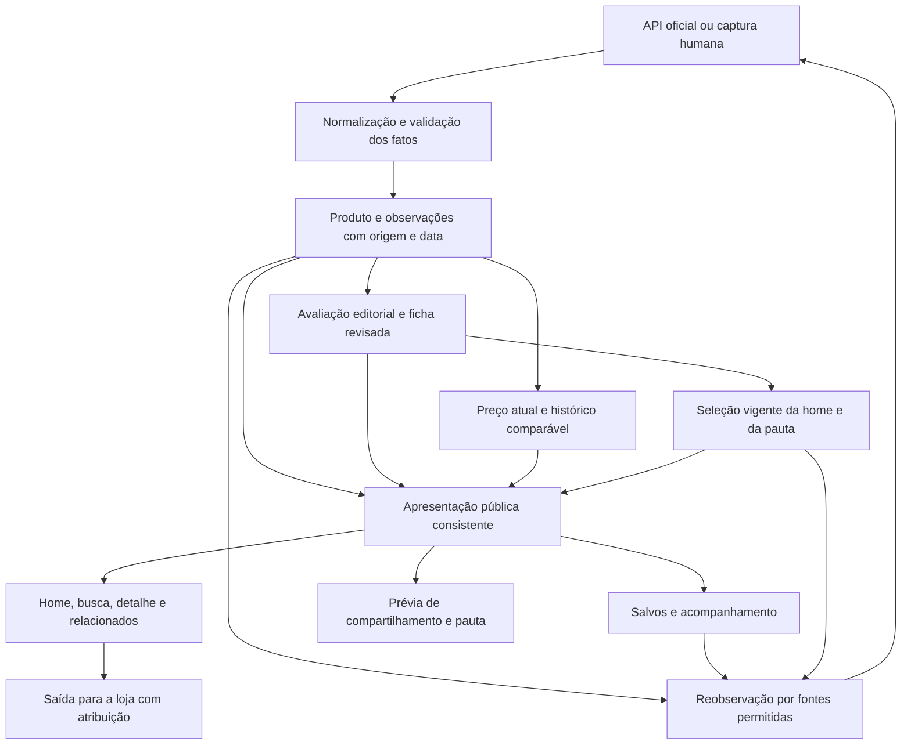

# Plano de implementação da experiência do comprador

**Plano vigente em 28/10/2026. Estado: implementação integrada; migrations e aplicação web publicadas em produção. Conteúdo editorial real depende de revisão e publicação na curadoria.**

O comprador deve encontrar produtos relevantes rapidamente, entender o motivo da indicação, saber a qual configuração o preço se refere e continuar sua pesquisa sem perder contexto. O plano acompanha os dados desde a captura até a saída para a loja e o retorno ao BizuMiner. Abrange `capture`, `persistence`, `extension` e `web`, incluindo administração e distribuição quando alimentam essa experiência.

Esta revisão amplia o antigo escopo restrito ao frontend. O [registro histórico](#registro-histórico-do-plano-anterior) permanece abaixo para consulta; seus estados e limitações descrevem as respectivas datas. Reutilizar a [integração de captura, curadoria, vitrine e pauta](./plano-integracao-captura-curadoria-vitrine-pauta.md), a [classificação dos destaques](./classificacao-hero.md) e o [acompanhamento de preços](./plano-acompanhamento-precos.md). Os resultados locais abaixo não comprovam publicação em produção.

## Implementação local de 28/10/2026

O usuário autorizou implementação e delegação. O trabalho existente da edição da home foi integrado, preservando alterações locais anteriores. A divisão entre captura/persistência, apresentação editorial e jornada do comprador permitiu conferir as fronteiras entre os módulos.

| Fluxo | Comportamento implementado |
|---|---|
| Fonte → ingestão → nova observação | Normalização conservadora do título de origem; produtores transportam evidência v2 e os fatos disponíveis. Mudança material no mesmo preço atravessa a amostragem de 20 horas. Repetir uma captura idempotente não reverte dados de uma captura posterior. |
| Curadoria → apresentação → recaptura | A ficha reutiliza revisões de `editorial_assessment`, com rascunho, publicação e retirada. Título, benefício, público, conteúdo e ressalva não dependem da participação na edição da home. Mudança material invalida a revisão; preço ou redação de origem, isoladamente, não apagam uma explicação duradoura válida. |
| Projeção pública → consumidores | Catálogo, destaques, edição persistida e detalhe projetam preço e apresentação no mesmo comando SQL. Caminhos legados usam uma transação de leitura consistente. Busca considera título editorial e original. Salvos, pauta, compositor e imagens de compartilhamento recebem a apresentação validada; o compositor revalida os itens selecionados antes de gerar conteúdo. |
| Preço → comparação → gráfico | Preço exato, faixa, valor inicial e moeda desconhecida são distintos. Preço riscado exige referência declarada pela fonte. Série, mínimo e máximo usam a mesma configuração, moeda e janela. Zero, um, vários preços iguais, variação e falha de leitura têm estados próprios. |
| Home → busca/filtro → detalhe → retorno | Capa com um destaque editorial apto, chamada curta e foto aprovada; sem destaque apto, mantém uma composição institucional. Busca junto aos filtros. Benefícios e atualização dos cards permanecem visíveis no celular. O link de retorno recupera consulta, categoria, lista carregada, posição e foco. Login mantém o produto de origem. |
| Salvar → conta → acompanhar | Cache de sessão separado por identidade; união dos salvos anônimos é explícita. Salvar e acompanhar têm ações distintas. A referência de acompanhamento preserva moeda, configuração e data; repetir o acompanhamento ativo não a reinicia. O resumo conta quedas comparáveis, sem somar moedas diferentes. |

### Regras para operação e implantação

- Aplicar a cadeia de migrations antes de publicar os consumidores novos. As três migrations desta implementação são `20261028041629_durable_product_presentation.sql`, `20261028041849_watch_comparable_baseline.sql` e `20261028042010_public_price_history_context.sql`. Dependem da base anterior, incluindo `20261027030237_compose_homepage_editions.sql`, que já estava em trabalho local. Conferir o histórico do ambiente de destino antes de decidir quais ainda precisam ser aplicadas.
- Títulos e argumentos editoriais reais precisam ser revisados e publicados na curadoria. Sem revisão válida, permanece o nome da fonte; nenhum texto sintético do ensaio foi inserido no catálogo real.
- Registros antigos sem moeda, variante ou condições suficientes continuam identificados como insuficientes. Não houve preenchimento especulativo do histórico nem das referências antigas de acompanhamento.
- Mudanças de moeda/configuração e observações vencidas não produzem queda de preço comparável. Um produto retirado permanece reconhecível nos salvos, sem oferecer uma saída de compra ativa.
- Acompanhar permite consultar mudanças na área da conta. Não foi ativado envio de e-mail; a newsletter não promete um serviço de entrega não verificado.
- As três migrations foram aplicadas em 28/10/2026 no projeto `spbuwcwmxlycchuwhfir`, e o build `dpl_4H4VShWrSsmg6UiXCr3yKuxKtHKL` foi promovido para `www.bizuminer.com.br`. O [mapeamento das versões remotas](./aplicar-migrations-supabase.md#experiência-do-comprador--produção-em-28102026) evita reaplicação por divergência de timestamps. Não houve publicação editorial real nem preenchimento especulativo dos dados antigos.
- A simulação de ativação da edição persistida retornou zero produtos aptos; ela não foi inicializada. O catálogo continua pelo caminho de transição e a capa usa a composição institucional até existir destaque válido. O detalhe real consultado confirmou 21 registros sem moeda comprovada, exibindo o motivo de não haver série comparável.

### Evidência local e limites

- Web: **479 testes passaram**, incluindo preço/histórico, navegação, autenticação, cache por conta e formatos de acompanhamento. Build de produção e verificação de tipos passaram com banco e autenticação remotos desativados.
- Captura, extensão e persistência: testes e tipagem dos módulos alterados passaram; extensão também compilada. Integração SQL em PGlite: cinco cenários de captura, doze de apresentação editorial, quatorze de edição da home, nove de salvos/acompanhamento e a suíte de histórico com estados, comparabilidade e permissões passaram.
- Testes de intercalação determinística verificam que uma captura entre leitura e resposta não mistura preço antigo com moeda/apresentação nova. PGlite usa uma conexão; isso não substitui o ensaio de concorrência entre sessões em PostgreSQL nativo.
- Navegador com dados fictícios e SQL real isolado: desktop 1280×720 e celular 390×844; busca pelo título editorial, categoria Casa, carregamento de 24 para 28 itens, detalhe, salvar anônimo, entrada para acompanhar e retorno pelo link preservando lista, posição e foco. Gráfico constante, variável e oferta sem comparação foram inspecionados. Não houve transbordamento horizontal nos tamanhos conferidos.
- O login Google real, a continuidade em um segundo aparelho, a atribuição de uma compra real e a retenção de compradores não foram exercitados neste ensaio. O botão nativo Voltar do navegador integrado encontrou uma falha de conexão com o servidor local; não recebeu aceite visual. O link de retorno do aplicativo passou.
- A aparência foi conferida com imagens substitutas e conteúdo de demonstração. A revisão editorial e estética do catálogo real, a validação com compradores e a liberação no ambiente de destino continuam etapas próprias.

## Evidências que determinam o trabalho

Na inspeção pública anterior foram observados títulos extensos, repetição de apresentações antes do catálogo no desktop, ausência de contexto editorial nos produtos abertos e o caso de 20 registros em 47 dias sem gráfico ou extremos. No celular, o catálogo aparece cedo, mas os cards ocultam o resumo histórico e a atualização do preço. O retorno pelo link do detalhe perdeu o filtro Casa. A avaliação simulada de 7/10 é qualitativa e não mede retenção de consumidores reais.

A inspeção local de 28/10 identifica as seguintes dependências:

| Constatação no código | Consequência para a implementação |
|---|---|
| Shopee lê `productName`; AliExpress lê `product_title`; extensão lê texto do anúncio e um extrator limita a 250 caracteres | Corrigir o fluxo de títulos desde os produtores e seus limites, preservando o conteúdo recebido e distinguindo título original de apresentação |
| Ingestão atualiza `product.title` em novas capturas e grava `title_snapshot` nas observações | Uma edição humana não pode compartilhar o campo que a recaptura sobrescreve |
| Os mapeadores oficiais examinados produzem `OfferEvidence` v1, embora existam tipos v2 com moeda, configuração, condições e origem do preço de referência | Auditar os caminhos ativos e completar o transporte de fatos efetivamente disponíveis; não basta acrescentar campos na tela |
| A ingestão pode dispensar observação de mesmo preço dentro de 20 horas usando uma verificação de variante | Garantir que mudança material de evidência, mesmo sem mudança de preço, não desapareça nessa deduplicação |
| A projeção pública do detalhe filtra histórico por moeda e configuração; a contagem é mais ampla | Explicitar escopos e estados; a causa nos registros remotos do produto observado ainda precisa de confirmação autorizada |
| `getEditorialProductPresentation` procura o produto na seleção publicada | Desacoplar a ficha editorial da participação temporária nos destaques |
| `VitrineProduct` não transporta versão/kit, tipo do preço e toda a semântica editorial necessária | Evoluir a leitura pública, seus conversores e todos os consumidores |
| Há alterações locais em andamento para edição da home, diversidade, atualização e métricas | Integrar esse trabalho e verificar sua implantação; não criar um segundo mecanismo concorrente |

## Fluxo e responsabilidades

Fatos pertencem ao anúncio e à observação que os sustenta. A ficha editorial explica utilidade e limitações. A avaliação da oferta depende de preço e condições atuais. A edição da home escolhe quais produtos apresentar naquele momento. Remover um produto da edição não apaga sua ficha; mudar configuração ou condições pode invalidar a parte correspondente da recomendação.

Os nomes de campos abaixo descrevem a semântica desejada. Reutilizar os contratos existentes antes de acrescentar entidades ou versões. Não há exigência de criar novos serviços ou uma camada genérica de transformação.

| Informação | Origem e processamento | Persistência e atualização | Saída para o comprador |
|---|---|---|---|
| Título | Nome da API ou texto extraído; normalização de espaços, entidades e caracteres sem inventar atributos | Título de origem e snapshot preservados; título editorial revisado separado e vinculado às evidências | Título legível em card, detalhe, busca, salvos e compartilhamento; modelo e configuração indispensáveis mantidos |
| Público, benefício e ressalva | Evidências do produto e avaliação editorial; sugestão de IA, se usada, permanece proposta | Reaproveitar avaliações e autoria; separar conteúdo duradouro de afirmações dependentes do preço | Uma frase no card; explicação e ressalva no detalhe; ausência não vira uma recomendação fictícia |
| Versão e conteúdo da compra | Variante, quantidade, dimensões e conteúdo informados pela fonte ou confirmados com origem registrada | `OfferEvidence`, estados de conhecimento e identidade da configuração; alterações materiais invalidam dependências | Informar a qual opção o preço corresponde; fotografia não comprova acessórios inclusos |
| Preço e desconto | Valor, moeda e condições da fonte; distinguir exato, a partir de, faixa e desconhecido | Centavos, moeda, data da observação, condições e origem do preço de referência | Mesma semântica em card, detalhe, filtros e prévia; desconto da loja separado de queda observada |
| Histórico | Observações elegíveis pela política real de comparabilidade | Série e resumos calculados no mesmo escopo, com janela e motivo de insuficiência explícitos | Linha estável, ponto único, comparação válida, falta de comparabilidade ou erro têm apresentações distintas |
| Imagem | URL e contexto da fonte, com restrições conhecidas preservadas | Manter referência/snapshot e vínculo com produto/configuração | Imagem correta, proporção estável e alternativa legível; revisão quando a imagem muda materialmente |
| Nota e vendas | Métricas declaradas pela loja | Preservar escala, amostra, origem, data e ausência | Estrelas, percentual positivo e vendas continuam distintos; não viram nota própria do BizuMiner |
| Categoria, família e coleção | Categoria da fonte, classificação interna ou decisão editorial identificada | Manter método/origem; título publicitário não deve alterar silenciosamente a classificação | Busca, filtros, relacionados e diversidade com significados consistentes; coleções só aparecem quando têm itens elegíveis |
| Salvos e acompanhamento | Ação explícita do usuário, identidade do produto e configuração acompanhada | Estado por usuário/conta, referência inicial e revalidação das ofertas; cache local é auxiliar | Continuidade entre lista, detalhe, login e outro aparelho; preço antigo é identificado |
| Navegação e exposição | Busca, filtros, página, posição e ações na interface | URL para estado compartilhável; sessão para posição/lista carregada; eventos mínimos por edição | Voltar retoma a exploração; métricas diferenciam impressão, interesse, saída e compra confirmada |

## Ordem de implementação

| Entrega | Capacidade concluída | Dependências |
|---|---|---|
| 0 | Trabalho existente conciliado e casos reproduzíveis preparados | Nenhuma |
| 1 | Capturas preservam fatos e mudanças materiais | 0 |
| 2 | Histórico e preço explicam corretamente o que se sabe | 1; estado vazio e linguagem podem ser corrigidos antes do enriquecimento completo |
| 3 | Ficha editorial persiste além da seleção da home | 1 |
| 4 | Todos os consumidores recebem a mesma apresentação válida | 2 e 3 |
| 5 | Home, detalhe e exploração entregam clareza e continuidade | 4; preservação de navegação pode avançar desde 0 |
| 6 | Salvar e acompanhar geram continuidade útil | 4 e integração com 5 |
| 7 | Migração, publicação e jornada verificadas no ambiente de destino | Aceites das entregas anteriores e autorizações aplicáveis |

A prioridade funcional é resolver a confiança no preço, tornar a curadoria visível e facilitar a descoberta. Medição começa junto das entregas; a avaliação de retorno acompanha a operação posterior. Este encadeamento descreve as dependências da implementação autorizada.

### Entrega 0 Conciliar a base e preparar a verificação

Inspecionar o diff antes de cada alteração e preservar trabalho de autoria incerta. Conferir as mudanças em `homepage-policy.ts`, `homepage-db.ts`, edição persistida, refresh após captura/triagem, workflows e métricas. Identificar quais partes estão apenas locais, quais migrations foram efetivamente aplicadas e qual versão está publicada, usando acesso remoto somente quando autorizado.

Preparar fixtures do fone com registros não comparáveis, do transmissor com título extenso, de anúncio com versões/kit e de preço estável. Usar dados sintéticos identificados onde o registro remoto não estiver autorizado. Registrar baseline dos testes pertinentes, sem transformar falhas preexistentes em requisito de refatoração.

**Aceite:** produtor, persistência, função pública e tela responsáveis por cada caso estão localizados; nenhuma implementação em andamento foi substituída; as limitações da reprodução estão explícitas.

### Entrega 1 Preservar os fatos da captura à persistência

Percorrer descoberta e reobservação por API oficial, extensão, captura pelo navegador e entrada manual, conciliando os caminhos efetivamente ativos. Conferir extração, limites do payload, validação na rota, escrita transacional e releitura. Uma mudança no coletor só está concluída quando o fato chega à observação persistida.

1. Preservar título de origem e produzir uma normalização conservadora. Revisar truncamentos nos extratores e limites de entrada conjuntamente; um texto truncado na origem não pode ser reconstruído pelo frontend. Ajustar o limite de transporte de forma compatível com extensões instaladas e itens pendentes na outbox.
2. Reaproveitar `OfferEvidence` v2 para transportar moeda efetivamente validada, tipo do preço, variante, conteúdo, condições e origem do preço anterior. Campos ausentes continuam ausentes; `not_applicable` exige fundamento e não serve para desbloquear comparações.
3. Na AliExpress, transportar a moeda dos campos `target_*` já validados. Na Shopee, preservar mínimo/máximo e a natureza derivada do preço anterior calculado a partir do desconto declarado. Preço mínimo não confirma qual variante será recebida.
4. Usar o mesmo tratamento na descoberta e no monitoramento por ID. Esclarecimentos humanos têm autoria, evidência e escopo próprios; nova captura não os confirma nem os apaga silenciosamente.
5. Ajustar a deduplicação para guardar mudança de configuração, conteúdo, moeda, condições ou evidência mesmo quando o preço não mudou. Reenvio do mesmo request continua idempotente. Preservar uma política deliberada de amostragem de preços estáveis.
6. Garantir coerência entre produto atualizado e snapshot usado na decisão. Uma mudança material deve invalidar ficha/afirmações/edição dependentes, mesmo se a execução posterior de refresh falhar. A leitura pública mantém as verificações de validade.

**Pontos principais:** `capture/src/types.ts`, mapeadores de Shopee/AliExpress, extratores e contratos da extensão, `persistence/src/ingest.ts`, `store.ts`, `pg-store.ts`, `monitoring-lookup.ts`, rotas e serviços de captura da web e funções SQL utilizadas por esses serviços.

**Aceite:** fixture atravessa cada entrada ativa e chega ao banco isolado sem perder título, moeda, configuração ou origem; mesma captura não duplica observação; mesmo preço com evidência material diferente é preservado; outra conta não pode injetar ou ler esses dados.

### Entrega 2 Tornar preço e histórico utilizáveis

Evoluir `DealDetail` e a projeção pública para devolver série, resumo e estado coerentes. Reutilizar a política canônica de comparabilidade e seus testes de paridade entre TypeScript e SQL. Conferir tanto o caminho público restrito quanto qualquer leitura de compatibilidade ainda necessária.

O resultado deve distinguir total de registros do anúncio, registros comparáveis no período exibido, janela, datas, último registro elegível, extremos e razão de indisponibilidade. O resumo da série é calculado sobre os mesmos pontos que o gráfico. Uma alegação de recorde pode exigir critérios adicionais; esse critério não se confunde com simplesmente possuir uma série desenhável.

| Estado | Comportamento esperado |
|---|---|
| Série comparável com mudança | Datas reais no eixo, valores e resumo consistente; intervalos sem observação não sugerem monitoramento contínuo |
| Série comparável estável | Linha horizontal, mínimo igual ao máximo e texto de estabilidade |
| Um ponto elegível | Ponto/valor com data, sem tendência ou recorde inventados |
| Nenhum registro | Informação de que o acompanhamento ainda não começou |
| Registros sem configuração comparável | Explicação direta de por que não é possível comparar; não mostrar uma curva vazia com extremos em traços |
| Registros apenas fora da janela | Informar a janela sem dados e o último registro conhecido, sem confundir com falha |
| Falha técnica | Estado de erro recuperável; não converter exceção em falta de histórico |
| Preço antigo | Último preço e data explícitos; nenhuma afirmação de preço atual |

Usar preço exato, faixa ou “a partir de” de forma uniforme e identificar condições relevantes perto do valor. Definir a semântica dos filtros: faixa de preços usa o valor representativo declarado, identificado quando for mínimo; nunca garante o custo de uma versão ainda desconhecida. Condições desconhecidas de frete, tributos e cupom permanecem explícitas quando afetam a interpretação.

**Pontos principais:** `price-evidence.ts`, `offer-history.ts`, `deal-signal.ts`, `public-offer-db.ts`, `db.ts`, funções SQL de projeção e `app/bizu/[slug]/page.tsx`.

**Aceite:** o caso “20 registros e zero comparáveis” recebe explicação verdadeira; os estados acima são exercitados com SQL real isolado e interface; moeda, kit ou condições diferentes não produzem queda, alerta ou selo indevido. Os limites atuais de 48 horas e sete dias permanecem até decisão explícita de produto.

### Entrega 3 Dar persistência e manutenção à ficha editorial

Reaproveitar a avaliação editorial existente, acrescentando o necessário para uma revisão publicável por produto/conta e configuração quando aplicável. Sua leitura deixa de depender de encontrar o produto na edição ativa. A edição referencia a ficha/avaliação válida; não se torna proprietária do texto.

Manter separados título de origem, título editorial, público, benefício, conteúdo, ressalva pública e justificativa da oferta naquele preço. Dúvidas internas não são publicadas automaticamente. Avaliações e revisões conservam evidência, autor, data e estado de aprovação; preservar as garantias existentes de histórico e concorrência.

No admin, permitir comparar fonte e proposta, editar, pré-visualizar card/detalhe/compartilhamento e publicar uma revisão. Uma recaptura não sobrescreve uma revisão humana. Mudança material deixa a revisão pendente quando afeta suas afirmações; mudança apenas de preço reavalia o mérito da oferta sem apagar utilidade ainda válida. Correção tipográfica não deve, por si só, invalidar identidade ou histórico.

O título deve identificar produto, modelo e diferença indispensável sem copiar a sequência de palavras do marketplace. Não impor um corte cego que elimine compatibilidade, quantidade ou capacidade. O nome curto tem fallback conservador para o título de origem quando não houver revisão válida.

Sugestão automática, se incorporada, ocorre fora da requisição pública, usa evidências disponíveis e produz rascunho revisável. Não ampliar chamadas pagas ou ativar aprovação automática por este plano. Começar pelos itens mais expostos e manter o catálogo acessível com estados honestos durante o preenchimento.

**Exemplo de aceite:** revisar o transmissor para um título curto fiel, publicar, recapturar o mesmo produto com apenas mudança de redação no título original, retirar da home e abrir por URL direta. A revisão válida permanece; uma troca real de configuração provoca reavaliação e não herda silenciosamente a indicação anterior.

**Pontos principais:** `editorial-selection.ts`, `editorial-selection-db.ts`, serviços de curadoria, avaliação e revisão no admin, persistência editorial existente e `homepage-db.ts`.

### Entrega 4 Entregar uma apresentação consistente a todos os consumidores

Evoluir a projeção pública e o conversor em `deal-view.ts`, com um resolvedor comum da apresentação válida. Transportar apenas campos públicos aprovados: título de apresentação e sua origem, configuração/conteúdo, contexto editorial, preço com tipo e data, estado histórico e evidências da loja. Avaliações internas, dados de conta e credenciais permanecem fora dessa resposta.

Manter o título original usado por ingestão, evidência e classificação. Campos novos entram de forma aditiva; o significado do `title` público legado só muda com a migração de seus consumidores, sem alterar silenciosamente contratos internos. Busca deve encontrar termos do título de origem, modelo e título editorial válido; validar consultas e índices com o volume real quando houver acesso autorizado.

| Consumidor | Integração exigida |
|---|---|
| Home, catálogo filtrado e API de ofertas | Mesma apresentação e elegibilidade, sem depender de o item estar destacado |
| Detalhe e relacionados | Mesma versão do título, preço e configuração; relacionados respeitam atualidade e finalidade |
| Salvos e área do cliente | Revalidar dados no servidor; migrar cache antigo sem perder IDs; cache não é prova de preço atual |
| Metadata, imagem OG e cópia de link | Usar título/contexto aprovado e regras de preço; atualizar a chave de prévia quando a revisão mudar |
| Pauta e compositor | Reutilizar conteúdo aprovado e condições atuais; preparar divulgação não equivale a enviá-la |
| Edição materializada e outros caches | Invalidar/recompor a apresentação após revisão, preço ou configuração, sem ressuscitar itens retirados |
| Links `/go`, links curtos e campanhas | Preservar slug, destino autorizado, identidade e atribuição; título editorial nunca gera um novo produto |

Revisar todas as cópias de dados, inclusive a edição persistida e o localStorage. Uma cache antiga deve ser reconhecida e atualizada, não aceita como fonte superior ao servidor. Prever leitura compatível durante rollout sem esconder erro de banco por meio de fallback permissivo. Ler fichas em lote e manter as consultas públicas limitadas; não acrescentar uma consulta por card nem inferência de IA durante a navegação. Comparar latência e quantidade de consultas com a baseline antes de liberar.

**Aceite:** uma revisão aparece de forma coerente em home, busca filtrada, URL direta, relacionados, salvos, pauta e nova prévia de compartilhamento. Atualização de preço não mantém alegação vencida em cache. Prévias já armazenadas por redes externas têm limite de atualização conhecido; não prometer recolher mensagens já divulgadas.

### Entrega 5 Reorganizar descoberta e decisão

Preservar identidade, imagens, clareza dos botões e transparência de afiliados. Preparar a composição visual usando produtos representativos antes de consolidar os componentes. Resolver simultaneamente título curto, altura do card e contexto; não simplesmente adicionar mais parágrafos ao layout atual.

A capa apresenta um único produto: o primeiro apto na ordem dos candidatos a destaque da edição vigente. A revisão humana usa presentation.cover (chamada de 3–72 caracteres e aprovação explícita da foto), além de título editorial de até 90 caracteres, benefício de até 160 e preço exato, moeda e observação atual confirmados. Esses campos seguem a projeção pública e a invalidação da ficha; trocar foto ou configuração exige nova revisão. A aprovação visual avalia nitidez, ausência de texto promocional e fidelidade ao conteúdo da compra; o sistema não detecta alteração dos bytes mantendo a mesma URL. Sem candidato apto ou em falha de imagem, usar arte institucional; nunca preencher a capa com os primeiros itens do catálogo. A busca fica junto aos filtros, fora da capa. A prévia na curadoria não publica o produto e a seleção continua sendo uma etapa separada. Remover apresentações redundantes antes da variedade. Meta de aceite visual: em 1280×720 e 1440×900, o primeiro viewport apresenta mais de uma oferta identificável com preço e ação, sem reduzir legibilidade para fazê-las caber.

No mobile, manter catálogo cedo, reduzir o espaço do primeiro card e preservar benefício, data relevante e tipo do preço. Conferir 360, 390 e 768 pixels, teclado, leitor de tela, foco, contraste, zoom e CTA fixo sem encobrir conteúdo. A hierarquia pode mudar por dispositivo; a verdade da oferta deve permanecer.

No detalhe, organizar título, configuração, benefício, preço, ressalva e ações antes da explicação extensa. Mostrar o resumo de preço junto da decisão e permitir abrir histórico e critérios. Explicações como “Conferido há 2 horas” e “Ainda não conseguimos comparar esta versão” substituem termos operacionais. Preservar a indicação de afiliado junto da saída.

Reutilizar composição/diversidade/renovação já em desenvolvimento. Separar claramente seleção editorial e catálogo completo. Filtros e busca mostram resultados diretamente. Coleções como “Para organizar um espaço pequeno” ou “Achados até R$100” só aparecem com seleção real e critérios visíveis. Nova captura não transforma automaticamente um item antigo em novidade.

Implementar retorno com busca, filtros, ordenação, página, itens carregados e rolagem. Usar URL para os filtros e estado de sessão para posição/continuidade. Preservar o comportamento de voltar do navegador. Um retorno informado por parâmetro deve aceitar apenas rotas internas permitidas; acesso direto ao detalhe tem fallback para o catálogo.

**Aceite:** filtrar Casa, carregar mais itens, abrir produto e voltar mantém a exploração; busca pelo nome original e pelo editorial encontra o mesmo produto; estados vazio, erro, edição expirada e catálogo escasso continuam úteis; o usuário identifica a oferta sem precisar decifrar termos internos.

**Pontos principais:** `app/page.tsx`, `vitrine.tsx`, `globals.css`, `deal-query.ts`, detalhe, componentes de navegação, `homepage-policy.ts` e projeções de catálogo.

### Entrega 6 Integrar salvos e acompanhamento ao momento de interesse

Disponibilizar acompanhar preço no detalhe, reutilizando `price_watch` e a área do comprador. Salvar e acompanhar são ações diferentes. O fluxo explica onde consultar a mudança e solicita login no momento em que a persistência da conta o exigir, retornando ao mesmo produto e à intenção original.

Conferir a união de salvos anônimos com a conta, sincronização em outro aparelho, remoção, logout e troca de conta. Separar o cache por identidade quando necessário; produtos de uma conta não podem reaparecer como salvos de outra. Erro de sincronização não deve ser apresentado como sucesso definitivo.

Vincular referência inicial e preço alvo à configuração/condições acompanhadas. Uma nova observação só gera movimento se comparável e suficientemente recente. Mudança de variante pede nova confirmação; não reiniciar silenciosamente a referência nem divulgar uma queda fictícia. Produtos retirados ou antigos permanecem reconhecíveis nos salvos, com estado e ações adequados às regras de publicação.

Avisos por e-mail são uma extensão condicionada à existência e verificação do serviço de envio. Antes de exibir “me avise”, conferir consentimento, origem e periodicidade da observação, fila, deduplicação, entrega, falha, repetição segura e cancelamento. A newsletter precisa da mesma conferência de promessa e operação. Ausência de envio confirmado deve produzir comunicação compatível com a capacidade disponível. Publicação externa e ativação de envios exigem autorização aplicável ao destino.

**Aceite do núcleo:** salvar → autenticar quando necessário → acompanhar → receber nova observação comparável → consultar variação → parar de acompanhar funciona sem perda, duplicação ou acesso entre contas. Aviso externo só recebe aceite após teste de entrega autorizado.

### Entrega 7 Verificar a migração e liberar por capacidades

Evoluir o banco de forma aditiva e compatível com clientes existentes. Manter isolamento por tenant/conta, chaves compostas, RLS e projeções públicas restritas. Revisar permissões da função pública e índices dos caminhos alterados; não expor tabelas internas para simplificar uma leitura. Respeitar a cadeia real de migrations e seus requisitos de verificação existentes.

Para registros antigos, preencher apenas fatos recuperáveis de evidência confiável, em lotes limitados, retomáveis e com contagem de resultados. A configuração atual do anúncio não comprova a configuração de uma observação antiga. Não reconstruir moeda, quantidade ou versão por suposição para aumentar a quantidade de gráficos. Campos não recuperáveis mantêm estado desconhecido e podem entrar em fila de enriquecimento humano.

A sequência de ativação é: schema compatível → produtores e leituras compatíveis → migração dos dados recuperáveis e revisão da amostra → consumidores → ativação gradual da apresentação. A reversão desativa a apresentação nova e restaura apenas versões ainda válidas, preservando observações e revisões. Nenhum rollback reabilita ofertas retiradas, preços vencidos ou comparações indevidas. Não editar migrations históricas aplicadas.

Antes de aplicar mudanças remotas, confirmar ambiente, versão, destino e autorização; a consulta ao banco recusada na análise anterior continua pendente. Migrations versionadas e testes isolados não comprovam aplicação em produção. A autorização local já concedida não exige nova permissão por arquivo.

## Verificação da jornada completa

Reutilizar as suítes de captura, projeção pública, comparação, seleção, home, autenticação, salvos e prévias. Executar testes de lógica e integração pertinentes aos módulos alterados, tipagem e build web; complementar com navegador. Usar PostgreSQL isolado para regras SQL reais e o ensaio nativo existente quando concorrência ou privilégios dependerem dele. PGlite não comprova concorrência entre conexões nem pooler remoto.

| Cenário de aceitação | Resultado necessário |
|---|---|
| API ou extensão → ingestão → projeção → card | Campos mantêm valor, origem, ausência e significado |
| Título editorial → nova captura → busca → detalhe → compartilhamento | Revisão válida preservada; mesma identidade e conteúdo coerente |
| Evidência nova com mesmo preço dentro de 20 horas | Mudança material registrada e dependências reavaliadas |
| Remoção da home | Some da edição; ficha válida continua acessível onde a publicação permitir |
| Troca de kit, variante, moeda, pagamento ou cupom | Comparação e recomendação afetadas são invalidadas |
| Histórico vazio, único, estável, variável, fora da janela ou com falha | Estado correto, sem tendência fabricada ou gráfico enganoso |
| Edição/observação vencida ou refresh com falha | Nenhuma leitura pública mantém promessa indevida |
| Categoria → carregamento adicional → detalhe → retorno | Filtros, lista, foco e posição restaurados |
| Anônimo → login → segundo aparelho → logout/troca de conta | Salvos preservados para o dono, sem vazamento entre identidades |
| Acompanhar → nova observação → parar | Movimento só comparável; cancelamento respeitado |
| Card/detalhe → `/go` → destino controlado | Loja e contexto corretos, campanha e atribuição preservadas; compra não inferida do clique |
| Novo DTO com cliente/cache antigo e rollback | Compatibilidade e fallback honesto, sem perda de IDs ou aprovação humana |

Conferir qualitativamente com compradores reais a capacidade de encontrar algo útil, explicar a indicação, identificar versão/preço e retomar a pesquisa. A simulação de agente não substitui essa validação. A apreciação estética e editorial requer conferência humana; o relatório deve separar testes observados, avaliação humana e pendências reais.

## Medição e conclusão

Reutilizar a instrumentação da edição em andamento para impressões visíveis, detalhe, favorito e saída, excluindo automação/admin quando aplicável. Medir exposição antes de comparar taxas; mudanças de texto não devem inflar novidade ou impressões por duplicação de edição. Mensurar sucesso de busca e retomada sem registrar indiscriminadamente termos livres ou dados pessoais.

Avaliar tempo até uma oferta útil, compreensão de preço/configuração, uso de salvos/acompanhamento e retorno. A retenção em 7/30 dias exige identidade e janela apropriadas: eventos por visualização mantidos por sete dias não bastam para medir retorno de uma pessoa em 30 dias. Definir agregação e retenção mínima adequada antes dessa afirmação; não acrescentar rastreamento persistente oculto.

O núcleo está concluído quando a cadeia origem → persistência → apresentação → nova observação passa nos aceites, a interface foi conferida nos dois dispositivos e as limitações de produção estão resolvidas ou declaradas. Envio externo e resultados de retenção têm aceites próprios; não atrasam a correção do histórico e da curadoria, nem podem ser declarados entregues por associação.

Não fazem parte desta correção checkout próprio, novo comparador entre lojas, novos marketplaces, automação de WhatsApp ou reativação de scraping proibido. Os caminhos citados localizam responsabilidades e podem se ampliar conforme a integração exigir, sem criar uma nova sequência de OS.

## Registro histórico do plano anterior

O conteúdo a seguir conserva o planejamento e os relatos anteriores. Seu escopo restrito à web e seus estados não substituem o plano vigente acima.

**Documento vivo — criado em 17/08/2026, a partir do diagnóstico de UX da vitrine BizuMiner.**
Escopo: `packages/web` (Next.js App Router). A instância motor (dados/curadoria) tem plano próprio: `plano-motor-curadoria.md`. Este plano **consome** os contratos definidos lá; nunca os implementa.

Status: ✅ feito e conferido · 🟡 parcial (com o que falta explícito) · ⬜ não iniciado

---

## Achados da leitura do código (17/08/2026)

Fatos observados, não inferências:

1. **`page.tsx` usa `force-dynamic`** — cada request abre conexão no pooler Supabase e roda 2 lateral joins. O roadmap afirma "ISR 15 min, HTML estático"; a realidade diverge. Precisa reconciliar (ver M1-C no plano do motor + fase UX-2 aqui).
2. **Identidade real ≠ roadmap.** O site em produção local é BizuMiner (papel `#f3f0e8`, azul `#3347ff`, ácido `#dfff70`, Arial + Georgia do sistema). O roadmap descreve "garimpo de ouro" escuro com Sora/Plus Jakarta via `next/font`. A decisão "zero requisição externa de fonte (LGPD/perf)" se perdeu no redesign — Arial é do sistema (ok), mas a identidade tipográfica planejada não existe mais.
3. **Todos os 24 blurbs são idênticos** ("Está no menor preço desde que a gente começou a monitorar") porque `isLowest()` compara com um mínimo que **inclui a observação atual** — é trivialmente verdadeiro para produto novo. Correção é do motor (M1-B); a UI só deve exibir o selo quando o contrato disser que ele é válido.
4. **Fluxo de conversão tem 2 cliques** (card → modal → `/go/[slug]`), e a seta ↗ no card sinaliza saída externa que não acontece.
5. **Produto não tem URL** — modal não altera rota; zero compartilhamento e zero indexação de long-tail.
6. **Acessibilidade já boa** (focus-visible, aria-pressed, aria-live, reduced-motion, pausa de carrossel) — preservar. Gaps: modal sem `Esc`/focus-trap, nav some no mobile <820px sem hambúrguer, fontes de 8–10px em meta/disclosure/contador.
7. **`` cru, sem `next/image`** — 24 imagens do ML sem lazy/srcset; hero é PNG com texto rasterizado.
8. **Botão "mandar um bizu" só mostra toast "em breve"** — CTA de seção inteira sem função.
9. **Existem duas superfícies visuais com objetivos diferentes.** `packages/web` é a vitrine ligada ao Supabase e ao redirect afiliado; `packages/site` era um protótipo estático do starter. **Arquivado em 20/08/2026 para `archive/site/`** — a ambiguidade deixou de existir; toda entrega visual mira `packages/web`.
10. **A avaliação do Mercado Livre está na fonte, mas não chega à UI.** Até M1-A, a frase “comparamos ... avaliação” está à frente da capacidade real e deve ser tratada como promessa pendente, não como fato implementado.
11. **Filtros misturam conceitos.** “Menor preço” é um estado/ordenação, enquanto “até R$100” e outras opções são faixas; a mesma linha faz papéis diferentes sem explicá-los.
12. **A direção editorial tem dois públicos.** “Não perca tempo procurando ofertas” resolve a dor do comprador e pertence ao primeiro viewport. “Automação de ofertas ... público qualificado” fala com marcas/afiliados e deve ficar na área de vendedores ou em rota própria; no hero ela confundiria a vitrine B2C.

---

## Contrato com o motor (fronteira entre instâncias)

A web consome, o motor entrega. Esboço de contrato **é** contrato — campo esquecido aqui vira campo perdido depois:

| Contrato | Entrega do motor | Fase web que consome |
|---|---|---|
| Evidência ML: `rating_star`, `sales_label`, `evidence_observed_at` | M1-A | UX-1 (prova no card) |
| `DealRow.lowest_verified: boolean` + `history_days`, `observation_count` | M1-B | UX-1 (selo honesto) |
| `dealDetail(slug)`: DealRow + `price_history: {observed_at, price_cents}[]` | M1-C | UX-2 (página + sparkline) |
| `product.category: string` | M2 | UX-3 (chips reais) |
| `POST` alerta de preço (email + product_id + consentimento) | M3 | UX-4 (CTA "me avisa se baixar") |
| Curadoria editorial: `blurb`, `score` (3 camadas) com fallback automático | M4 | UX-4 (narrativa própria + score) |

Enquanto um contrato não existe, a UI **degrada explicitamente** (esconde o selo/CTA), nunca simula o dado.

---

## Fase UX-0 — Contrato editorial + superfície canônica

**Objetivo:** decidir o que a página promete antes de alterar o visual e impedir trabalho na cópia errada.

- Superfície canônica: `packages/web`. `packages/site` foi arquivado em 20/08/2026 (`archive/site/`); não existe mais segunda vitrine para sincronizar.
- Promessa B2C: economia de tempo + decisão confiável. Proposta-base: **“Você não perde tempo caçando ofertas. A BizuMiner cruza preço, histórico e avaliações do Mercado Livre para mostrar só o que merece atenção.”**
- Assinatura de marca preservada: “Um bizu bom vale ouro.” continua como frase memorável; a nova linha explica o serviço em linguagem funcional.
- Barra superior: preferir **“Curadoria do sinal à escolha · links de afiliado”**. “Ponta a ponta” só entra sem qualificador se o dono aceitar que esse percurso termina na recomendação, não na entrega do produto.
- Mensagem B2B fica fora do hero. Proposta para a área de vendedores: **“Automatizar ofertas é fácil. Conquistar público qualificado é outro jogo.”** A frase só é publicada junto de um canal real de contato e da declaração de independência editorial.

~~**Decisão do dono necessária:** BizuMiner é somente marca de curadoria para compradores ou também será a marca do produto B2B de automação?~~

> ✅ **Resolvido em 20/08/2026.** O BizuMiner é marca de curadoria para compradores, e é o produto. O brief B2B de julho foi suplantado pelas decisões tomadas desde 17/08 e virou registro histórico. A home é B2C sem ressalva. Ver [`docs/estado-do-projeto.md`](../estado-do-projeto.md), seções 2 e 3.

**Critério de saída:** mapa de copy por seção aprovado por ambos os sócios; nenhuma frase promete dado ou serviço inexistente.

## Fase UX-1 — Primeiro viewport, evidência e conversão em 1 clique

**Depende de:** M1-A para nota/vendidos e M1-B para o selo de preço. Pode começar antes, mas os blocos de evidência ficam escondidos até o contrato real existir.

**Objetivo:** explicar o serviço em cinco segundos, mostrar prova suficiente e tornar a ação principal inequívoca.

- Hero em HTML/CSS, com texto selecionável e adaptável; manter a arte como composição, não como portadora exclusiva da mensagem. CTA primário “Explorar achados” e secundário “Como escolhemos”.
- Reduzir a altura do hero para que busca ou início do catálogo apareça no primeiro viewport de notebook sem destruir o impacto editorial.
- Card passa a exibir, quando disponível: `Nota no Mercado Livre`, rótulo de vendidos e horário/data da evidência. Nunca chamar vendidos de “avaliações”.
- `ver oferta ↗` vira **“Ver no Mercado Livre ↗”** e link direto `<a href="/go/[slug]" target="_blank" rel="noreferrer sponsored">`; remover o pedágio do modal para o clique de compra.
- Título e imagem podem abrir a página interna futura; enquanto UX-2 não existir, não fingem destino diferente. Coração nunca dispara saída afiliada.
- Selo “menor preço já visto” só aparece com `lowest_verified`; caso contrário, usar texto factual como “preço monitorado” ou omitir.
- Tipografia mínima de 11px para informação; corpo principal ≥16px no mobile; alvos de toque ≥44×44px; estados hover, focus, pressed, loading, sucesso e erro.
- Menu acessível abaixo de 820px; busca com botão textual/ícone compreensível; modal remanescente fecha com `Esc`, prende foco e devolve foco ao gatilho.
- `next/image` nos cards; hero com dimensões explícitas, `priority` só no primeiro slide e `sizes` por breakpoint.
- “Mandar um bizu” vira contato real; toast de erro persiste pelo menos 6s.
- Telemetria mínima e sem PII: impressão do catálogo, busca, filtro, favorito, newsletter e saída `/go`, suficiente para calcular clique por impressão. Não gravar e-mail em evento analítico.

**Fica de FORA:** página de produto, categoria real, alerta de preço, score BizuMiner e comparação.

**Critério de saída:** proposta + CTA entendidos no primeiro viewport; card→Mercado Livre em um clique; evidência da fonte corretamente rotulada; nenhuma entidade HTML crua; navegação íntegra em 360, 390, 768, 1024 e 1440px.

**Verificação:** typecheck · testes dos estados condicionais de evidência · navegação por teclado · axe/checagem de contraste · clique real registrando `click_event` · Lighthouse mobile com performance ≥85, acessibilidade ≥95 e CLS <0,1 · veredito humano de copy e estética.

## Fase UX-2 — Página de produto `/bizu/[slug]` + compartilhabilidade

**Objetivo:** cada bizu vira URL, e a URL vira conteúdo que se distribui sozinho.

**Depende de:** M1-C (`dealDetail` + histórico).

- Rota `/bizu/[slug]` com ISR (revalidate curto): título, imagem, preço/âncora, **sparkline SVG do histórico** (server-rendered, sem lib de chart), blurb (M4, com fallback), CTA único para `/go/[slug]`, disclosure.
- OG image gerada (`next/og`): foto + preço + selo em texto — o card de WhatsApp é o produto. **Entregue em 20/08/2026 via plano-distribuicao.md (D-1)**; o mini-gráfico no card fica para quando o histórico for denso (decisão do dono).
- Modal da vitrine é **substituído** por navegação à página (intercepting route se quisermos manter a sensação de overlay; decisão na entrega).
- `sitemap.xml` + `robots.txt` (pendência já registrada no roadmap) incluindo `/bizu/*`.
- Vitrine `/` sai de `force-dynamic` para ISR + revalidate on-demand no hook da varredura (contrato com M1-C; resolve o achado nº 1).

**Fica de FORA:** alerta de preço (M3 ainda não existe), comparador de alternativas (dado não existe no schema).

**Critério de saída:** URL de produto colada no WhatsApp renderiza OG com preço; página indexável; `/` servida estática entre varreduras.

**Verificação:** typecheck · teste de rota (slug inexistente → 404) · OG inspecionada em preview real · query confirmando que `/` não abre conexão por request (log do pooler ou instrumentação).

## Fase UX-3 — Catálogo navegável

**Objetivo:** transformar a grade monótona em catálogo navegável, reduzir fadiga e separar claramente filtro de ordenação.

**Depende de:** M2 (categoria), M3 (alerta), M4 (curadoria/score).

- Chips de categoria reais sob o rótulo literal “Navegue por categoria”; faixas de preço viram filtro secundário e “menor preço” sai desse grupo para a ordenação.
- Ordenações explícitas: “Destaques selecionados”, “Maior queda real”, “Menor preço” e “Mais recente”; a padrão usa o ranking de curadoria quando M4 existir, nunca apenas o maior desconto declarado.
- Em telas pequenas, filtros abrem em painel acessível; estado ativo não depende só de cor e sempre oferece “limpar”.
- Mostrar 24 itens por página, com paginação numerada no desktop e anterior/próxima no mobile; preservar página, busca, filtros e ordenação na URL quando a pessoa volta de um produto.
- Busca: botão `↵` vira "buscar" legível; sem resultado local, oferecer limpar/estado claro (já existe empty state — estender).
- Faixa de “quedas recentes” **se e só se** M1-C tiver histórico com densidade suficiente para afirmar “caiu X% hoje” — senão fica de fora.

**Fica de FORA (deste plano inteiro, por ora):** dark mode; modo garimpo (swipe); comparador lado a lado; redesign tipográfico com `next/font` — vale doc de decisão próprio se a identidade BizuMiner for a definitiva (registrar no roadmap qual identidade venceu).

**Critério de saída:** usuário navega por categoria, distingue filtro de ordenação, limpa estados e volta de uma página de produto sem perder o contexto da lista.

## Fase UX-4 — Retenção, confiança e curadoria própria

**Depende de:** M3 (alertas) e M4 (curadoria/score).

**Objetivo:** dar motivo para voltar e tornar a metodologia BizuMiner uma experiência, não apenas um manifesto.

- CTA contextual “Me avise se baixar” na página de produto; incluir estado anti-FOMO: quando o preço ainda não é especial, dizer isso e oferecer alerta.
- Favoritos explicam onde ficam e preservam estado; newsletter informa frequência e benefício (“cinco sinais fortes por semana”, se essa cadência for aprovada).
- Card/página em três camadas: **resumo** (veredito rápido), **evidências** (preço/histórico/nota) e **bizu** (para quem vale + principal ressalva).
- Score BizuMiner é separado visual e semanticamente da nota do Mercado Livre e abre a composição dos critérios; nenhuma caixa-preta.
- Campo editorial opcional “Não compre se…” para reduzir arrependimento e diferenciar a curadoria de sites de desconto.
- Área de vendedores usa a mensagem B2B aprovada, canal funcional e política de independência; conteúdo pago, se existir, recebe rótulo próprio.
- Página de transparência explica afiliação, atualização, critérios, ausência de garantia de preço e distinção entre dados do marketplace e opinião editorial.

**Fica de FORA:** avaliações próprias de usuários, comentários, gamificação, swipe e comparador completo. Só entram após dados de uso provarem necessidade.

**Critério de saída:** alerta completo ponta a ponta; score e nota da fonte não podem ser confundidos em teste de compreensão; top 24 sem blurb repetido; dono aprova copy e equilíbrio visual.

---

## Regras desta instância

- **Nada de dado simulado na UI.** Selo, score, sparkline e alerta só aparecem alimentados pelo contrato real. (Cicatriz: blurb repetido 24× veio de exibir afirmação que o dado não sustentava.)
- **Edição de arquivo sempre via editor UTF-8, nunca PowerShell** (incidente de encoding registrado no roadmap, 18/08).
- Acessibilidade existente é piso, não teto: nenhuma entrega pode regredir focus-visible/aria/reduced-motion.
- Toda entrega termina com **pedido de conferência** (parcial por padrão) antes de ✅ — quem implementa não aprova.

---

## Registro de implementação — 18/08/2026 (🟡 aguardando conferência independente)

### UX-0 e UX-1 entregues para revisão

- A promessa B2C entra no primeiro viewport: “Não perca tempo caçando ofertas”; a explicação limita a promessa a preço, histórico e evidências reais do Mercado Livre.
- A mensagem B2B ficou na área de vendedores, com contato real por e-mail e declaração de independência editorial.
- Cards agora expõem três camadas: desconto declarado no anúncio, histórico de preço e evidência da fonte. Nota e rótulo de vendidos seguem identificados como dados do Mercado Livre.
- A ação comercial é um link direto e ostensivo: **“ver no Mercado Livre”** abre `/go/[slug]` em nova aba e preserva `sponsored`; coração continua local ao navegador.
- Filtros de categoria, faixa de preço e ordenação foram separados. Categorias vêm do banco; há 12 itens iniciais e “carregar mais”.
- Menu móvel, busca com botão textual, estados vazios e aviso de favoritos foram preservados/implementados. Não há score BizuMiner nem avaliações próprias simuladas.

### UX-2 parcialmente entregue para revisão

- Criada a rota compartilhável `/bizu/[slug]`, com produto, preço, evidências da fonte, disclosure, CTA afiliado e gráfico SVG gerado somente de observações existentes.
- A página informa literalmente quantos registros existem e qual período foi monitorado, sem inferir tendência nem nomear um estado abstrato de “formação”.
- Ainda faltam `sitemap.xml`/`robots.txt` e ISR/revalidate on-demand; dependem do fechamento de M1-C e de uma decisão de infraestrutura. **A OG image saiu desta pendência em 20/08/2026** — entregue como D-1 do `plano-distribuicao.md`.

### Verificações executadas

- `packages/web`: `npm run typecheck`, `npm test` e `npm run build` passaram.
- `packages/persistence`: `npm run typecheck` e `npm test` passaram (5 testes).
- Navegação local conferida em `/` e em uma rota real `/bizu/ml-MLB28263665`: conteúdo renderizado, links internos/CTA presentes e nenhum overlay de erro do Next.
- A revisão humana ainda precisa validar os breakpoints 360, 390, 768, 1024 e 1440px, a leitura da copy e o clique afiliado ponta a ponta antes de qualquer item receber ✅.

---

## Registro de paginação e busca — 18/08/2026 (🟡 aguardando conferência independente)

- A home expõe 24 produtos por página. No desktop, o controle apresenta anterior, páginas numeradas, reticências e próxima; abaixo de 560px, reduz para anterior, “Página X de Y” e próxima.
- Busca, categoria, faixa de preço e ordenação continuam aplicadas no servidor. Qualquer mudança desses estados volta à página 1.
- O estado público usa parâmetros legíveis (`pagina`, `categoria`, `preco`, `ordem`, `busca`). Recarregar, compartilhar a URL e navegar com Voltar/Avançar restaura o mesmo contexto.
- A vitrine comunica o recorte real, por exemplo “Mostrando 25–48 de 290 achados”, e a numeração editorial dos cards continua global entre páginas.
- Verificação automatizada: página 1 = 24 itens; página 2 = 24 itens; total = 290; 0 IDs duplicados. Troca 2 → 3 exibiu 49–72 e Voltar restaurou 25–48.
- Verificação responsiva em 390×844: números ficam ocultos, status “Página 2 de 13” visível e ambos os controles direcionais habilitados. Sem overlay do Next ou erro de console após reiniciar o servidor.
- `npm run typecheck`, 6 testes e `npm run build` passaram. A rota `/` permanece dinâmica e adiciona apenas 6,93 kB ao bundle de página (110 kB de First Load JS).
- Pendente para ✅: conferência humana do ritmo de 24 cards por página, da estética do controle e de busca/filtros em aparelhos físicos.

## Registro do novo carrossel e da linguagem literal — 18/08/2026 (🟡 aguardando conferência humana)

- O banner rasterizado e estreito foi substituído por um carrossel integral em HTML/CSS. O primeiro slide combina promessa editorial e produtos reais; os demais usam dados atuais do catálogo.
- Imagens de produto usam `object-fit: contain`, preservando o objeto completo em vez de cortá-lo para preencher o quadro. A composição ocupa a mesma largura estrutural da faixa de controles abaixo.
- O primeiro slide diz “Menos tempo procurando. Mais clareza para decidir.”; preço, nota, vendidos e histórico aparecem como fatos, não como metáforas.
- Foram removidos da interface pública “sinal”, “sinal em formação”, “Explore a mina” e equivalentes. Entraram “ofertas monitoradas”, “registros de preço”, “período monitorado”, “categorias” e “destaques selecionados”.
- A promessa B2C continua no primeiro viewport; a mensagem “Automatizar ofertas é fácil. Conquistar público qualificado é BizuMiner.” permanece na área destinada a vendedores.
- Conferência automatizada em desktop: carrossel inicial e slide de produto renderizados, 24 cards na página, 183 ofertas no total, nenhuma rolagem horizontal e nenhum overlay/erro do Next.
- Pendente para ✅: julgamento dos sócios sobre proporção, ritmo e copy, além de conferência visual em aparelhos móveis reais. As regras responsivas foram implementadas, mas não substituem esse veredito humano.

## Ajuste responsivo e área clicável do destaque — 19/08/2026 (🟡 aguardando conferência humana)

- A altura do carrossel deixou de depender apenas da largura da tela. Em monitores com pouca altura útil, ela agora é limitada pelo viewport descontando barra superior, cabeçalho e controles; o conteúdo interno reduz espaçamentos e escala tipográfica sem alterar a composição em telas grandes.
- A imagem de cada produto em destaque passou a ser um link interno para `/bizu/[slug]`, com cursor, resposta visual no hover, foco de teclado explícito e nome acessível contendo o produto.
- O link textual “ver detalhes” continua disponível. Ambos os acessos registram `hero_detail_click`, enquanto um gesto horizontal acima de 48 px troca o slide e bloqueia a navegação acidental da imagem.
- Pendente para ✅: conferir a proporção em um notebook 1366×768 (ou equivalente), validar a legibilidade dos títulos reais e testar clique, teclado e gesto horizontal em dispositivo físico.

## Experiência mobile-first de garimpo — 19/08/2026 (🟡 aguardando conferência humana)

- A referência produzida no Google Stitch foi tratada como direção de produto, não como especificação literal. A identidade editorial existente, a origem real dos dados e os contratos atuais da vitrine foram preservados.
- A home abaixo de 820px agora tem composição própria: abertura compacta, busca prioritária, categorias roláveis, barra de ordenação/filtro e grade simétrica de duas colunas. O primeiro produto ocupa a largura completa para criar hierarquia; depois do sexto item, um intervalo editorial sugere três categorias reais sem interromper o fluxo.
- A paginação numerada continua no desktop. No mobile, “carregar mais 24” acrescenta os próximos produtos à grade, remove duplicidades e registra a última página carregada na URL — durante a sessão de navegação, a pessoa continua garimpando sem substituir os itens anteriores.
- A navegação inferior oferece Início, Categorias, Salvos e Menu, com estado atual exposto também por `aria-current`. Categorias, filtros e salvos abrem superfícies móveis dedicadas, devolvem foco ao título e deixam a ação principal ao alcance do polegar.
- Favoritos guardam IDs e uma cópia normalizada dos produtos no navegador. Isso permite reencontrar o item no painel “Seus salvos” mesmo fora da página onde ele apareceu; ainda não existe sincronização entre aparelhos ou conta de usuário.
- A página `/bizu/[slug]` recebeu ação de salvar, CTA afiliado fixo no rodapé mobile e uma faixa horizontal de até quatro produtos reais da mesma categoria. Nenhuma recomendação, imagem ou preço é simulado.
- Imagens de catálogo, detalhe e relacionados usam `next/image`, `sizes` por breakpoint e domínios remotos explicitamente permitidos. O desktop mantém carrossel, filtros completos, paginação e grade de quatro colunas.
- Verificação automatizada: `npm run typecheck`, 10 testes e `npm run build` passaram. No navegador real, a grade foi conferida em 360, 390 e 768 px sem overflow horizontal; 24 → 48 itens foram anexados; salvar → contador → painel de salvos funcionou; o detalhe exibiu CTA fixo e quatro relacionados; no breakpoint desktop, a navegação mobile ficou oculta e quatro cards permaneceram alinhados.
- Pendente para ✅: os sócios precisam conferir ritmo, densidade, copy e conforto de toque em aparelhos físicos; validar especialmente sessões longas de rolagem, áreas seguras de iPhone/Android e se o destaque de largura dupla deve continuar sempre no primeiro item.

## Escada de verificação da instância web

1. `npm run typecheck` (tudo)
2. Testes de componente/rota quando houver lógica (tudo que tenha branch)
3. Navegação real teclado+mobile viewport (mudança visível)
4. Clique ponta a ponta gravando `click_event` + Lighthouse (caminho crítico)
5. Veredito do dono sobre estética/copy (gosto e marca)
